# 03 — User Journeys

> Canonical inputs: `00-DECISION-REGISTER.md` rev 6 (UK primary + India locale, any currency, workspaces; UK/GBP demo, single-account first, personas, §10a figures, §10b three-step onboarding, §6a accounts & income, §6b importers & format profiles). Screens: `04-UX-UI-DESIGN.md`, `.design/foresight/INFORMATION_ARCHITECTURE.md` and `design/hifi/` ("Atelier light"). Agents and workflows: `06-AGENT-ORCHESTRATION.md`. Contracts: `08-GENERATIVE-UI-CONTRACTS.md`.
> All people, accounts and figures are **fictional**. P1 figures are design fixtures generated from `design/fixture/fixture.json`, not results. The UI term for a financial space is **Profile** (data model: `workspace`, `wsp_`).

## 0. How to read this document

### 0.1 Three rules that shape every journey

1. **Single account first.** One account with everything flowing through it is the normal case, the primary demo and the judge's path. Multi-account, joint and coverage-gap behaviour appear **only when the data contains them** (section P3 variants).
2. **Detect first, confirm second, ask last.** We never ask for something the data shows. We ask the user to confirm what we detected, and only ask for what the data can't show.
3. **Straightforward beats thorough.** Onboarding is three steps: **Drop your statements → Check what we found → Home**. Everything else (goals, digest, categorisation review) is offered later from Home, never forced.

### 0.1a The judge's demo path (rev 6)

1. **Upload a fresh CSV** (not a pre-loaded persona) → Check what we found → Home (J2, J6). The demo profile is the fallback entry point; sign-in is shown disabled.
2. Ask a paraphrase of the affordability question in the AI Workspace (J7, J8): "Can I afford a £1,200 holiday?" → paying on 6 Nov would take the balance to about −£148 on 26 Nov; paying after 27 November keeps December's low at about £1,086, £586 above the buffer.
3. The recommendation shows its **real** check history from the run trace (J10).
4. **Close the loop:** accept the checked plan → re-forecast → Home shows the resulting lowest balance before payday, whatever the engine produces (*fixture*: £604, 2% chance below the £500 buffer) → the Lab's March outlook (*fixture*: £8,388 with the plan) (J11) → the next digest is **fired by the scheduler**, not by hand (J13).
5. Show the public `/quality` page with the committed evaluation results.

### 0.2 Journey map

| # | Journey | Persona | Surfaces | Requirements shown | Priority |
|---|---|---|---|---|---|
| J1 | Explore the live demo | Judge / anyone | `/` → Home | B, C, D, E, F end to end | **Must** |
| **J2** | **Three-step onboarding with one Monzo CSV** | **P1 Amara** | `/start` → Home | **B, D (real ingestion, balance handling)** | **Must** |
| J3 | A bank with no built-in format: unknown CSV layout → confirm columns once | P2 Jamie | `/start` step 1 | B | **Must** |
| J4 | Missing, stale or mismatched balance | P1, P2 | Step 2, Home | D (forecast integrity) | **Must** |
| J5 | Categorisation review & correction (teaches merchant memory) | P1 | Home prompt → Transactions | B, G | **Must** |
| J6 | First Home | P1 | Home | C, D, E | **Must** |
| J7 | Ask a question → generated answer → follow-up | P1 | AI Workspace | A, C, D, E, F; bonus conversation | **Must** |
| J8 | "Can I afford a £1,200 holiday?" → Decision Lab | P1 | AI Workspace, Lab | **D (core)**, E, F; bonus goals | **Must** |
| J9 | Proactive risk alert → evidence → accept / dismiss | P1 | Home, Insight detail, Evidence drawer | C, E, F | **Must** |
| J10 | Recommendation rejected & revised (the visible loop) | P1 | Evidence → Checks | A, **core loop**, F | **Must** |
| J11 | Plan at risk → adaptive advice (and goals, when set) | P1 | Home, Lab | Bonus goals, E | Should |
| J12 | The long January (seasonal insight) | P1 | Home, AI Workspace | C, D, E | Should |
| J13 | Scheduled Telegram digest | P1 | Telegram → deep link | Bonus scheduled delivery | Should |
| J14 | Irregular income: "What if a client pays 45 days late?" | P2 | Lab | D | Should |
| J15 | Single side account with no regular income; money in we can't confirm | S14 Sam Patel | Step 2, Home, Evidence | B, D, E (V-19) | Should |
| J16 | India profile (XLS, ₹, UPI) + ambiguous-currency and mixed-currency variants | P4 Aanya; fictional variants | New profile → `/start` → Home | B, C, D (locale generality) | Should |
| V1–V5 | Multi-account household variants (money map, joint account, untracked card, PDF, aliases) | P3 | Step 1–2, Home, Lab | B, D | Should (V4 PDF = Tier 2) |

**Judging path (demo script, under 5 minutes):** follow §0.1a exactly: J2 with a freshly uploaded CSV → J6 → J7 → J8 → J10 (real run trace) → J11 (accept → re-forecast → resulting low → Lab outlook) → J13 (scheduler-fired digest) → `/quality`. J1 (demo profile) is the fallback if upload fails. It uses P1 only, with one account, and every requirement A–H is visible on that path; it matches `10` DOC-03 and the README.

---

## J1 — Explore the live demo

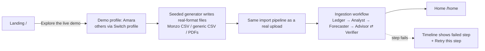

| Step | User sees | System does |
|---|---|---|
| 1 | Landing has two entry points: **Explore the live demo** and **Import a CSV statement**. Sign-in is shown disabled. The demo opens Amara's profile ("One account. The simplest start."); P2–P3, plus P4 when the India pack ships, are reachable from *Switch profile*. A "Demo data" badge stays in the top bar. | — |
| 2 | Progress: the agent timeline fills row by row ("Ledger: 1,163 transactions categorised · 94% by rules and memory, 6% by model") | The generator emits files in **real export formats**, and they go through the **same importers and agents** as an upload. Nothing is pre-baked. |
| 3 | Lands on Home. A one-time note: "Written at 10:42 from 12 months of Amara's (fictional) Monzo data. Every figure links to how it was calculated." | Home briefing (`brf_`) persisted. |

Failure: the timeline shows the failed step in plain words ("Forecaster could not complete: deterministic engine error") with **Retry this step**. Earlier steps are not re-run (LangGraph checkpoint).

---

## J2 — Three-step onboarding with one Monzo CSV (P1 Amara) — *the primary journey*

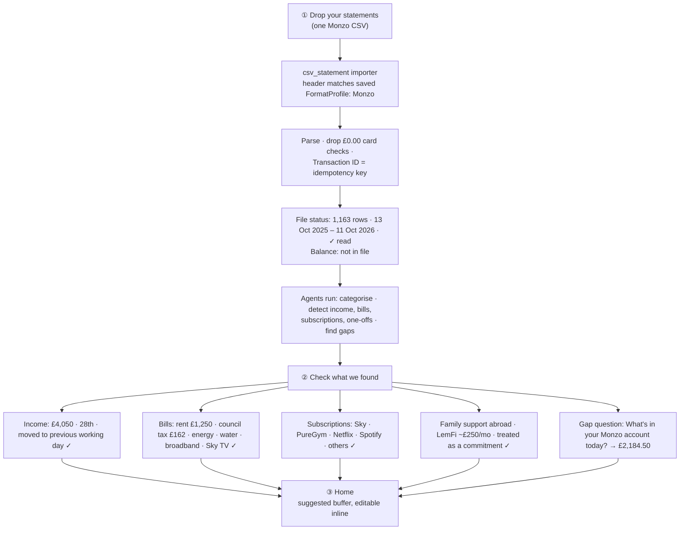

| Step | User sees | System does | Edge cases |
|---|---|---|---|
| **① Drop** | One drop zone: "Drop your bank statements. CSV or PDF, one file is fine." Under it, two quiet links: *Try a demo workspace* · *Add transactions by hand*. | — | CSV: max 10 MB / 20k rows; text PDF: max 20 MB / 60 pages, 30 s parse timeout. |
| ① file status | A single row per file: **Detected format: Monzo CSV** · current account · 1,163 transactions · 13 Oct 2025 – 11 Oct 2026 · ✓ Read · *Balance not included in Monzo exports. We'll ask in a moment.* | Generic `csv_statement` importer; the header signature matches the built-in **Monzo `FormatProfile`** (data, not code). Skip rules drop £0.00 card-check rows (count shown on hover). `Transaction ID` dedupes re-uploads. Monzo's own category is kept as a feature only. | Unknown layout → J3 one-time "confirm columns" inline in the same row. |
| ① → ② | "Reading your transactions…" with the agent timeline in compact form (≈ 30–60 s, to be measured) | Full ingestion workflow (`06` W1). | Cancel stops analysis and discards transient file bytes; persisted step/audit records remain. |
| **② Check** | A short list, each with ✓ / edit, all skippable: **Income** "£4,050 from NORTHGATE SYSTEMS LTD (Bacs), on the 28th, or the working day before. Seen 12 times." · **Bills** rent £1,250 (standing order, 1st), council tax £162 (direct debit, 15th), energy £78 (20th), water £42 (5th), broadband £31 (9th), Sky TV £46 · **Savings transfer** £400 on the 15th · **Subscriptions** PureGym £27.99, Netflix £12.99, Spotify £12.99 and others; "Netflix overlaps with Sky TV" is kept for Home · **Family support abroad** LemFi, about £250/mo, "We'll treat this as a commitment and never suggest cutting it." | Detected items are `provenance=detected`. A tap on ✓ makes them `confirmed`. | No income detected → gap question for net take-home (J4/§6a). |
| ② gap question | Exactly **one** question here, because the data showed one gap: "**What's in your Monzo account today?** Monzo exports don't include a balance. You can skip this, and we'll show changes instead of amounts." → £2,184.50 | `BalanceAnchor{source=user_entered, provenance=declared, as_of=11 Oct}`. | Skip → relative mode (J4). |
| **③ Home** | Lands on Home. The buffer line reads "Keep at least **£500**? (Amara’s chosen buffer; change it)". The user edits inline, Amara keeps £500. In the Financial briefing: *Set a goal* · *Get a weekly note on Telegram* · *Check 38 transactions we weren't sure about*. | Home briefing (`brf_`) written. | — |

What is **not** asked of Amara: account type (detected), bank (detected), individual or joint (only one account and no partner-like transfers, so individual by default), gross salary, NI number, date of birth, or bank login.

---

## J3 — A bank with no built-in format: unknown CSV layout, confirmed once (P2 Jamie)

| Step | User sees | System does | Edge cases |
|---|---|---|---|
| 1 | File row: **Detected format: new layout** · ◆ "Confirm your columns (one time only)". The row expands to show the first 5 rows with a proposed role per column: Date · Description · Amount, or Paid in / Paid out · Balance (optional) | `csv_statement`: table locator finds the header row (not assumed row 1). No saved profile matches, so the Ledger Agent **proposes a `FormatProfile`** from the redacted header + ≤5 digit-masked sample rows (it never sees amounts). Sign convention (one amount column vs in/out) and date format inferred. | Date ambiguity (`03/04/2026`) → resolved from values > 12. Otherwise two interpretations are shown side by side for one tap. |
| 2 | "Which bank is this? (optional, so we recognise it next time)" → Starling | Confirmed profile saved as a `FormatProfile`, so the next file with this header is matched silently ("Detected format: Starling CSV"). | — |
| 3 | File row turns ✓: "842 rows · 1 Oct 2025 – 10 Oct 2026 · balance found, reconciled". | Balance column → anchors + per-row running-balance check. | Running balance broken → J4 mismatch. |

There are only two importers, `csv_statement` and `pdf_statement`. Bank knowledge lives in saved format profiles. Built-in profiles (Monzo and Revolut; other banks only if subsequently added as profile data) and previously confirmed layouts skip this step entirely. Revolut's consolidated statement is split by the table locator into one account per currency pocket.

---

## J4 — Missing, stale or mismatched balance

Principle (register §6.5): **never require an opening balance when dated balances exist, and never invent one when they don't.**

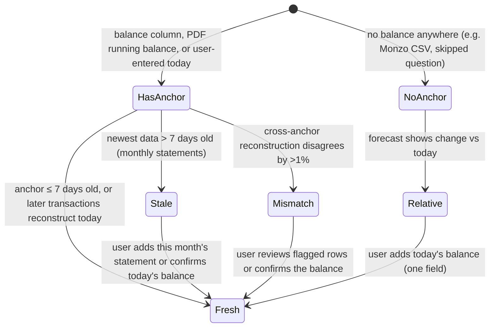

| State | What the user sees | Forecast behaviour |
|---|---|---|
| Fresh | "**£2,184.50** · you told us, 11 Oct" (DECLARED badge) or "from your statement, 11 Oct" | Absolute £ forecast with buffer line. |
| **Relative** | "**+£1,862** expected by 28 Oct compared with today" and a quiet prompt: "Add today's balance to see actual amounts and your buffer risk." | The y-axis is *change from today*. Buffer-breach probability shows `—` with the reason. |
| Stale | Caution label: "Last statement ends 30 Sep, 12 days ago. Add this month's statement for an up-to-date forecast." | Forecast starts from the anchor date. The unobserved period is shaded "No data", and the band widens. |
| Mismatch | "Your statement's balance and the transactions disagree by £84.20 from 14 Aug. 2 rows may be missing." → rows | A failed within-file reconciliation rejects the batch before commit; adding a manual anchor cannot bypass it. For a mismatch between previously accepted anchors, retain both with an inconsistency warning, audit it, and request missing/corrected data. |

> "+£1,862" and "£84.20" are illustrative only.

---

## J5 — Categorisation review & correction (moved out of onboarding)

The review is **offered, not forced**: a line in the Home Financial briefing ("Check 38 transactions we weren't sure about"), a count badge on Transactions, and inline correction anywhere a transaction appears.

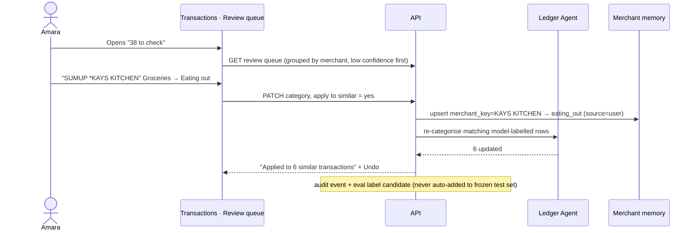

| Detail | Rule |
|---|---|
| Row shows | Date · raw narration (mono) · merchant · amount · category · **why** ("Rule: DELIVEROO → Food delivery", "Memory: you labelled this", "Model: 72% sure"). |
| Payment-type codes | UK codes (DD, SO, FPO, FPI, BGC, DEB, TFR) are shown as small tags. They also drive rules (SO/DD → recurring candidates). |
| Payments to people | Faster Payments to individuals get quick picks: *Rent · Family · Friends · Split bill · Other*. Incoming ones get *Reimbursement · Settling up · Gift · Income*. |
| Sensitive categories | **Family support abroad** (LemFi, Wise, WorldRemit…) is a commitment and is never suggested for cuts unless the user asks. **Betting & gaming** is its own category, and wins are *betting returns*, not income. Insights about betting are neutral and opt-in (Settings → Insights). |
| Teaching | User corrections write `merchant_memory` with `source=user` and always beat rules and the model. |
| Downstream | Changes bump `data_version` → findings, forecast and the Home briefing are marked outdated and regenerated in the background (debounced 30 s). |

---

## J6 — First Home (P1)

```mermaid
flowchart LR
  subgraph Home [/home — cached brf_]
    H[Hero<br/>Lowest balance before payday · £812 · 27 Oct]
    M[Metric cards<br/>Balance £2,184.50 · next payday 28 Oct · buffer £500 · chance below buffer 0%]
    CH[Cash-flow chart<br/>pay-cycle lows, P10–P90 band]
    B[Financial briefing ≤4<br/>Food delivery +41% · Netflix overlaps Sky TV · long January · 38 to review]
    I[Proactive insights ≤3<br/>each with one action]
  end
  H --> M --> CH --> B --> I
  I -->|"View how"| E[Evidence drawer]
  CH -->|"Explore in the Lab"| L[Decision Lab, baseline loaded]
  B -->|"Ask about this"| Q[AI Workspace, question prefilled]
```

Figures are the *fixture* baseline (before the car repair in J9). Home reads a persisted snapshot, computed on first visit and then cached. **Visiting it never calls an LLM.** Regeneration triggers are in `04`. The Home chart shows pay-cycle lows; the weekly sawtooth appears only in the Details tab and the Lab.

---

## J7 — Ask a question → generated answer → follow-up

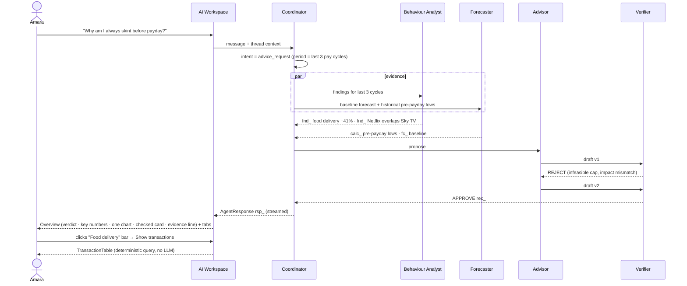

| Step | User sees |
|---|---|
| 1 | "Try asking…" chips drawn from current findings: "Why am I skint before payday?", "Which subscriptions overlap?", "Can I afford a £1,200 holiday?", "How does March look?" |
| 2 | The progress state shows live step labels ("Analysing transactions → Building forecast → Simulating → Checking"), then the answer appears in the fixed answer skeleton (Overview · Details · Recommendation · Transactions · How it was checked); the follow-up input stays pinned. |
| 3 | Narrative with receipts: "In each of the last three months your balance bottomed out in the 4 days before payday. The main change is food delivery: £286.40 in 30 days, 41% above your usual £203.10." By app: Deliveroo £136.37 (11 orders), Uber Eats £109.01 (9), Just Eat £41.02 (3)." → ranked spending bars by merchant (Overview) → checked suggestion → evidence line "Checked by N agents · M drafts rejected · View how". The weekly trend (Details) and the 23 transactions (Transactions) sit in tabs. |
| 4 | Follow-up actions: *Show the 23 orders* · *Try a cap in the Lab* · *What if I also cancel Netflix?* They post structured follow-ups without re-classification. |
| 5 | Any chart mark → *Show transactions · Ask about this · Open evidence*. |
| 6 | Out of scope ("Should I put this in a stocks and shares ISA?") → Foresight explains it analyses cash flow, not investments, and offers what it can do. It never gives product or regulated financial advice. |

---

## J8 — "Can I afford a £1,200 holiday?" → Decision Lab

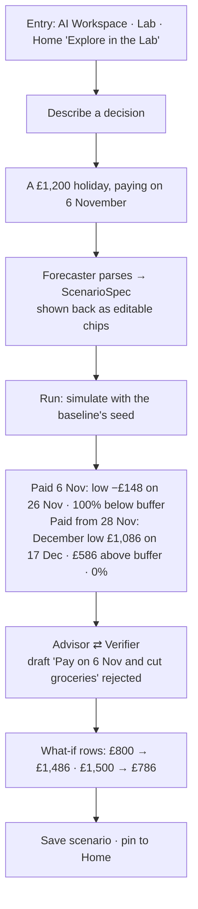

| Step | User sees (P1 fixtures) |
|---|---|
| 1 | The user types the decision. Chips come back: **ONE-OFF · £1,200.00 · 6 Nov 2026 · Travel**. Each chip is editable, and assumptions are stated ("Paying 6 Nov, as you said"). In the Lab, **nothing runs until Run**. |
| 2 | Overview chart: baseline (royal blue + band) vs scenario (dashed, from the divergence point), £500 buffer dotted, Today rule, paydays ticked. The long gap from 18 Dec to 28 Jan is labelled. |
| 3 | Key numbers: paid 6 Nov → lowest **−£148 on 26 Nov** (likely −£273 to −£29), 100% chance below the buffer · paid from 28 Nov → December low **£1,086 on 17 Dec** (£936–£1,218), **£586 above the buffer**, 0% · end of March **£7,188**. |
| 4 | Verdict in words, never a bare yes/no: "**You can afford a £1,200 holiday after 27 November.** Paying on 6 November would take you about £148 overdrawn before payday." |
| 5 | Recommendation tab: what-if rows (£800 → December low £1,486, 0%, March £7,588 · £1,500 → £786, 1%, £6,888) and the rejected draft "Pay on 6 Nov and cut groceries" with its reason. Recalculating a row is deterministic (engine call, no LLM). |
| 6 | Save → `scn_`. Pin → appears on Home. The Details tab shows the weekly chart; *How it was checked* shows the agent timeline. |

---

## J9 — Proactive risk alert → evidence → accept / dismiss

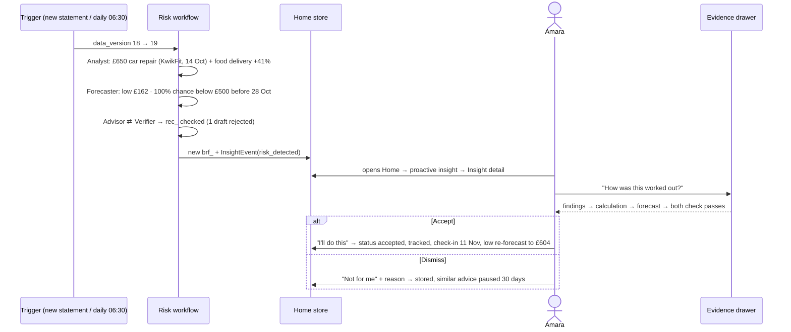

Accepting **moves no money**. Foresight has no payment access. The recommendation becomes a tracked commitment and is added to the forecast as a visible, removable "planned" change. After 30 days the system compares actual behaviour with the commitment → *Intervention worked* (or a neutral "no change yet").

---

## J10 — Recommendation rejected & revised (the visible loop)

This journey exists so a user, and a judge, can **see the system check its own work.**

> **Honesty note (rev 4.3).** The diagram below is the *designed* example. In the product and the demo, the history shown is always the **real trace of that run**. If a live run approves the first draft, the UI shows "Checked · first draft approved", and the rejection example is demonstrated separately from the labelled adversarial set (09 §3.6), never staged as if it happened in the user's run.

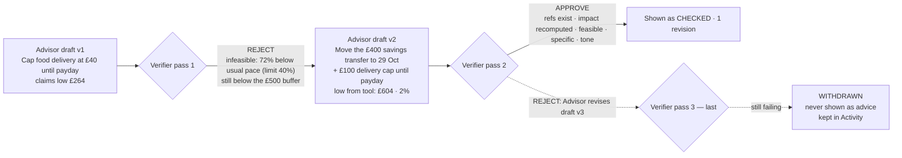

| Where | What the user sees |
|---|---|
| InterventionCard | "Checked · 1 revision" (link) |
| Evidence → **Checks** | Both drafts side by side. Each check shows pass/fail and the critique in plain words; the deterministic recomputed figure is shown, while an invalid model claim is labelled as rejected and kept in the audit record. |
| Activity | Withdrawn advice is listed ("Withdrawn: couldn't be checked"). It is never hidden from the record. |

---

## J11 — Plan at risk → adaptive advice (and goals, when set)

The P1 fixture defines **no goal**, so the demo closes the loop with the checked plan and the March outlook. Goals stay available from the Lab's Goals view (flag `goals`).

| Step | Detail |
|---|---|
| Accept | From Insight detail → *I'll do this* on the checked plan (savings transfer to 29 Oct + £100 cap). Re-forecast: lowest balance before payday **£604** (£538–£667), 2% chance below the £500 buffer. Later lows: Nov **£1,052**, Dec **£2,286**. |
| Outlook | Lab → March: **£8,388** with the plan vs **£8,345** with no action. Stated as forecasts with a likely range, never as guarantees. |
| Trigger | New data or a saved scenario pushes the plan's low back below the buffer → InsightEvent `plan_at_risk`, e.g. booking the £1,200 holiday for 6 Nov (low −£148). |
| Adaptive advice | Behind → the Advisor proposes stronger checked options (e.g. pay for the holiday after 27 Nov). Ahead → advice relaxes. Nothing touches family support. |
| Goals (optional) | If the user sets a goal (*Set a goal* on Home), GoalProjection shows the target line, P50 path with band and gap bracket; the amount or date is editable inline and recomputes deterministically. |

---

## J12 — The long January (seasonal insight)

| Step | Detail |
|---|---|
| Detection | The Forecaster's pay calendar knows UK December practice. Amara's December pay is detected from history as early (**Fri 18 Dec**), and the next pay is **28 Jan**: a **41-day gap**. |
| When it surfaces | It appears in the Home Financial briefing from mid-November, and is promoted to a proactive insight if the January low approaches the buffer (e.g. after the holiday scenario). |
| Copy | "Your December pay arrives on Friday 18 December, and the next on 28 January. That's 41 days on one pay packet." The figure for the January low comes from the forecast, never from copy. |
| Actions | *See January in the Lab* · *Ask about this* (AI Workspace). |

---

## J13 — Scheduled Telegram digest

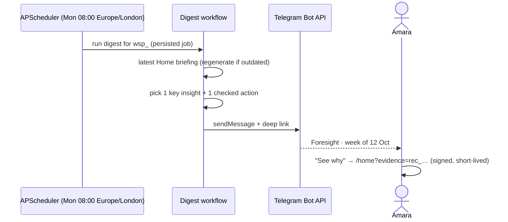

Example (fictional):

```
Foresight · week of 12 October

Food delivery is up 41%: £286.40 in 30 days against your usual £203.10.
After the £650 car repair, your lowest balance before payday on 28 October
is likely to be about £162, below your £500 buffer.

One plan: move the £400 savings transfer to 29 October and keep delivery
under £100 until payday. Lowest balance then about £604. Checked by Foresight.

See why → https://…/r/abc123
```

Set-up from Home → *Get a weekly note*: a one-time code, then `/start <code>` to the bot. Frequency: weekly (default), daily, or off. Each send is stored as `DigestDelivery` with its exact content. Failures retry ×3 with backoff, then show in Activity.

---

## J14 — Irregular income: "What if a client pays 45 days late?" (P2 Jamie)

| Step | Detail |
|---|---|
| 1 | Step ② shows income as **clients**, not a salary: "4 clients paid you in the last 6 months, £900–£6,500 per invoice. Which are ongoing?" The forecast uses a per-client timing and amount distribution. |
| 2 | Self Assessment payments on account (31 Jan, 31 Jul) are detected from HMRC payments and confirmed as obligations. |
| 3 | Lab chip: **INCOME DELAY · client "Halden Studio" · +45 days**. Result: the 31 Jan payment on account falls inside the gap → RiskAssessment **HIGH**. Checked advice: set aside part of the December invoice for the January payment. |

---

## J15 — Single side account with no regular income (fixture `S14-side-account`)

Fictional **Sam Patel** imports only a side account: money arrives as top-ups from their own name, regular payments from one person and occasional PayPal transfers, never as pay. Rules: 00 §6a "Inflows we can't confirm". Screens: 04 §3.6 and §8.3; prototype `states.html#no-income`. Figures are *(04 fixture)*.

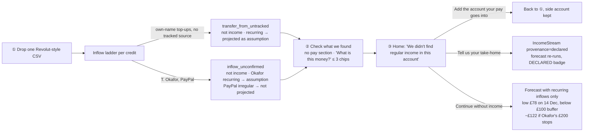

| Step | What happens | Why |
|---|---|---|
| ① | One file, balance column present (£212.40), three currency tables: GBP imported, empty USD skipped, small EUR pocket imported as a separate account and excluded from the GBP forecast. | Multi-table CSV handling; nothing to ask about balance. |
| Ladder | Top-ups "Payment from S PATEL" £150 on the 1st and 15th (8 times) → recurring `transfer_from_untracked`. T. OKAFOR £200 around the 20th (5 times) → recurring `inflow_unconfirmed`. PayPal (4 since July, £40–£120) → irregular `inflow_unconfirmed`. No company/payroll pattern → no income stream. | Own money and unknown money are never called income. |
| ② | No "Your pay" section. A "What is this money?" block shows the largest unconfirmed sources (up to 3) as one-tap chips; the rest wait in Transactions → Review queue. Answering "From my other account" on the top-ups adds a gap prompt to import that account. | Ask only where the data has a gap; max 3 questions. |
| ③ | Home headline "We didn't find regular income in this account", three equal options. Income £0; "From your other account" £300 and "Other money in (not confirmed)" £285 shown separately. Forecast low **£78 on 14 Dec**, below the £100 buffer, with its assumptions listed (top-ups, Okafor; PayPal not projected). | Honest about what one account can show. |
| Advice | "Act on this" may suggest spending changes, but nothing that only works if unconfirmed inflows continue: V-19 recomputes without unconfirmed inflows and rejects proposals whose outcome flips. | Advice never relies on money that may not arrive. |
| Assumptions | Recurring unconfirmed money (Okafor) is listed under "Assumed, not confirmed" with a *Don't assume this* switch; turning it off re-runs the forecast (low ≈ −£122). PayPal becomes projected only if it turns regular (≥3, steady cadence, CV ≤ 20%). | Conservative by default; visible when it changes. |

Evals: INC-11…INC-14 in `09` (S13 and S14 fixtures).

---

## J16 — India profile, and currencies we must detect (P4 Aanya)

Rules: 00 §6c (any currency, locale packs, workspaces) and §4 (P4). Screens: 04 (Switch profile), §8.6 (currency & format confirm), §10.13 (money formatting). Fictional data; Indian support is **validated on test data only** and says so.

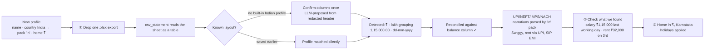

| Step | What the user sees | Why |
|---|---|---|
| New profile | Avatar menu → *Switch profile* → *New profile* → name "Aanya", country **India**, home currency **₹ INR** (pre-filled from country). | Country selects the `in` locale pack; nothing else to configure. |
| ① Drop | `aanya-savings-2026-09.xlsx` · "Spreadsheet · new layout · Confirm your columns". The proposal shows Date · Narration · Chq/Ref · Withdrawal · Deposit · Closing balance; user confirms once. | No built-in Indian profiles are claimed (00 §6c); the generic importer and a one-time confirm cover it. |
| Format | File row: "Detected: **₹ INR · 1,15,000.00 · dd-mm-yyyy** (from the data)". No question, because `₹`/`INR` is unambiguous and days above 12 fix the date order. | Detect first; ask only if ambiguous. |
| Reconcile | "✓ Reconciled · 412 rows · running balance chains". | Same gate as every import. |
| Categorise | `UPI/DR/412345678901/SWIGGY/YESB/swiggy@ybl` → Food delivery; `NACH/ICCL/MF SIP` → Savings & investments; `UPI/DR/…/RAMESH K/…` rent on the 3rd → Rent. | Locale pack narration parsers + merchant lexicon; the LLM handles the rest. |
| ② Check | Pay ₹1,15,000 (last working day) ✓ · Rent ₹32,000 on the 3rd ✓ · SIP ₹5,000 on the 5th (savings, not spending) ✓. | Same three-step flow as UK. |
| ③ Home | All figures in ₹ with lakh grouping; the finding "Food delivery ₹14,860 in 30 days, usual ₹10,540, +41%"; footer note "India support is validated on test data." | Honesty rule (00 §4). |

**Variant J16a: ambiguous currency.** A CSV whose amounts show `$` and no currency column. File row: "Amounts use **$**. Which currency?" with one-tap chips *US dollar · Canadian dollar · Australian dollar · Other…*, pre-selecting the profile's home currency if it is a dollar. Until answered, the batch stays `needs_review` and is not committed. The answer is saved on the format profile, so the same layout never asks again.

**Variant J16b: mixed-currency profile.** A UK profile imports a Revolut-style file with a GBP table and a small EUR pocket. The EUR pocket becomes its own account. Home shows it on a separate line: "**€212.40** · Revolut EUR · not included in the £ forecast". The Lab and forecasts run per currency; there is no FX conversion or combined total (00 §6c). AI Workspace answers about it are in euros.

Evals: the P4, EUR, JPY and mixed-currency generator variants in `09` (00 §6c "Evaluation of generality").

---

## P3 variants — the multi-account household (Kofi & Hannah)

These appear **only because P3's data contains them**. A single-account user never sees any of it.

### V1 — Several files in one drop, and the money map

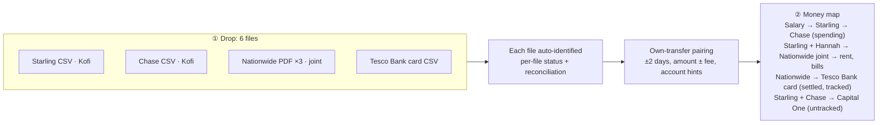

| Step | Detail |
|---|---|
| ① | One row per file with its own status. None of P3's banks has a built-in profile, so each CSV shows "Detected format: new layout · Confirm your columns" once; the confirmed profile is saved for next time. |
| ② | Because there is more than one account, the step adds a **money map**: a simple left-to-right flow (income → accounts → where money goes), with edge labels in £/month. Users confirm or correct each link ("Starling → Chase top-ups · own transfer ✓"). |
| Pairing | Own transfers are paired and excluded from income and spending. A tracked Tesco Bank card settled from Nationwide is a liability settlement, so its line items are the spending (no double count). |

### V2 — Joint account: arrangement, consent, scope

| Step | Detail |
|---|---|
| Asked only now | Because regular transfers from another person land in Nationwide, step ② asks: "**Is the Nationwide account joint?**" → Yes → arrangement (*Household pot* (default) · *Equal share* · *% share* · *Fixed contribution*) and a required tick: "This account includes Hannah's transactions, and she's agreed to me adding it." Joint rows remain staged locally and excluded from the committed ledger and all Mesh calls until consent; the other files can continue. |
| Classification | Hannah's deposits → `partner_contribution`, never Kofi's income. Joint spending is not attributed to a person. |
| Language | Household-level only ("household groceries are up 18%"), never "Hannah spends…". |
| Scope selector | Home and Lab show **Mine · Household · account**. The default is **Household**. *Mine* follows `07` §6.10: the household-pot default excludes the joint balance and counts Kofi’s contributions as outflows; equal/percentage arrangements include his share. Scenarios carry their scope as a chip. |

### V3 — Untracked card paid from two accounts

| Step | Detail |
|---|---|
| Detection | Payments to "CAPITAL ONE" leave both Starling and Chase. They're aggregated across accounts **before** asking. |
| One gap question | "Your Capital One card is paid from two of your accounts, about £— a month in total. Add its statement to see what it's spent on?" → *Add statement* · *Skip* |
| If skipped | The payments count as spending in **Credit card bill (unitemised)**. The coverage indicator reads "1 card we can't see". |
| Untracked account variant | "£400 goes to an account we can't see every month. What does it pay for?" → *Savings* · *Bills (tell us which)* · *Add that account* · *Skip* → `DeclaredObligation` with a DECLARED badge. |

### V4 — Generic PDF import with reconciliation (Tier 2)

| Step | Detail |
|---|---|
| ① | Nationwide PDFs dropped. File status per statement: "**Nationwide · statement 1–30 Sep** · 49 rows · ✓ Reconciled: running balance chains and totals match". |
| Unknown layout | If the layout isn't recognised with confidence, the Ledger Agent proposes a column layout from the header and up to 5 redacted sample rows (the LLM never outputs amounts). Extraction is then deterministic. |
| Rejected | If the reconciliation gate fails: "**Couldn't verify this statement**: rows don't add up to the stated closing balance (difference £—). Nothing was imported from it." → *See the rows* · *Try a CSV instead*. There is never a silent partial import. |
| Password-protected | "This PDF is password-protected. Enter the password to open it here. It isn't stored." |
| Learned | A confirmed layout is saved, so the next statement from that bank is auto-identified. |

### V5 — Same person, several names

"**K MENSAH**, **KOFI MENSAH** and **MENSAH K A** look like the same person: you. Merge?" → user-confirmed `Counterparty{aliases[]}`. The user's own name variants are recognised as *self*, so transfers to them are own transfers.

---

## Appendix — Open Banking later, without redesign

Every source implements one `ImportSource` contract. The UX already handles its outputs:

| Stage | Contract | CSV (v1) | PDF (Tier 2) | Open Banking (later) |
|---|---|---|---|---|
| Acquire | `acquire() → RawArtifact` | Drop | Drop (+ password) | Consent → fetch |
| Extract | `extract() → RawRows[]` | `csv_statement` + FormatProfile | Layout + extraction | API payload |
| Validate | Reconciliation, row errors | Same | **Mandatory gate** | Same |
| Normalise | → `Transaction`, `BalanceAnchor`, `ImportBatch(source_type)` | Same | Same | Same |
| Show | Per-file status row in step ① | Same | Same + reconciliation status | "Connected · synced 10:42" |

Open Banking adds only an Acquire option ("Connect your bank") next to the drop zone. Steps ② and ③ are unchanged.
