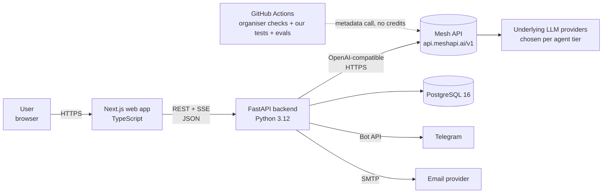
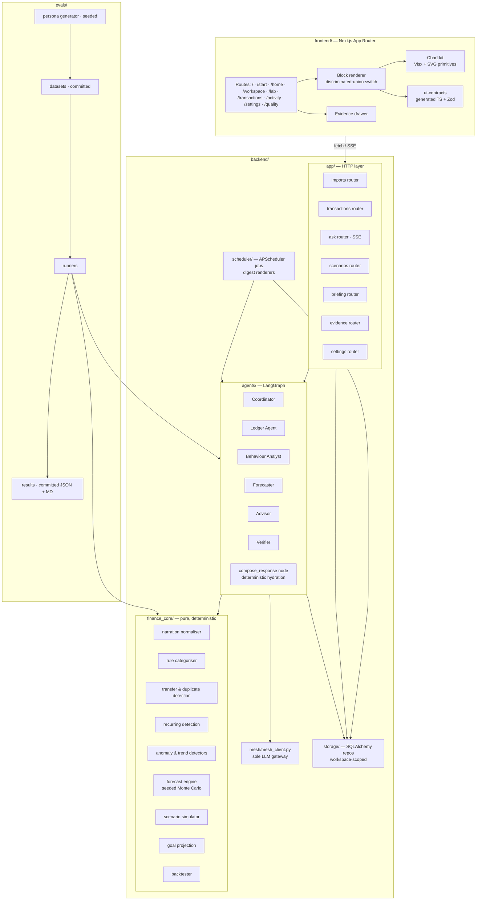
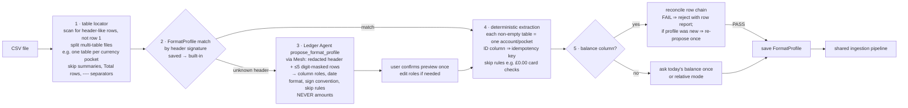
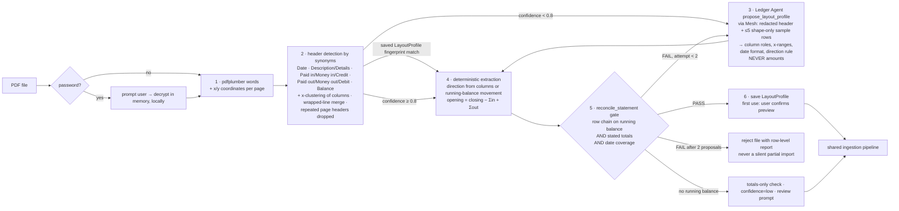
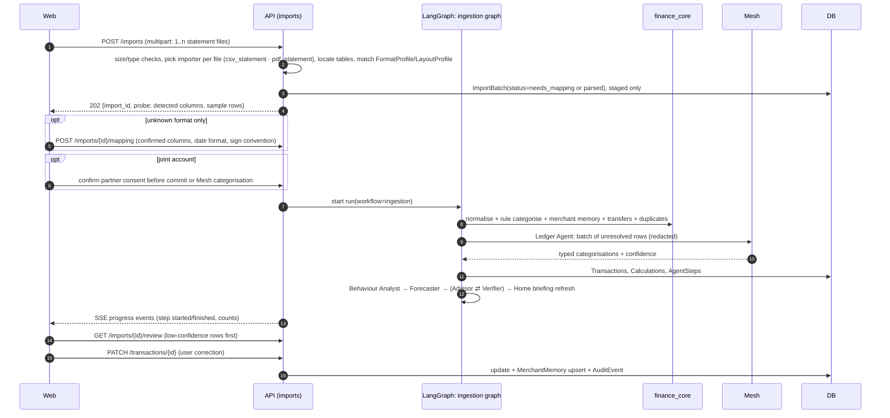
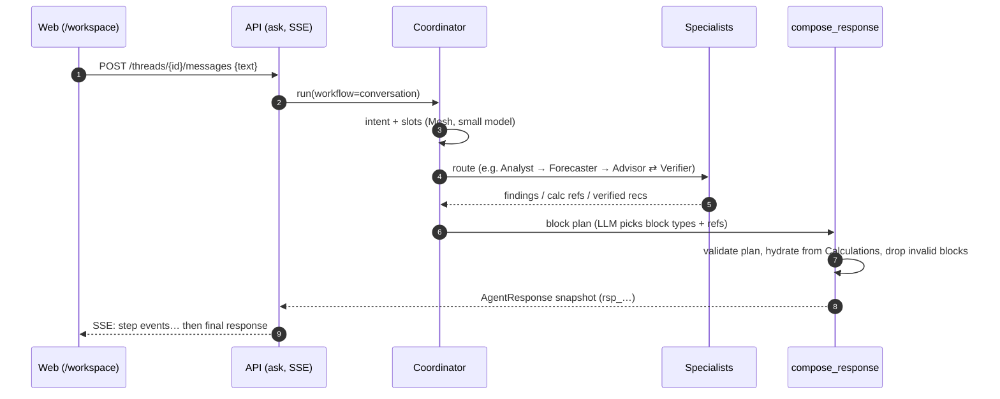
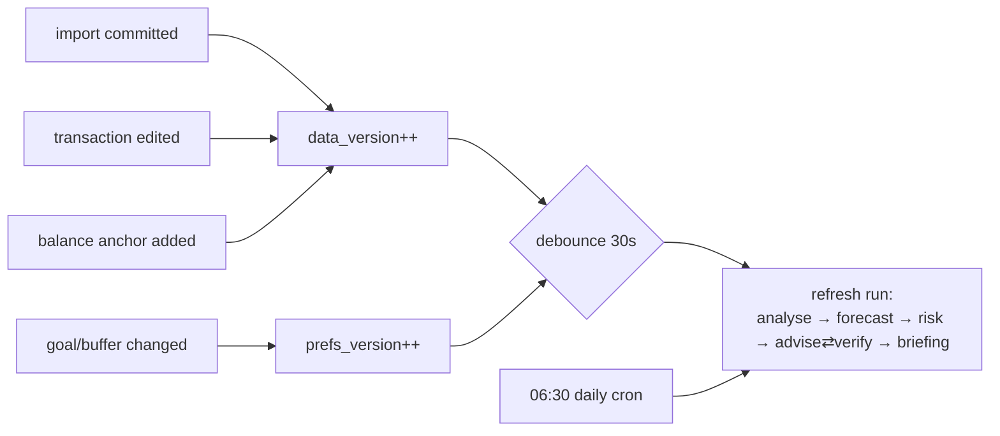

# 05 — System Architecture & Technical Decisions

> Canonical decisions live in [`00-DECISION-REGISTER.md`](00-DECISION-REGISTER.md). This document explains *how* those decisions fit together, the trade-offs behind them, and how the hackathon build differs from a production build.
> Agent-level detail (contracts, graphs, verifier rules) is in [`06-AGENT-ORCHESTRATION.md`](06-AGENT-ORCHESTRATION.md). Entities are in [`07-DATA-MODEL.md`](07-DATA-MODEL.md). UI block contracts are in [`08-GENERATIVE-UI-CONTRACTS.md`](08-GENERATIVE-UI-CONTRACTS.md).

Status: design. No production code exists yet. Code snippets are pseudocode that shows shape, not implementation.

---

## 1. Architectural principles

| # | Principle | Consequence in the design |
|---|---|---|
| A1 | **Numbers come from code, words come from models.** | `finance_core` is a pure, I/O-free Python package. LLM nodes can only *reference* `calc_…` IDs. The API hydrates values. |
| A2 | **One gateway for AI.** | `backend/mesh/mesh_client.py` is the only module allowed to import `openai`. An `import-linter` forbidden contract (§3.1, rule list) fails the build if any other module imports an AI SDK. This makes the "every call goes through Mesh" rule provable. |
| A3 | **Every step leaves a record.** | Every agent node writes an `AgentStep`. Every recommendation links to findings, calculations and verification results. Audit is a by-product of execution, not a separate feature. |
| A4 | **Reproducible by default.** | Seeded simulations, `engine_version` stamped on every calculation, the same input hash gives the same output, and eval results are committed. |
| A5 | **Read paths are cheap.** | The Home briefing, past analyses and scenarios are persisted snapshots. Opening a page never triggers an LLM call. |
| A6 | **Workspace isolation everywhere.** | Every workspace-owned table has `workspace_id`; system Category rows and built-in profiles are read-only reference-data exceptions. Every repository method requires it. No query can be constructed without it. Forecast cache keys include data/prefs versions, currency, scope/account, as_of, horizon, parameters and engine version (`00` §13). |
| A7 | **Small number of moving parts.** | One API process (FastAPI + LangGraph + APScheduler), one PostgreSQL 16 database, one Next.js app: three containers in one Docker Compose project. Production splits these apart along clearly marked seams. |

---

## 2. System context



Trust boundaries:
1. **Browser ↔ API.** Untrusted input: CSV files, chat text, scenario parameters.
2. **API ↔ Mesh.** Third-party processor. Only the minimum, redacted data crosses it (§7.3).
3. **API ↔ Telegram/SMTP.** Outbound only. Digests contain summary figures, never full transaction lists.

---

## 3. Component architecture



### 3.1 Module boundaries and dependency rules

Enforced with `import-linter` contracts in CI.

| Module | May import | Must not import | Owns |
|---|---|---|---|
| `finance_core` | numpy, pandas, stdlib, its own pydantic value types; importers may use csv/openpyxl/xlrd/pdfplumber on supplied bytes; `holidays` (python-holidays) for calendars; validated locale-pack values injected by the application at start-up | `storage`, `agents`, `mesh`, `app`, network or filesystem access | All arithmetic: categorisation rules, detectors, forecasts, simulations, goal projections, backtests; importers transform supplied bytes without fetching or opening files; `finance_core/locale_packs/` (locale packs, currency table, format inference) |
| `mesh` | `openai`, `httpx`, settings | `storage`, `app` | Client construction, model-tier routing, retries, token and cost accounting, redaction hook |
| `agents` | `finance_core`, `mesh`, `storage` (through repositories), its prompt files | HTTP/router modules in `app` | LangGraph graphs, nodes, prompts, tool wrappers, verifier rules |
| `storage` | SQLAlchemy | `agents`, `mesh`, `app` | Models, repositories, migrations, the workspace-scoping guard |
| `app` | everything above | — | HTTP, auth/session, request validation, SSE streaming, error mapping |
| `scheduler` | `agents`, `storage`, delivery adapters | `app` | Job definitions, digest rendering, delivery |
| `evals` | `finance_core`, `agents`, `storage` (throwaway Postgres schema per run) | `app` | Datasets, metric computation, reports |

The **Mesh-only rule** (rev 4.3), enforced three ways:
1. **Import contract.** An `import-linter` *forbidden* contract applies to every package except `backend.mesh`: no imports of `openai`, `langchain_openai`, `langchain_community`, `litellm`, `anthropic`, `google.genai`, `cohere`, `transformers`, `sentence_transformers` or `tiktoken`. LangGraph is used **only** for the graph (`langgraph` core); no LangChain model wrappers anywhere. Test stubs fake `mesh_client`; they never construct an `OpenAI()` client.
2. **Egress allow-list.** Integration and eval runs install a socket guard allowing only `api.meshapi.ai`, the Telegram Bot API and the configured SMTP host (09 ORC-13). Any other outbound connection fails the run. `backend/mesh` may use `httpx` only through the `openai` client to the Mesh base URL.
3. **No silent telemetry.** Settings force `LANGSMITH_TRACING=false` and `LANGCHAIN_TRACING_V2=false` at start-up, and a unit test asserts it, so no run traces (which would contain financial data) leave the app.

The README states it plainly: **every model call goes through `backend/mesh/mesh_client.py` to `https://api.meshapi.ai/v1`; there are no embeddings, no OCR and no client-side AI (the Next.js app never calls a model).** This sits beside the organiser's own CI check that LLM calls route via Mesh.

### 3.2 Import sources: two generic importers, bank knowledge as data (00 §3, §6b)

There are exactly **two importers**: `csv_statement` (Tier 1) and `pdf_statement` (Tier 2). No bank-specific code exists. Everything a bank does differently lives in **data**: a `FormatProfile` (CSV) or a `LayoutProfile` (PDF). Built-in profiles ship for Monzo and Revolut. An unknown bank gets an LLM-proposed profile that the user confirms once and that is then saved.

```
Importer (protocol)
  kind: "csv_statement" | "pdf_statement" | "manual" | "demo_seed"        # future: "open_banking"
  locate(file) -> list[TableCandidate]          # CSV: header-like rows + table spans; PDF: header row + column x-clusters per page
  match_profile(table) -> FormatProfile | LayoutProfile | None        # by header signature / layout fingerprint (saved per user, then built-ins)
  # propose_profile is an orchestration step outside this protocol: Ledger Agent via Mesh — only when no profile matches; never outputs amounts
  extract(table, profile) -> list[RawTransactionRow]   # deterministic; strings + provenance (file, table, row | page, x/y)
  reconcile(rows, balances) -> ReconciliationReport    # whenever a running balance or stated totals exist
```

| Importer | Tier | Format/layout profile type | Built-in profiles | Scope |
|---|---|---|---|---|
| `csv_statement` | **1** | `FormatProfile` | Monzo, Revolut (consolidated), plus common UK banks as available. **No Indian built-ins claimed** (no real samples) | Bank CSV exports in general (claims limited to tested layouts), plus **XLS/XLSX** (Tier 2) read into the same table model (rev 4.2) |
| `pdf_statement` | **2** | `LayoutProfile` | Fictional eval layouts only | Any text-based statement PDF. Scanned/image-only PDFs (no text layer) are rejected with a clear message: **OCR is out of scope** |

**Shared propose → verify pattern (both importers).** Both importers follow the same sequence: *locate → match saved/built-in profile → else LLM proposes a format/layout profile from a redacted sample → deterministic extraction → reconcile → user confirms once → profile saved*. This is the ingestion equivalent of Advisor ⇄ Verifier: the LLM only labels structure, deterministic code extracts every amount, and reconciliation (where a balance or totals exist) or the user's one-time confirmation of a preview is the gate.

#### 3.2.0 CSV statement pipeline (Tier 1)



`FormatProfile{signature (normalised header tokens), column_roles: {date, description, amount | money_in+money_out, balance?, id?, bank_category?, time?}, date_format, sign_convention, decimal/thousands, skip_rules[] (zero_amount, total_row, separator, summary_section), table_split_rule, created_by: builtin|llm_proposed|user, confirmed_at}`.

Built-in examples (data):
- **Monzo**: header contains `Transaction ID, Date, Time, Type, Name, Category, Amount, Money Out, Money In, Description`; `dd/mm/yyyy`; id = `Transaction ID`; skip `zero_amount`; `bank_category` kept as a categorisation *feature*, not ground truth; no balance ⇒ balance gap question.
- **Revolut consolidated**: summary sections first, then one table per currency pocket (`Date, Description, Category, Money in, Money out, Balance`); dates like `2 Sept 2026`; skip `total_row`, `separator`, `summary_section`; each non-empty pocket = an account; running balance ⇒ anchors + reconciliation.

**Privacy of CSV text sent to Mesh** follows the same rules as PDF below: only for unknown headers; header column titles plus ≤5 rows with every digit replaced by its shape and free-text cells replaced by `<TEXT>`; never amounts, balances, names, references or account identifiers.

#### 3.2.1 Generic PDF statement pipeline (Tier 2)



Design notes:
- **The LLM can't create money.** It only labels columns. Every amount comes from the PDF text layer, and an arithmetic inconsistency fails reconciliation; a semantically wrong layout that balances still needs truth/preview checks. This is the ingestion equivalent of the Advisor ⇄ Verifier loop.
- **Known traps encoded as tests** (from real-statement analysis, no personal data kept): per-row direction often isn't labelled once text is extracted; descriptions wrap onto 2–3 lines; headers repeat per page; a "Balance on <first day>" header can be end-of-day rather than opening (hence opening derived from closing and totals, not trusted from the header).
- `LayoutProfile{fingerprint (normalised header tokens + page width bucket), column_roles, x_ranges, date_format, direction_rule, created_by: detected|llm_proposed, confirmed_at}` is stored per workspace; the global seed set ships with the fictional eval layouts only.
- Limits: 20 MB, 60 pages per file; parsing runs in a worker thread with a 30s timeout.

**Privacy of statement text sent to Mesh (PDF and CSV).** Only step 3, and only for unrecognised layouts/headers. Sent: the header line tokens (column titles), and at most 5 sample rows where **every digit is replaced by its shape** (`12.50` → `99.99`, dates → `99 Aaa 9999`) and description tokens are replaced by role placeholders (`<TEXT>`), plus x-positions. Never sent: amounts, balances, names, addresses, sort codes, account numbers, statement-period totals, or any page other than the sampled lines. The statement's address block is skipped by geometry (above the header row). This is unit-tested with fictional statements containing planted names and numbers that must not appear in the outbound payload.

---

### 3.3 Locale packs, currencies and spreadsheets (00 §6c, rev 4)

**Workspaces.** `Workspace` (`wsp_`) is the isolation unit (replaces "profile"): accounts, imports, saved format/layout profiles, goals, forecasts, recommendations, audit log. It carries `country`, `home_currency`, `locale`, `timezone`. Hackathon: one local user, a workspace switcher, demo workspaces P1–P4. Production: `User` (managed auth) 1 → n `Workspace` via a `WorkspaceMembership` row (owner only in v1; shared household workspaces are a later extension).

**Locale packs as data.** `finance_core/locale_packs/` holds `uk/pack.yaml` and `in/pack.yaml` plus a loader that validates them against a Pydantic `LocalePack` schema at start-up. A pack contains: default currency and locale; number/date format hints; holiday calendar id for `python-holidays` (`GB-ENG`; `IN` + state subdivision, e.g. `KA`); payday conventions; category rules and merchant lexicon; narration grammars (UK payment-type codes; Indian UPI/NEFT/IMPS/NACH/ECS/ATM patterns); protected categories (e.g. `family_support_abroad` in `uk`, domestic family support in `in`); wording rules (FCA guidance-not-advice; SEBI/RBI-neutral, no product names). The engine never branches on country; it reads the pack. Adding a country = a YAML file + generator formats + eval rows.

```
finance_core/locale_packs/
  uk/pack.yaml, in/pack.yaml   # data only
  pack.py                        # LocalePack schema + loader (validated, cached)
  currency.py                    # ISO 4217 table: code → minor-unit exponent, symbols
  formats.py                     # infer_number_format, infer_date_order, parse_amount
```

**Currency handling.**
- Money is `amount_minor: int` + ISO 4217 `currency`; the exponent comes from `currency.py` (JPY 0, GBP/INR/EUR 2, KWD 3). No code assumes pence.
- **Detection ladder per account** (`detect_currency`): currency column → unambiguous symbol/code in amounts or headers (`£`, `₹`, `€`, `INR`, `GBP`) → the matched FormatProfile/LayoutProfile → workspace `home_currency`. Ambiguous symbols (`$`, `kr`, `¥`) produce a one-tap confirmation in "Check what we found".
- **Number and date inference** (`infer_number_date_format`, deterministic): decimal/grouping separators from the column's value set (`1.234,56`, `1,234.56`, lakh `1,15,000`); date order from saved/built-in format data or unambiguous dates; otherwise H13 asks once with the pack’s locale pre-selected and blocks commit until answered. Inference result is stored on the FormatProfile so later imports skip it.
- **Per-currency forecasting.** `build_forecast` runs per currency group; a workspace view shows its home currency, other currencies are separate balances. **No FX conversion and no FX forecasting** (no rates source); the Verifier rejects cross-currency arithmetic (06 V-20).

**Spreadsheets.** `.xlsx` via `openpyxl` (read-only, values only, formulas ignored), legacy `.xls` via `xlrd`. Each sheet becomes a table and goes through the same table locator → FormatProfile → extraction → reconciliation path as CSV. Merged header cells and leading bank-letterhead rows are handled by the locator. Macros are never executed.

**Holidays and paydays.** `python-holidays` provides calendars per pack; payday rules (`same_date_prev_working_day`, `last_working_day`, `first_working_day`, `every_n_days`) resolve against the pack's calendar.

## 4. Key request flows

### 4.1 Statement import → reviewed ledger



User corrections become merchant memory, so later imports start with better rule coverage. That improvement is measured in evals (09 §5.2).

### 4.2 Conversational question



### 4.3 Home briefing read (no LLM)

`GET /briefing` returns the latest `Briefing` snapshot (`brf_…`) along with a `freshness` object `{generated_at, data_version, stale: bool}`. If `stale`, the UI shows "Updating…". It does **not** block. Regeneration is triggered by events (§6.3), never by page views.

### 4.4 Scenario run (Decision Lab)

`POST /scenarios` with either structured controls (`ScenarioSpec`) or free text. Free text is parsed into a `ScenarioSpec` by the Forecaster LLM step, and the user confirms the parsed spec before it runs. Then the deterministic simulation runs with the same seed as the baseline, and the result is persisted as `sim_…` plus `calc_…`. An optional Advisor ⇄ Verifier pass runs if the scenario breaches the buffer or a goal.

---

## 5. Technology decisions and trade-offs

The stack is **decided** (see 00 §8). Each table records the alternatives considered and why they lost, so a reviewer can see the reasoning.

### 5.1 Backend framework — **FastAPI** (decided)

| Option | For | Against | Verdict |
|---|---|---|---|
| **FastAPI** | Native Pydantic v2, so one schema system for API, agent contracts and UI blocks; async lets SSE stream agent progress; OpenAPI lets us generate TS types | Async discipline needed around sync SQLAlchemy/NumPy (use threadpool) | **Chosen** |
| Flask | Simple, allowed by the rules | No native validation or OpenAPI; streaming is awkward; we would rebuild what FastAPI provides | Rejected |
| Django | Admin, ORM, auth included | Heavy for an API-only backend; slows iteration | Rejected |

### 5.2 Agent orchestration — **LangGraph** (decided)

| Option | For | Against | Verdict |
|---|---|---|---|
| **LangGraph** | Explicit `StateGraph` with named nodes and conditional edges, so the analyze → forecast → advise flow and the verify loop are *visible in code* (a named bonus item); checkpointer allows resume; works with any OpenAI-compatible client (Mesh) | Learning curve; we avoid LangChain abstractions beyond the graph itself | **Chosen** |
| CrewAI | Fast to get role-based agents running | Control flow is implicit; harder to prove a bounded retry loop; harder to keep numbers out of LLM output | Rejected |
| AutoGen | Strong for multi-agent chat | Conversation-shaped, so non-deterministic routing; poor fit for auditable, bounded pipelines | Rejected |
| Custom orchestrator | Total control, no dependency | We would re-implement state, checkpoints and visualisation, and lose the "structured framework" bonus | Rejected (but nodes are plain functions, so they can be ported) |

Constraint: we use **LangGraph only for the graph**. LLM calls go through `mesh_client` (via the `openai` SDK), not LangChain chat-model wrappers. This keeps the Mesh routing unambiguous for the organiser's static check.

### 5.3 LLM access — **Mesh via `openai` SDK** (mandatory)

```
# pseudocode — backend/mesh/mesh_client.py
client = OpenAI(base_url="https://api.meshapi.ai/v1", api_key=env["MESH_API_KEY"])

def complete(tier, messages, response_schema, *, run_id, step_id, timeout_s, max_retries=2) -> ParsedOutput:
    model = MODEL_TIERS[tier]                     # resolved from config; IDs from Mesh catalogue (OPEN #1)
    messages = redact(messages)                   # §7.3
    resp = client.chat.completions.create(model=model, messages=messages,
                                          response_format=json_schema(response_schema), temperature=TIER_TEMP[tier])
    parsed = response_schema.model_validate_json(resp.choices[0].message.content)   # raise → repair/retry path
    record_usage(run_id, step_id, model, resp.usage, latency)                         # AgentStep
    return parsed
```

- **Model tiers** (actual model IDs are OPEN #1 and must come from Mesh's catalogue, never guessed):
  - `fast`: Coordinator intent, Ledger batch categorisation, block planning. Low cost, high throughput.
  - `reasoning`: Advisor proposals, Verifier LLM-judge, Forecaster scenario parsing for complex text.
  - Optional `judge-alt`: a model *different from* the Advisor's model for the Verifier's LLM-judge, to reduce self-agreement bias. Mesh's multi-model access makes this cheap to do.
- **Structured outputs**: every LLM call has a Pydantic response schema. If the model or endpoint doesn't support `json_schema` response format, fall back to JSON mode plus validation plus one repair attempt.
- **Failover**: Mesh offers provider failover. We also keep a per-tier fallback model list in config.
- **No-credit key check**: CI and app startup call a Mesh metadata endpoint (e.g. a model-list call) to validate `MESH_API_KEY`, matching the organiser's critical check.

### 5.4 Storage — **PostgreSQL 16 everywhere** (decided, rev 5.2)

| Option | For | Against | Verdict |
|---|---|---|---|
| **PostgreSQL 16** | Concurrent writers (API requests, APScheduler jobs and LangGraph checkpoints write at the same time); row-level security for workspace isolation; JSONB for snapshots; `PostgresSaver` for LangGraph; **one engine in CI, local, judge and deployed environments** | Needs a server: provided by Docker Compose locally and on the VPS, and by a `services: postgres` container in GitHub Actions | **Chosen** |
| SQLite (WAL) | Zero setup | Single writer ("database is locked" under scheduler + API + checkpointer writes); no RLS; a second engine to keep behaviourally identical | Rejected (rev 5.2) |
| DuckDB | Excellent analytics | Not an OLTP store; awkward with the ORM | Rejected (could be used inside evals only) |

Rules:
- SQLAlchemy 2.0 typed models + **Alembic** migrations, applied automatically when the backend container boots (`alembic upgrade head`) and before tests.
- Money is `BIGINT` **integer minor units (ISO 4217 exponent)** plus a currency code; never floats. Timestamps are `timestamptz` (UTC); transaction posting dates are local calendar `DATE` values.
- `JSONB` only for snapshots (`result`, `blocks`, evidence payloads), never for anything we filter on.
- **Workspace isolation**: enforced in the repository layer (`WorkspaceContext`, A6) from Stage 1; Postgres **row-level security** policies keyed on `current_setting('app.workspace_id')` are added as a Stage 3 hardening task (defence in depth, not blocking).
- LangGraph uses `PostgresSaver` (same database, its own tables); APScheduler uses `SQLAlchemyJobStore` on the same database.
- CI and tests: GitHub Actions `services: postgres:16`; each test runs in a transaction that is rolled back (or a per-test schema for tests that need commits); evals use a throwaway schema per run.

### 5.5 Frontend — **Next.js (App Router) + TypeScript** (decided)

| Option | For | Against | Verdict |
|---|---|---|---|
| **Next.js + TS** | Full control over the distinctive "Atelier light" design; typed block renderer; SSE streaming UI; server components for fast snapshot reads | Second language and toolchain; deployment of two apps | **Chosen** |
| Streamlit | Very fast, all-Python | Looks like every other Streamlit app; can't do the evidence drawer, streaming agent timeline or custom chart grammar well | Rejected |
| Gradio | Fast chat UI | Same issues as Streamlit; chat-first, not analysis-first | Rejected |
| Jinja2 + HTMX | One deployable, Python-only | Rich interactive charts and drawer state become hand-rolled JS anyway | Rejected |

Type sharing: UI Pydantic models in `backend/app/ui_contracts/` export JSON Schema → generated TS types and Zod validators in `frontend/src/ui-contracts/` (`08` §2). Shared UI value models form a dependency leaf without HTTP/router imports. FastAPI OpenAPI separately generates endpoint types; no hand-mirrored Block schema.

### 5.6 Charts — **Visx for forecast/scenario, plain SVG elsewhere** (proposed; OPEN #2)

| Option | For | Against |
|---|---|---|
| **Visx** (D3 primitives as React) | Exact control of the data grammar (solid history, accent band, dashed simulated, dotted buffer rule, "today" rule); accessible SVG | More code per chart |
| Recharts | Fast; declarative | Default look is hard to escape; uncertainty bands and annotations are fiddly |
| ECharts / Plotly | Powerful | Heavy bundles; visually generic; canvas reduces accessibility |

Decision rule: the four "hero" charts (CashFlowForecast, ScenarioComparison, GoalProjection, SpendingBreakdown) use Visx. Sparklines and bars use hand-written SVG. Recharts is the emergency fallback if Visx work slips.

### 5.7 Scheduling — **APScheduler in-process** (decided)

| Option | For | Against | Verdict |
|---|---|---|---|
| **APScheduler** (AsyncIOScheduler + SQLAlchemyJobStore on PostgreSQL) | No extra infrastructure; jobs persisted in the same database; real cron triggers (satisfies "real scheduler, not a button") | Runs inside the API process; multiple API replicas would double-fire | **Chosen**: a single process plus a DB-lock row to guard against double-firing |
| Celery + Redis | Scales; retries; separate workers | Redis plus a worker process makes judge reproduction harder | Production |
| OS cron / GitHub Actions cron | Simple | Cannot reach a local DB; not part of the app | Rejected |

Jobs: `daily_refresh` (06:30 workspace-local time: recompute forecast when data, preferences, engine version or as-of date changed, run risk detection, regenerate the briefing if anything material changed), `weekly_digest` (configurable day/time per workspace), `stale_balance_check` (daily).

### 5.8 Digest delivery — **Telegram (primary) + SMTP (secondary)** (proposed; OPEN #4)

Telegram Bot API: free, instant and easy to demo live. The user links an account with a one-time `/start <token>` deep link. SMTP works with any provider and shares the same renderer. A digest is a persisted `rsp_…` snapshot rendered to Telegram MarkdownV2 or HTML email, containing **one key insight and one approved action**, or an honest status/next step if none is approved (`00` §13) plus a link back to the evidence.

### 5.9 Authentication (hackathon vs production)

| Option | For | Against | Verdict |
|---|---|---|---|
| **Signed-cookie session + profile switcher** (UI term "Profile"; demo profiles P1–P4 plus a "your data" workspace) | No external dependency; judges can open the app without signing up; isolation still enforced by `workspace_id` | Not real multi-tenant auth | **Hackathon** |
| Clerk / Auth0 | Managed, MFA, quick integration | External account needed by judges; adds failure modes | Production option |
| Supabase Auth + Postgres RLS | Auth and RLS together | Ties storage to Supabase | Production option |
| Roll our own passwords | — | Security liability | Never |

The architecture keeps an `AuthContext → workspace_id` seam in `app/deps.py`. Swapping to managed auth changes only that dependency.

**User → Workspace.** Hackathon: a single implicit local user; the session holds the active `workspace_id` chosen with *Switch profile*. Production: managed auth yields a `user_id`; `WorkspaceMembership(user_id, workspace_id, role=owner)` authorises access; every repository call still takes a `WorkspaceContext`, and Postgres RLS checks `workspace_id` against the members table.

---

## 6. Runtime architecture

### 6.1 Processes (hackathon)

```
docker compose up        # or: make demo (same stack, then seeds demo workspaces)
├── postgres : postgres:16                       (named volume, no host port in production)
├── backend  : uvicorn backend.app.main:app      (FastAPI + LangGraph + APScheduler, one worker;
│                                                 runs `alembic upgrade head` on boot)
└── frontend : Next.js standalone server         (proxies /api/* to backend → one origin)
```

### 6.2 Concurrency

- LangGraph runs execute in a bounded asyncio task pool (default 4 concurrent runs). CPU-bound engine work (Monte Carlo) runs in a threadpool through `anyio.to_thread`.
- **Monte Carlo budget**: 500 paths × 90 days × ~15 categories is about 675k draws. Vectorised NumPy should complete well under a second (to be measured; the engine benchmark test asserts a ceiling).
- One active *write* run per workspace at a time (ingestion or refresh), guarded by a `workspace_run_lock` row. Conversational runs are read-mostly and can run in parallel.

### 6.3 Event-driven freshness



The briefing stores `{data_version, prefs_version, engine_version, as_of}`. It is stale if any version changes or `as_of` differs from the workspace-local financial date (`08` §10).

---

## 7. Security, privacy & trust

### 7.1 Secrets

- `MESH_API_KEY`, `TELEGRAM_BOT_TOKEN`, `SMTP_*`, `SESSION_SECRET` are read from the environment (`pydantic-settings`). A local `.env` is gitignored, and `.env.example` is committed with placeholder values only.
- GitHub Actions secrets: `MESH_API_KEY`, `SUBMISSION_TOKEN` (organiser). Our own workflows never echo them, and live evals run on `workflow_dispatch` or nightly until submission; push/PR evals replay recorded responses (`09` §16).
- A pre-commit hook (`gitleaks` or `detect-secrets`) blocks committing anything shaped like `rsk_…`.
- The Mesh key is used server-side only. It never reaches the browser, and no client-side LLM calls exist.

### 7.2 Workspace isolation

- Every workspace-owned table carries a non-null `workspace_id`; global categories and built-in format/layout profiles are read-only exceptions scoped through the repository API. Repositories take a `WorkspaceContext` object rather than a raw ID, and the base query adds `WHERE workspace_id = :scope`. A unit test enumerates all models and asserts each has the column and that each repository applies the scope.
- Evidence and snapshot endpoints check that the requested `calc_…`, `rec_…` or `rsp_…` belongs to the session's workspace, returning 404 rather than 403 to avoid leaking existence.
- Production: Postgres RLS policy `workspace_id = current_setting('app.workspace_id')` as defence in depth.

### 7.3 What is sent to Mesh (data minimisation)

| Agent call | Sent | Never sent |
|---|---|---|
| Ledger categorisation | Normalised narration with payment-type code kept and identifiers masked (`DEB DELIVEROO ••••`, `FPO PERSON_1 ••-••-••`), amount band (e.g. "£20–50"), direction, weekday | Sort codes, account and card numbers, payment references, names of people (counterparties matched to a person-name heuristic or a known `Counterparty` are masked as `PERSON_n`), balances |
| Ledger format/layout proposal (unknown CSV headers; PDF Tier 2 unrecognised layouts) | Header column titles, ≤5 sample rows reduced to digit *shapes* and `<TEXT>` placeholders, x-positions | Any amount, balance, name, address, account identifier, totals, other pages |
| Behaviour Analyst | Finding objects: category, aggregates, deltas, finding IDs | Raw transaction lists |
| Forecaster (scenario parse) | User's scenario text, list of category names, list of recurring obligation labels | Balances, transactions |
| Advisor | Findings, forecast summary (calc refs with values rounded), goals, buffer | Raw transactions, account identifiers |
| Verifier (LLM-judge) | Proposal text, cited evidence summaries, deterministic check results | Raw transactions |
| Coordinator | User message, available intents | Financial data |

**Joint accounts and partner data (00 §6a).** A joint account contains a third party's (the partner's) transactions:
- **Consent gate:** importing an account with `ownership=joint` requires an explicit confirmation that the user has the partner's agreement (human review point H10 in 06). The confirmation is stored as an `AuditEvent` with timestamp and arrangement. Without it the import is not committed.
- **No attribution:** the system never infers or stores *who* spent a joint transaction. Advice about joint spend is household-framed (Verifier V-15).
- **Minimised outbound data:** counterparty names on joint-account credits (e.g. the partner's name in a Faster Payments narration) are masked as `HOUSEHOLD_MEMBER` before any Mesh call, and digests never name the partner.
- **Collected income data is minimal:** net take-home only. Never gross salary, National Insurance number, date of birth or bank credentials (employer names in narrations are used only to detect the income stream and are masked before Mesh calls).
- **Deletion:** removing a joint account hard-deletes its transactions, derived calculations and snapshots that reference it. Forecasts are recomputed.

**Indian identifiers (`in` pack).** Before any Mesh call, redaction also masks: UPI IDs/VPAs (`name@bank`, `98xxxxxxxx@upi`) → `VPA_n`; UPI and IMPS reference numbers (12-digit RRNs) → `REF`; IFSC codes (`AAAA0XXXXXX`) → `IFSC`; Aadhaar-shaped (12 digits, optionally spaced 4-4-4) and PAN-shaped (`AAAAA9999A`) strings → `ID`; Indian mobile numbers → `PHONE`. The payee display name inside a UPI narration is kept only when it matches the pack's merchant lexicon; otherwise it is masked as `PERSON_n`. Fixtures with planted identifiers must produce zero leaks.

Redaction runs inside `mesh_client.redact()` *and* at the call site, so a missed field at one layer is caught by the other. Redaction has unit tests with UK card, DD/SO, Faster Payments (FPO/FPI), Bacs and Monzo/Revolut narration fixtures, Indian UPI/NEFT/IMPS/NACH fixtures, and fictional PDF statements.

### 7.4 Input handling

- PDF (Tier 2): max 20 MB / 60 pages, text layer required, no embedded JavaScript or forms evaluated, 30s parse timeout; passwords are held in memory for the request only and never stored or logged.
- CSV: max 10 MB, max 20k rows, UTF-8/UTF-16/Windows-1252 detection, formula-injection guard on export (`=`, `+`, `-`, `@` prefixes are escaped), no evaluation of cell content.
- Chat input: max 2,000 characters. Prompt-injection posture: user text is placed only in the user role; tool and finding data are wrapped in clearly delimited data sections; the LLM has no tools that mutate financial data. All mutations go through API endpoints that require explicit user action.
- Rate limits per session on `/threads/*/messages` and `/scenarios` to cap Mesh spend.

### 7.5 Trust in output

- Advice is never shown unless it is `APPROVED` by the Verifier. `WITHDRAWN` advice is visible only in the audit trail.
- A persistent footer note: "Guidance, not regulated financial advice (UK FCA / India SEBI)." High buffer-breach risk adds a signpost to free help (MoneyHelper in the UK; a free debt-advice service in India). User-facing copy says "Checked", never "Verified".
- Every forecast shows its uncertainty band and assumptions, never a single deterministic line.

### 7.6 Data rights

Settings → "Export my data" (zip of JSON and CSV) and "Delete workspace" (hard delete cascade, plus deletion of the APScheduler jobs for the workspace). Both are recorded as `AuditEvent`s (the identifying audit chain is purged with the workspace; only a non-identifying deletion counter remains).

---

## 8. Observability

| Signal | Where | Contents |
|---|---|---|
| `AgentRun` | DB | workflow, trigger (user/event/cron), status, started/finished, total tokens, cost estimate, revision count |
| `AgentStep` | DB | node name, agent, model, tier, prompt version hash, input hash, output (validated JSON), tool calls with args and results refs, tokens in/out, latency, retry count, error |
| `AuditEvent` | DB | user-visible state changes (recommendation approved/withdrawn/accepted/dismissed, transaction recategorised, goal changed) |
| Structured logs | stdout (JSON, `structlog`) | `run_id`, `step_id`, `workspace_id` (hashed) correlation |
| UI | AgentExecutionTimeline block + Evidence drawer | Same `AgentStep` data rendered for users and judges |

Production adds OpenTelemetry traces (one span per node) exported to Langfuse or Tempo, plus dashboards for p95 latency per workflow, verifier rejection rate, and Mesh error and failover rate.

---

## 9. Cost model (formulas, not invented prices)

Let `p_in(tier)` and `p_out(tier)` be Mesh's per-token prices for the chosen models (read from Mesh at decision time, OPEN #1).

| Workflow | LLM calls | Token estimate (assumption) | Cost formula |
|---|---|---|---|
| Ingestion of *N* rows | `ceil(U / 50)` Ledger batches, where `U` = rows unresolved by rules/memory (assume `U ≈ 0.25N` first import, `≈ 0.05N` later) | per batch ≈ 1.5k in / 1.2k out | `ceil(U/50) × (1.5k·p_in(fast) + 1.2k·p_out(fast))` |
| Analysis refresh | 1 Analyst call | ≈ 3k in / 1k out | `3k·p_in(reasoning) + 1k·p_out(reasoning)` |
| Advise ⇄ verify | 1 Advisor + 1 Verifier per round, rounds `r ∈ {1,2,3}` | Advisor ≈ 4k/1.5k; Verifier ≈ 3k/0.8k | `r × (cost_adv + cost_ver)` |
| Conversation turn | Coordinator + 0–3 specialists + block planner | ≈ 2k–10k in total | sum of called nodes |
| Scenario (free text) | 1 parse + optional advise ⇄ verify | ≈ 1.5k/0.5k parse | parse + optional loop |
| Format/layout profile proposal (CSV and PDF) | 0 for built-in/saved profiles; ≤ 2 for a new bank format | ≈ 1k in / 0.4k out | `attempts × (1k·p_in(fast) + 0.4k·p_out(fast))` |
| Digest | 0 by default; optional one `fast` headline call; stale briefing invokes W2 first | ≤20-word optional headline | 0 or headline cost, plus W2 if stale |
| Home view | 0 | — | 0 |

Locale notes: the `in` pack has no built-in FormatProfiles, so the first import of each Indian layout costs ≤ 2 proposal calls; UPI narrations are more varied than UK codes, so assume `U ≈ 0.35N` on a first Indian import until merchant memory warms up. Currency detection, number/date inference and holiday resolution are deterministic (0 LLM calls, < 50 ms per file).

Controls: per-run token budget enforced by the Coordinator's `budget_guard` (default 60k tokens and 12 LLM calls per run, FR-60); per-workspace daily cap; merchant memory reduces Ledger calls over time (tracked as an eval metric: "LLM calls per 100 transactions").

---

## 10. Testing strategy

```
                ▲  few      E2E (Playwright): onboarding demo → briefing → ask → lab → evidence drawer
               ▲▲▲          Contract tests: Block union Py ⇄ TS; OpenAPI snapshot; LangGraph topology snapshot
              ▲▲▲▲▲         Agent tests with Mesh stubbed by recorded fixtures (VCR-style) + 1 live smoke test
             ▲▲▲▲▲▲▲        Integration: repositories + workspace isolation; import pipeline on fixture CSVs
            ▲▲▲▲▲▲▲▲▲  many  finance_core unit + property tests (Hypothesis): balance reconstruction, simulator invariants, determinism
```

Plus the **evaluation suite** (09), which is separate from tests: tests assert correctness, evals measure quality and are reported, not just pass/fail.

Key invariants under property tests:
- `simulate(empty_scenario) == baseline` (byte-identical with the same seed).
- A one-off outflow of X on day d lowers every path's balance by exactly X for all days ≥ d, and leaves earlier days unchanged.
- Delaying income by k days never increases the balance before the delayed receipt in a fixed-flow fixture; whole-horizon minimum monotonicity is tested only with unchanged spend draws and a horizon covering both receipt dates.
- Balance reconstruction: anchor + Σ transactions between dates equals a later anchor (within the tolerance flagged as stale).
- Transfer pairs net to zero across accounts and are excluded from spend.
- Same inputs give the same `inputs_hash` and the same `result` (determinism).
- PDF: for every fictional layout (≥ 3), extracted rows reconcile 100% against the generator's ground truth; a deliberately wrong `LayoutProfile` (swapped in/out columns) **must** fail `reconcile_statement`; the outbound layout-proposal payload contains no digit other than shape placeholders.
- Currency & locale: amounts round-trip exactly for exponents 0/2/3 (JPY, GBP/INR, KWD); `1.234,56`, `1,234.56` and `1,15,000` parse to the same minor units as their ground truth; a file with ambiguous DMY/MDY dates and no saved/built-in date format triggers exactly one H13 question, with the locale hint pre-selected; `build_forecast` on a GBP+EUR workspace returns two currency groups and never a summed total; an `in`-pack workspace resolves the last working day using the Karnataka calendar.
- XLS: an `.xlsx` with letterhead rows and merged headers yields the same transactions as its CSV twin; a formula cell is read as its cached value; no macro execution path exists.
- CSV importer: table locator finds headers below summary rows; the built-in Monzo profile drops £0.00 rows and uses `Transaction ID` for idempotency; the built-in Revolut profile yields one account per non-empty pocket and reconciles each; an unknown-bank fixture goes through `propose_format_profile` → confirm → saved → second import matches without an LLM call; in/out vs signed-amount detection.

---

## 11. CI/CD

| Workflow | Trigger | Jobs |
|---|---|---|
| `.github/workflows/agent-arena-2026-checks.yml` | as defined by organiser (downloaded verbatim, **never modified**) | Compile all Python; requirements list a web framework and LLM client; Mesh base URL used; `MESH_API_KEY` valid (metadata call) |
| `ci.yml` (ours) | push, PR | feature-flag check (a flag may be on only if its linked suites are green in `latest.json`), ruff + mypy (backend), `import-linter` contracts, Mesh-only import contract + tracing-off test, pytest against a `services: postgres:16` container (unit, integration, contract; Mesh stubbed; transactional rollback per test), frontend typecheck + lint + unit, Playwright smoke against a seeded demo database |
| `publish.yml` (ours) | `workflow_run` of CI on `main` with success; PRs build only | Build and push `foresight-backend` / `foresight-frontend` to GHCR with `sha-<commit>` and `main` tags (never `latest`) |
| `security.yml` (ours) | push to `main`, PR, daily, manual | **Zero-issue policy: any finding of any severity fails.** CodeQL `security-extended` for Python, JavaScript/TypeScript and Actions (fails on any SARIF result); dependency review on PRs (`fail-on-severity: low`); `pip-audit --strict` over runtime and dev requirements; `npm audit --audit-level=low`. A final `security` job aggregates them and is a required check on `main`. Repo settings add secret scanning with push protection and Dependabot security updates (`.github/dependabot.yml` keeps version-bump PRs off) |
| `evals.yml` (ours) | push/PR replay; `workflow_dispatch` + nightly live until submission | Replay all on push/PR; live `python -m evals.run --suite all --mode live --seeds 1729,2024,31415,4242,8128`; uploads report artefacts. Committed results are produced locally and committed deliberately (09 §13) |

`requirements` placement: the organiser's check scans for a requirements file listing a web framework and an LLM client, so the **repo root** keeps `pyproject.toml` and an exported `requirements.txt` listing `fastapi` and `openai`, even though code lives under `backend/`. This must be verified against the downloaded workflow on day one (roadmap Stage 0, PLT-02).

---

## 12. Deployment — continuous, on the owner's VPS, from day one (rev 5.2)

**Decision (resolves 00 §12 open decision #3):** Foresight is deployed from **Stage 0** onto the owner's existing single-VPS platform and grows as feature flags turn on. Human judges review a live URL for shortlisted entries; deploying continuously keeps the deployed app and the submitted code identical. The hackathon does not prescribe a host (the deployed URL is optional and reviewed only for shortlisted entries).

**Platform pattern (generic description; the platform's own configuration lives in a separate private repository):** public traffic → Cloudflare DNS → **Caddy** (TLS, hostname routing) → the app's public container; images built by GitHub Actions and stored in **GHCR**; **Watchtower** pulls new images for the app's own scope; operator/admin access only over **WireGuard**; app secrets in a server-side `.env`, never in Git or images.

| Component | Hackathon deployment | Production |
|---|---|---|
| Compose project `foresight` | Three services. `frontend`: Next.js standalone server, the **only** service on the Caddy network; proxies `/api/*` to the backend through Next.js rewrites, so the browser sees one origin (no CORS). `backend`: FastAPI + in-process APScheduler, always on, private app network only. `postgres`: PostgreSQL 16, private app network only, named volume, **no host ports**. All services: `restart: unless-stopped`, `security_opt: no-new-privileges:true`, json-file log rotation, Watchtower labels with scope `foresight-staging`. | Separate API/worker/web deployments; managed Postgres with PITR |
| Images | `ghcr.io/<owner>/foresight-backend` and `foresight-frontend`, tags `sha-<commit>` and `main` (**never `latest`**). Built in CI, not on the server. | Same, plus signed images |
| Publishing | **Only after CI is green on `main`**: the publish workflow runs on `workflow_run` of the CI workflow (organiser checks + tests + replay evals) with `conclusion == success`. PRs build images without pushing. Watchtower therefore only ever sees green builds. | Same, plus staged rollout |
| Rollback | Pin the compose image to a previous `sha-<commit>` tag | Same |
| Public URL | **https://foresight.olaheavy.dev** via Cloudflare DNS → Caddy TLS | Same |
| Secrets | Server-side `/…/foresight/.env`: `MESH_API_KEY`, `POSTGRES_PASSWORD`, `DATABASE_URL`, `TELEGRAM_BOT_TOKEN`, `SMTP_*`. Only `.env.example` is committed. | Secret manager with rotation |
| Scheduler | In-process APScheduler on the always-on backend container (job store in Postgres) | Dedicated worker + queue with idempotent jobs |
| Data on the server | **Demo workspaces only**, re-seeded from the seeded generator through the real importers on every deploy (DEMO-01). **Real data never goes to the VPS**; uploads in the public demo are per-session and purged daily. Because demo data is reproducible from the generator, backups are optional; a nightly `pg_dump` kept off-server is enough if useful. | Per-user data, retention policy, PITR backups |
| Resources | ~1–1.5 GB RAM in total (Postgres ~256 MB, backend ~512 MB, Next.js ~256 MB) on a small shared VPS | Sized per load |
| Availability | Kept up until results are announced on **22 Nov 2026**; `/healthz` monitored | SLOs |

Rejected hosts (one line each): Render — always-on instance and persistent disk need a paid plan; Vercel — separate origin from the API (CORS) and a second platform; Fly.io/Railway — extra platforms with volume/sleep caveats; all add cost and moving parts the owner's VPS already covers.

Pipeline:
1. `main` is protected; GitHub Actions runs the organiser workflow, `ci.yml` and replay evals.
2. **Publish only on green**: `publish.yml` (triggered by `workflow_run` on success) builds and pushes both images with `sha-<commit>` and `main` tags.
3. Watchtower (scope `foresight-staging`) pulls the new `main` images; the backend boots, runs `alembic upgrade head`, re-seeds demo workspaces, and exposes the **deploy SHA** at `/healthz` and in the app footer. The README shows the URL from Stage 0.
4. Smoke tests follow the platform's onboarding checklist: the public URL returns 200, `/healthz` reports the expected SHA, no container publishes host ports, logs show no startup errors.
5. **Feature flags** (`features.yaml`, FR-86) decide what the deployed app shows; CI refuses a flag turned on while its eval suites are red, so the public app never shows a half-built feature.

Readiness probe `/healthz` (database reachable, migrations at head, deploy SHA), and `/healthz/mesh`, which runs the metadata call and is cached for 5 minutes. Postgres is internal to the app network, so the egress allow-list (Mesh, Telegram, SMTP; 09 ORC-13) is unchanged.

---

## 13. Hackathon vs production architecture

| Concern | Hackathon (build this) | Production (designed seam) |
|---|---|---|
| Data store | PostgreSQL 16 in Docker Compose, repository-layer `workspace_id` scoping (RLS policies added in Stage 3) | Managed Postgres + RLS, PITR backups, field-level encryption for narrations |
| Auth | Signed cookie, profile switcher (demo profiles P1–P4; sign-in shown disabled) | Managed auth, MFA, sessions in DB; `User` 1→n `Workspace` |
| Agent runtime | In-process LangGraph, `PostgresSaver` checkpointer | Worker pool, durable retries |
| Scheduling | APScheduler + DB lock | Queue + idempotent jobs + dead-letter |
| Ingestion | generic `csv_statement` (CSV + XLS/XLSX; built-in Monzo/Revolut profiles), manual, demo; generic PDF with reconciliation gate (Tier 2); locale packs `uk`, `in`; any currency, forecasts per currency | + Open Banking (UK AIS; India Account Aggregator), OCR for scanned statements, more locale packs, FX conversion with a rates source |
| Observability | DB tables + JSON logs + UI timeline | OTel → Langfuse/Grafana, alerting on verifier-rejection spikes |
| Models | Two tiers via Mesh | Per-task routing, offline eval gating before a model change ships |
| Compliance | Disclaimer, data export/delete, joint-account consent record, per-pack wording rules | UK GDPR / Data Protection Act 2018 (lawful basis, retention, DPIA), FCA advice-vs-guidance perimeter review; India DPDP Act 2023 and SEBI investment-adviser perimeter review; DPAs with Mesh and providers |

---

## 14. Architecture risks

| Risk | Impact | Mitigation |
|---|---|---|
| Structured-output support differs across Mesh models | Parse failures, retries, cost | Schema-validated outputs, JSON-mode fallback, one repair attempt, per-tier fallback model list; contract tests on recorded responses |
| LLM latency makes conversation slow (3–5 sequential calls) | Poor demo feel | SSE streaming of step events; skip unnecessary agents through routing; cache findings and forecasts by data_version |
| Concurrent writes from scheduler, ingestion and checkpoints | Lock waits or duplicate work | PostgreSQL row-level locking, a `workspace_run_lock` row per workspace, short transactions |
| VPS is a single shared host | Downtime during judging | `restart: unless-stopped`, `/healthz` monitoring, rollback by `sha-<commit>` tag, demo data reproducible from the generator |
| Organiser CI expects files in specific places | Ineligible submission | Download and run the workflow in Stage 0 before any feature work |
| Forecast quality on irregular income (P2) | Weak eval numbers | Report honestly per persona; baseline comparisons make the trade-offs visible |
| India support validated only on synthetic data and a constructed holdout | Real Indian exports may break inference or categorisation | README states the limitation; generic importers + LLM-proposed profiles + reconciliation make failures loud; add real samples when available |
| Generic PDF parsing breaks on unseen layouts | Failed imports | Tier 2 only; reconciliation gate means failures are loud and safe; CSV is always available; saved layouts improve over time |
