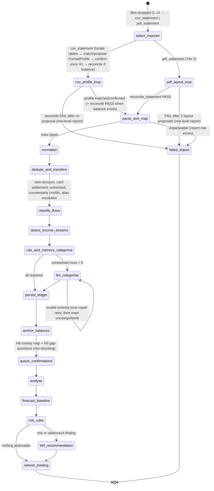
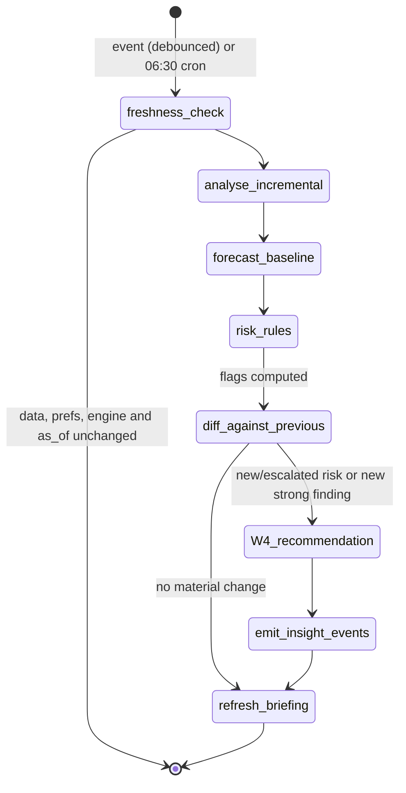
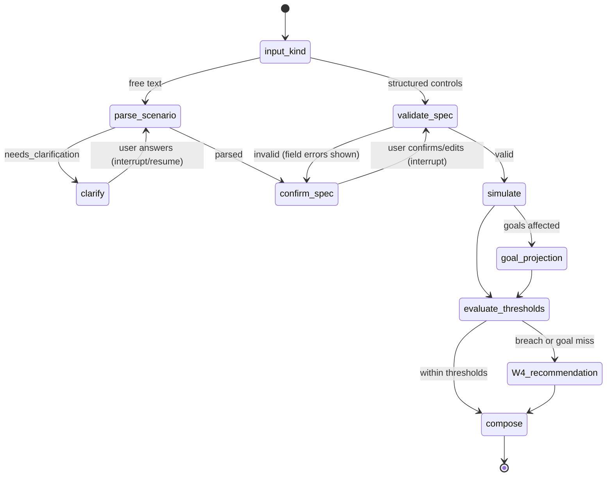
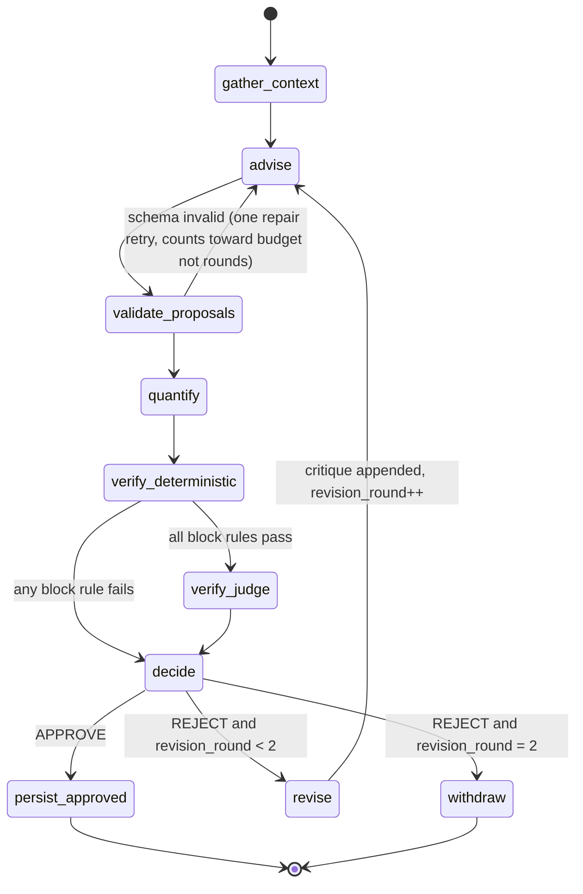
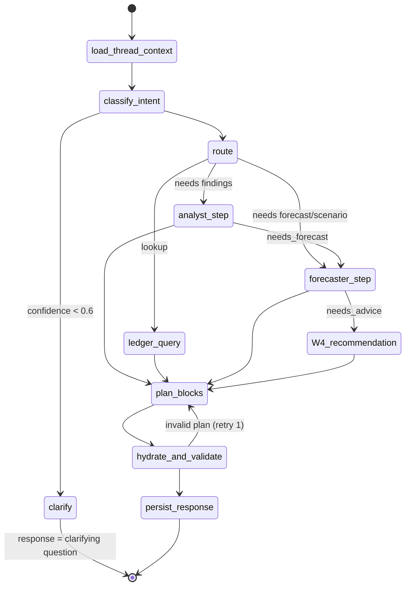
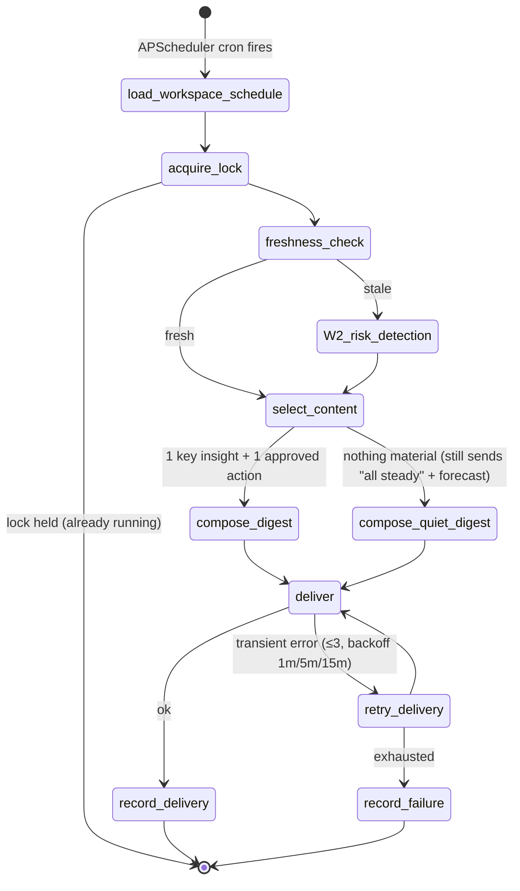

# 06 — Agent Orchestration

> Canonical agent boundaries are in [`00-DECISION-REGISTER.md` §5](00-DECISION-REGISTER.md). This document justifies them, defines contracts, tools and routing, and specifies the LangGraph graphs for all six workflows.
> Runtime, security and cost context: [`05-SYSTEM-ARCHITECTURE.md`](05-SYSTEM-ARCHITECTURE.md). Entity definitions: [`07-DATA-MODEL.md`](07-DATA-MODEL.md). Block contracts: [`08-GENERATIVE-UI-CONTRACTS.md`](08-GENERATIVE-UI-CONTRACTS.md).

All schemas below are **pseudocode in Pydantic style**. They show fields and constraints, not implementation.

---

## 1. Design rules

1. **Deterministic first, LLM second.** Each agent runs its deterministic tools *before* calling an LLM. The LLM only handles what code cannot: ambiguous narrations, natural-language interpretation, ranking and explanation, critique.
2. **LLMs reference numbers, never author them.** LLM outputs carry `calc_…`, `fnd_…` and `fc_…` references. LLM free text uses value placeholders under `08` §5.0; the deterministic hydrator supplies every displayed numeric value. Literal financial numerals are rejected (V-07).
3. **Each agent = own prompt + own tools + own output schema + own model tier.** This makes them "genuinely distinct" in the organiser's sense, and the graph topology snapshot test proves each one is reachable and called.
4. **Bounded loops.** Every loop has a hard cap enforced by the graph (not by the prompt). Hitting the cap ends in an explicit terminal state (`WITHDRAWN`, `NEEDS_REVIEW`), never in silence.
5. **Every node writes an `AgentStep`.** No step, no claim. The audit trail is built from the execution record.

---

## 2. Evaluating the candidate boundaries

The brief proposed five candidates: Categorisation, Behaviour Analyst, Forecasting, Advisor, Recommendation Verification.

| Candidate | Keep? | Reasoning |
|---|---|---|
| Transaction Categorisation → **Ledger Agent** | **Keep, widen** | Categorisation alone is too narrow. Transfer pairing, duplicate detection and narration normalisation share the same input (raw rows) and the same failure mode (wrongly understood transactions). One agent owning "what is this transaction?" gives one place for confidence and corrections. |
| Financial Behaviour Analyst | **Keep** | Distinct input (categorised ledger over time) and distinct output (findings). It owns recurring-obligation detection because recurrence is a *behaviour* pattern, and the Forecaster consumes it as an input. |
| Forecasting Agent → **Forecaster** | **Keep, add simulation and goals** | Forecast, simulate and goal projection must use the *same* engine and seed so differences are attributable. Splitting them across agents risks two engines drifting apart. |
| Financial Advisor | **Keep** | Distinct job: turn findings and forecasts into specific interventions. It must not be able to approve itself. |
| Recommendation Verification → **Verifier** | **Keep, as a hard gate** | This is the track's "core loop" (criterion #2). Merging it into the Advisor would make self-critique a prompt trick, not an orchestration fact. |
| Coordinator | **Add (required)** | The organiser requires "a coordinator routing work". It also owns budgets, retries and response composition. |
| Presenter / UI agent | **Reject as an agent** | Picking blocks is a small `fast`-tier call inside the Coordinator's `compose` step. Hydration and validation are deterministic. A separate agent would add a hop with no new judgement. |
| Goals agent | **Reject** | Goal projection is a Forecaster tool; goal advice is an Advisor input. A separate agent would duplicate both. |
| Anomaly agent separate from Analyst | **Reject** | Anomalies are one detector family among trends and recurrence. Splitting them would split salience ranking. |
| Digest agent | **Reject** | The digest *reuses* the latest approved recommendation and briefing. The renderer is deterministic, and the one LLM need (a short headline) is a Coordinator compose call. |

**Result: Coordinator + 5 specialists**, matching 00 §5.

---

## 3. Shared types (pseudocode)

```python
Money = int                      # integer minor units (ISO 4217 exponent: pence, paise, yen…); currency per account; workspace home_currency (GBP default)
CalcRef = str                    # "calc_01J…"
FindingRef = str                 # "fnd_01J…"

class EvidenceRef(BaseModel):
    kind: Literal["calculation", "finding", "forecast", "simulation", "transaction_query", "goal"]
    id: str                      # calc_/fnd_/fc_/sim_/goal_ id, or a saved query id
    role: Literal["trigger", "impact", "context"]   # why it is cited

class AgentEnvelope(BaseModel):  # wraps every agent output stored in AgentStep.output
    agent: Literal["coordinator","ledger","analyst","forecaster","advisor","verifier"]
    run_id: str
    step_id: str
    prompt_version: str          # hash of prompt file
    model: str | None            # None for deterministic-only steps
    payload: <agent-specific schema>
```

---

## 4. Agents

### 4.0 Coordinator

| | |
|---|---|
| **Responsibility** | Decide which specialists run, in what order, under what budget. Classify user intent. Compose the final `AgentResponse`. Enforce retries and budgets. Never calculates, never advises. |
| **Model tier** | `fast` (intent classification + block planning). System-triggered workflows route through a static table with **no LLM**. |
| **Prompt intent** | "Classify the user's question into one of these intents, extract slots, decide whether it needs a forecast or advice. Never answer the question yourself." Block-planning prompt: "Given these available references, pick the blocks that best answer the question, from this list only." |
| **Tools** | `route_table(intent) → plan`, `budget_guard(run) → ok/exceeded`, `list_available_refs(run)`, `compose_response(plan) → AgentResponse` (deterministic hydration + validation) |

```python
class IntentClassification(BaseModel):
    intent: Literal["spending_breakdown","trend_or_change","transaction_lookup","subscription_review",
                    "affordability","scenario","goal_status","risk_check","advice_request",
                    "explain_recommendation","smalltalk_or_out_of_scope"]
    slots: dict[str, str | int | list[str]]     # e.g. {"category_key":"food.delivery","period":"last_30d","amount_minor":64000}
    needs_forecast: bool
    needs_advice: bool
    confidence: float                            # < 0.6 → clarifying question block instead of routing

class BlockPlan(BaseModel):
    blocks: list[BlockRequest]                   # type + refs only; no values (see 08)
    narrative_points: list[NarrativePoint]       # short claims, each with ≥1 EvidenceRef
```

### 4.1 Ledger Agent

| | |
|---|---|
| **Responsibility** | Turn raw files and rows into trustworthy transactions: pick one of the two generic importers (`csv_statement`, `pdf_statement` Tier 2; 00 §6b), match or propose a `FormatProfile`/`LayoutProfile`, extract, normalise, deduplicate, pair transfers, resolve counterparties, categorise with confidence, learn from corrections. For the single-account default (P1), cross-account pairing stays invisible; the missing-balance gap is still shown and pot/untracked-transfer classification still runs. |
| **Model tier** | `fast`, batched (≤ 50 rows per call), only for rows that deterministic layers leave below confidence 0.85. |
| **Prompt intent** | **Parameterised by the workspace's locale pack** (00 §6c): the template receives `{country}`, the pack's narration-grammar summary, its category taxonomy and its protected categories. UK rendering: "You are categorising UK bank narrations (card payments, DD, SO, FPO/FPI, BGC/Bacs, TFR). For each row choose exactly one category from the provided taxonomy (07), give confidence 0–1 and a short reason that names the token you relied on. If it looks like a payment to a person, say so. Remittance services (LemFi, Wise, WorldRemit, Remitly…) to individuals abroad are `family_support_abroad`. Do not invent merchants." India rendering (`in` pack): "You are categorising Indian bank narrations (UPI `UPI/DR|CR/<ref>/<payee>/<bank>`, NEFT, IMPS, NACH/ECS mandates, ATM). The payee token after the reference is the counterparty; NACH mandates are usually EMIs, SIPs or insurance; UPI payments to individuals for rent are `housing.rent`…" Prompt files: `prompts/ledger.categorise.{uk,in}.md`, each with its own `prompt_version`. Profile prompt (unknown bank formats): "Given a redacted statement header and ≤5 redacted sample rows (digits replaced by shapes, text by `<TEXT>`; for PDF with word x-positions), return a `FormatProfile` (CSV) or `LayoutProfile` (PDF) mapping columns to roles, date format, sign/direction rule and skip rules. Never output amounts or descriptions." |
| **Tools (locale & currency, deterministic, 00 §6c)** | `parse_narration(text, locale_pack)` (applies the pack's narration grammar: UK payment-type codes, or Indian UPI/NEFT/IMPS/NACH/ECS/ATM patterns; returns `{payment_type, counterparty_token, reference, merchant_hint}` with identifiers masked), `detect_currency(table, profile, workspace)` (ladder: currency column → unambiguous symbol/code → matched profile → home currency; returns `ambiguous=true` for `$`/`kr`/`¥` → one-tap confirm, H13), `infer_number_date_format(table, locale_pack)` (decimal/grouping separators incl. lakh grouping; date order from saved/built-in format data or unambiguous dates, otherwise H13 asks once with the pack locale pre-selected; result saved on the FormatProfile), `resolve_payday(rule, locale_pack)` (pack holiday calendar). |
| **Tools (deterministic)** | `normalise_narration` (calls `parse_narration` with the workspace's pack, then strips scaffolding such as UK payment-type codes DD/SO/FPO/FPI/BGC/DEB/TFR/CHQ or UPI/NEFT prefixes, extract merchant/counterparty token, mask sort codes, account numbers, card digits and payment references), `merchant_memory_lookup` (workspace-level, then the locale pack's merchant lexicon), `rule_categorise` (regex/keyword/MCC-like rules with priority), `detect_duplicates` (same account, amount, date ±1 day, normalised narration similarity ≥ 0.9, different import batch), `detect_transfer_pairs` (equal and opposite amounts ± fee across the workspace's own tracked accounts within ±2 days, counter-account hints in narration, or a payee matching the user's own name variants via counterparty aliases; **includes credit-card settlement**: a bill payment from savings to a *tracked* card account is a liability-settlement transfer, not spend), `classify_untracked_transfer` (outflow to an own account that is not tracked → `transfer_to_untracked`, not spend; recurring ones raise a gap question; bill payment to an *untracked* card → `credit_card_bill_unitemised`; payments to the same untracked card from several accounts are **aggregated before one gap prompt**), `detect_income_streams` (recurring credits → `IncomeStream` candidates: source, robust-median net amount, payday rule, account; flags bonus/arrears as one-off and salary split across accounts; irregular income → distribution, see 00 §6a), `classify_counterparty_credit` (apply the complete inflow ladder in `00` §6a: paired tracked transfers → own-name untracked top-ups → refunds → qualifying recurring payroll → government → betting returns → `inflow_unconfirmed`; person reimbursements/split settlements require confirmation, never presumed income), `resolve_counterparty_aliases` (clusters name variants of the same person, e.g. `K MENSAH` / `KOFI MENSAH` / `Mensah K`, by normalised-name similarity + shared sort code/account suffix where present; proposes merges for user confirmation; recognises the user's own variants as *self*; persists `Counterparty{aliases[]}`), `apply_correction` (writes merchant memory) |
| **Tools (CSV ingestion, Tier 1)** | `locate_tables` (scan for header-like rows rather than assuming row 1; split multi-table files such as per-currency pockets; skip summary sections, `Total` rows, separators), `match_format_profile` (header signature → saved FormatProfile, then built-ins: Monzo, Revolut), **`propose_format_profile`** (LLM, `fast` tier with `reasoning` fallback — only for unknown headers; same redaction as PDF; output `FormatProfile` — **never amounts**), `extract_csv_rows(profile)` (deterministic; ID column ⇒ idempotency key; skip rules), `reconcile_statement` (when a balance column exists) |
| **Tools (PDF ingestion, Tier 2)** | `extract_pdf_words` (pdfplumber words + x/y coordinates, page by page; password prompt → local decrypt), `detect_layout` (header row by synonym sets: Date · Description/Details · Paid in/Money in/Credit · Paid out/Money out/Debit · Balance; x-clustering of columns; wrapped-line merge; repeated page headers dropped; reuses a saved `LayoutProfile` by fingerprint), **`propose_layout_profile`** (LLM, `fast` tier with `reasoning` fallback — *only* when `detect_layout` confidence < 0.8; input is the redacted header line + ≤5 redacted sample rows as tokens with x-positions, digits replaced by shape `9999.99`; output is a `LayoutProfile` of column roles and x-ranges, date format and direction rule — **never amounts**), `extract_rows(layout)` (deterministic; direction from paid-in/out columns or running-balance movement; opening = closing − Σin + Σout), **`reconcile_statement`** (deterministic gate, see below) |

Categorisation cascade per row:

```
user override (locked)            → confidence 1.00, method=user
rule match (high-precision rule)  → 0.90, method=rule
rule match (broad rule)           → 0.70, method=rule  → consult memory, then LLM if unresolved
merchant memory (workspace)         → 0.97, method=memory
merchant memory (global seed)     → 0.92, method=memory
no match                          → sent to LLM
LLM result                        → model confidence, capped at 0.95; method=llm
LLM confidence < 0.6              → category=uncategorised, flagged for review
```

**Ingestion — the Ledger Agent's own propose → verify loop (shared by `csv_statement` and `pdf_statement`).** Ingestion has a self-checking loop, the same shape as the advice loop. Shown for PDF; for CSV read `match_format_profile` / `propose_format_profile` / `extract_csv_rows`, the gate is `reconcile_statement` when a balance column exists, otherwise internal structural checks, with H1 only for an unknown format (a known balance-free CSV never requires mapping confirmation):

```
detect_layout ──confident──────────────┐
      │ low confidence                  ▼
propose_layout_profile (LLM) ──► extract_rows ──► reconcile_statement
      ▲                                              │
      └── failure report (which rows/columns broke) ─┤ FAIL and attempt < 2
                                                     │ PASS → save LayoutProfile (confirmed on first use, H11) → normal pipeline
                                                     │ FAIL after 2 proposals → reject file with row-level report (never a silent partial import)
```

`reconcile_statement` (deterministic, block): (a) **row chain**: `prev_balance + in − out = balance` within one ISO currency minor unit; sparse balances check complete date groups, never invented per-row balances; (b) **totals**: Σin, Σout and opening/closing match the statement's stated totals if printed; (c) date monotonicity and date-range coverage against the statement period. No running balance column ⇒ stated totals are checked (`passed_low_confidence`, review prompt). With neither balances nor totals, PDF is rejected as unverifiable; CSV is `not_available`, with today’s balance offered once (or relative mode). H1 preview confirmation applies only to unknown CSV formats. Output `ReconciliationReport{rows_checked, rows_passed, first_break_row, totals_match, verdict}` is persisted on the `ImportBatch` and shown per file in onboarding step 1 ("reconciled ✓ 214/214 rows"). The layout/format proposal LLM never sees or outputs an amount. Reconciliation catches arithmetic errors but cannot prove the descriptions/categories are correct; user preview and independent parse-truth checks cover those.

```python
class LedgerInput(BaseModel):
    import_id: str
    rows: list[NormalisedRow]                   # id, masked narration, merchant_token, amount_band, direction, date

class LedgerCategorisation(BaseModel):
    txn_id: str
    category: CategoryCode                       # must be in taxonomy (validated)
    confidence: float = Field(ge=0, le=1)
    is_person_payment: bool
    reason: str = Field(max_length=120)          # must mention a token present in the narration (V-L1 check)

class LedgerOutput(BaseModel):
    categorised: list[LedgerCategorisation]
    duplicates: list[DuplicateGroup]             # deterministic
    transfers: list[TransferPair]                # deterministic; kind ∈ {own_account, card_settlement}
    untracked_transfers: list[UntrackedFlow]     # kind ∈ {transfer_to_untracked, credit_card_bill_unitemised}; recurring → gap question
    income_streams: list[IncomeStreamCandidate]  # provenance="detected"; awaiting confirmation (H8)
    counterparty_credits: list[CounterpartyCredit]  # partner_contribution | reimbursement | split_settlement candidates
    counterparty_merges: list[AliasMergeProposal]   # name variants → one Counterparty; awaiting confirmation
    reconciliation: ReconciliationReport | None  # PDF / running-balance sources
    review_queue: list[str]                      # txn_ids needing user review
    stats: LedgerStats                           # counts by source, LLM rows, mean confidence (feeds evals)
```

### 4.2 Behaviour Analyst

| | |
|---|---|
| **Responsibility** | Detect what is true and notable about the user's behaviour: trends, anomalies, recurring obligations, subscription changes. Rank by salience. Write the plain-language finding. |
| **Model tier** | `reasoning` (one call per refresh). |
| **Prompt intent** | "Here are candidate findings computed from the user's data, with their statistics. Rank them by how much they matter to this user's cash position and goals. Write each headline in ≤ 14 words and a one-sentence explanation. Use calculation placeholders for every amount, percentage, count and date; never author numeric literals. Discard findings that are statistically weak (provided flag)." |
| **Tools** | `detect_recurring` (amount and period clustering: weekly/monthly/quarterly/termly; ≥3 occurrences, amount CV ≤15%; annual obligations may use two with prior-year evidence), `category_trend` (last 30d vs trailing 3-month median, robust z = (x − median)/(1.4826·MAD); candidate if z ≥ 2.0 **and** \|Δ\| ≥ max(£25, 15% of median)); one-off large items (visa fees, devices, insurance renewals) are excluded from baselines and surfaced as `large_one_off`; `family_support_abroad` is treated as a commitment (recurring-like), never as a discretionary spike; betting findings are only surfaced if the user has opted in (Settings), worded neutrally, and `betting_return` credits are never income, `detect_new_merchant_spike`, `detect_price_change` (recurring amount change ≥ 5%), `detect_duplicate_subscriptions` (same service class, both active), `detect_time_pattern` (share of spend by hour band) |

```python
class FindingCandidate(BaseModel):              # deterministic, persisted as Finding(status="candidate")
    finding_id: FindingRef
    kind: FindingKind  # enum owned by 07 §3.4; includes time_pattern/income_change
    stats: dict                                  # e.g. {"current_minor":28640,"baseline_median_minor":20310,"delta_pct":41.0,"robust_z":3.1,"n_orders":23}
    calc_refs: list[CalcRef]
    txn_query: TxnQuery                          # reproducible filter to show supporting transactions
    strength: Literal["strong","moderate","weak"]

class RankedFinding(BaseModel):
    finding_id: FindingRef
    salience: int = Field(ge=1, le=5)
    headline: str = Field(max_length=90)
    explanation: str = Field(max_length=240)
    numbers_used: list[CalcRef]                  # every number in headline/explanation must map here (V-07)

class AnalystOutput(BaseModel):
    findings: list[RankedFinding]                # LLM may drop or rank, never create findings
    discarded: list[tuple[FindingRef, str]]      # with reason
```

### 4.3 Forecaster

| | |
|---|---|
| **Responsibility** | Own the forecast engine: build the baseline, run scenarios, project goals, run backtests. Explain the drivers of a result. |
| **Model tier** | `fast` for simple scenario parsing; `reasoning` for multi-part scenarios ("which combination of changes…"). |
| **Prompt intent** | Parse: "Convert the user's what-if into a ScenarioSpec using only these modifier types and these category/obligation IDs. If something is ambiguous (which month? which amount?), return a clarification instead of guessing." Explain: "Given baseline vs scenario deltas (provided), name the top drivers in one sentence each, referencing calc IDs." |
| **Scope** | Every forecast/simulation takes `scope ∈ {mine, household, account:<acct_id>}` (00 §6a). `mine` = individual accounts + the user's share of joint accounts per `joint_arrangement`; `household` = all tracked accounts; default `household` when a joint account exists, else `mine`. Own-account transfers net out within scope; transfers crossing the scope boundary (e.g. P3: Kofi's monthly contribution into the joint Nationwide pot under `mine`, or Capital One payments to the untracked card) are treated as outflows/inflows. Scope is part of the seed input and stored on every `fc_`/`sim_`. |
| **Currency** | **Forecasts run per currency** (00 §6c). `build_forecast` groups the scope's accounts by currency and returns one `ForecastResult` per currency group; the workspace view leads with `home_currency`, other groups are shown separately. No FX conversion or FX forecasting; a ScenarioSpec amount must carry the currency of the account it affects (the parser asks if unclear). |
| **Tools** | `build_forecast(workspace, scope, horizon=90, seed) → fc_` (one per currency group), `simulate(spec, base=fc_) → sim_` (inherits base scope), `goal_projection(goal, fc_ or sim_)`, `optimise_cuts(target, constraints)` (deterministic greedy search over allowed category cuts for "which combination improves my position"), `backtest(cutoffs)` (used by evals) |

```python
class ScenarioModifier(BaseModel):              # discriminated union by "type"; owned by 07 §6.5
    type: Literal["one_off_outflow","one_off_inflow","split_outflow","income_delay","income_change_pct",
                  "recurring_add","recurring_change","recurring_cancel","category_cut_pct",
                  "category_cap","move_to_goal","buffer_override"]
    # type-specific fields use amount_minor/date/from_date/to_date/category_key/obligation_id

class ScenarioSpec(BaseModel):
    schema: Literal["scenario_spec/1"]
    name: str
    currency: str                              # ISO 4217; must match baseline and monetary refs
    scope: Literal["mine","household","account"]
    scope_account_id: str | None = None
    modifiers: list[ScenarioModifier] = Field(min_length=0, max_length=12)  # empty is baseline identity
    horizon_days: int = 90                       # 30–180; auto-extend for goal up to 365
    assumptions: list[str] = []                  # annotations only, no competing modifier schema

class ScenarioParseResult(BaseModel):
    status: Literal["parsed","needs_clarification"]
    spec: ScenarioSpec | None
    clarification: ClarifyingQuestion | None     # e.g. options: ["December","January"]

class ForecastSummary(BaseModel):               # deterministic, persisted
    forecast_id: str                             # fc_ or sim_
    scope: Literal["mine","household"] | str     # or "account:<acct_id>"
    seed: int
    engine_version: str
    p10_p50_p90_min_balance: tuple[Money, Money, Money]
    min_balance_date_p50: date
    prob_below_buffer: float
    end_of_month_balances: list[MonthBalance]
    calc_refs: dict[str, CalcRef]
    drivers: list[DriverDelta]                   # for scenarios: per-modifier contribution (same seed → attributable)
```

### 4.4 Advisor

| | |
|---|---|
| **Responsibility** | Propose a small number (1–3) of specific, feasible interventions that improve the forecast or goal outcome, each tied to the finding or forecast that triggered it. |
| **Model tier** | `reasoning`. |
| **Prompt intent** | "Here are the user's ranked findings, forecast risk, goals, buffer and the intervention types you may use. Propose at most 3 interventions. Each must name a concrete action on a specific merchant, category, obligation or date, cite the trigger evidence IDs, and state the *expected direction* of impact. Do not state impact amounts — they will be computed. If revising, address every point in the critique." |
| **Tools** | `list_findings`, `get_forecast_summary`, `get_goal`, `simulate` (called by the graph after the proposal to compute impact, not by the LLM), `intervention_catalogue` (allowed action types and their parameters) |

```python
class InterventionProposal(BaseModel):
    proposal_id: str
    action: Literal["cap_category","cancel_recurring","downgrade_recurring","defer_purchase",
                    "move_purchase_date","set_aside_amount","reschedule_transfer","build_buffer"]
    currency: str                               # same ISO currency as baseline and impact
    params: dict                                 # e.g. {"category_key":"food.delivery","monthly_cap_minor":9000}
    title: str = Field(max_length=80)
    rationale: str = Field(max_length=300)
    trigger_refs: list[EvidenceRef] = Field(min_length=1)    # role="trigger"
    expected_direction: Literal["improves_buffer","improves_goal","reduces_risk"]
    claimed_monthly_impact_minor: int            # MANDATORY (rev 4.3): the Advisor's own estimate in minor units;
                                                 # never displayed; V-06 checks it within ±1% of recompute_impact,
                                                 # so mis-estimates are caught naturally, not only by injection
    claimed_impact_text: str | None              # optional prose; any figure in it is checked the same way (V-06/V-07)

class AdvisorOutput(BaseModel):
    proposals: list[InterventionProposal] = Field(max_length=3)
    revision_of: str | None                      # previous proposal set id
    critique_addressed: list[str] | None         # per critique item, how it was handled
```

After the LLM step, the graph runs `quantify_proposals` (deterministic): for each proposal, translate it into a `ScenarioSpec`, run `simulate` with the baseline seed, and attach `impact_calc_refs` (monthly saving, Δ buffer-breach probability, Δ goal shortfall).

### 4.5 Verifier

| | |
|---|---|
| **Responsibility** | Act as a gate. Approve, reject with critique, or withdraw each proposal. Deterministic rules run first, then the LLM-judge runs only on proposals that pass them. |
| **Model tier** | `reasoning`, preferably a **different model** from the Advisor's (`judge-alt`) to reduce self-agreement. |
| **Prompt intent** | "You are an auditor. For each proposal, given the evidence summaries and deterministic check results, judge: Is it specific to this user? Is the rationale supported by the cited evidence? Is it respectful and non-judgemental? Is it generic advice that would apply to anyone? Return pass/fail per criterion with a one-line reason. Do not rewrite the proposal." |
| **Tools** | `verify_evidence_refs`, `recompute_impact`, `check_feasibility`, `check_generic_advice`, `check_numbers_in_text`, `check_conflicts` (with goals, essential categories, other proposals) |

```python
class RuleResult(BaseModel):
    rule_id: str                                 # "V-01" …
    passed: bool
    severity: Literal["block","warn"]
    detail: str
    evidence: dict                               # e.g. {"claimed":1100000,"recomputed":986000}

class VerificationResult(BaseModel):            # persisted as ver_…
    proposal_id: str
    round: int                                   # 1..3
    deterministic: list[RuleResult]
    judge: list[RuleResult] | None               # only if deterministic all passed (block-severity)
    verdict: Literal["APPROVE","REJECT","WITHDRAW"]
    critique: list[str]                          # actionable, fed to Advisor on REJECT
```

---

## 5. Verifier rule catalogue

Deterministic rules (**D**) run first and can block. LLM-judge rules (**J**) run only if every block-severity D rule passes. A proposal is `APPROVE`d only if all block rules pass.

| ID | Type | Rule | Severity | Failure example |
|---|---|---|---|---|
| V-01 | D | Every `trigger_refs` ID exists, belongs to this workspace, and has status ≠ superseded (FR-50a) | block | Cites `fnd_…` from an older data_version |
| V-02 | D | At least one trigger is a **finding or forecast** (not only context) | block | Proposal cites only the goal |
| V-03 | D | Action targets exist: the merchant/category/obligation is present in the user's data in the trailing 90 days | block | "Cancel Disney+" when no such recurring exists |
| V-04 | D | Feasibility: a category cap is ≥ 60% of its 3-month median (i.e. ≤ 40% cut); essential categories (rent, council tax, energy, water, loan/BNPL repayments, insurance) cannot be cut, only rescheduled (FR-50c) | block | Cap food delivery at £90 vs median £203.10 (56% cut) |
| V-05 | D | Recomputed impact has the claimed `expected_direction` and magnitude ≥ materiality (≥ £10/mo or ≥ 5 pp risk reduction) (FR-50d) | block | Cancelling £2.99 iCloud+ presented as a risk fix |
| V-06 | D | The mandatory `claimed_monthly_impact_minor` (and any figure in `claimed_impact_text`) is within ±1% of `recompute_impact` (FR-50b) | block | Claims +£220/mo, recomputed £196.40 |
| V-07 | D | Every number in title/rationale maps to a referenced calculation (after formatting normalisation) | block | Rationale says "you spend 60% more" with no calc showing 60% |
| V-08 | D | No conflict with goals or buffer in any affected pay cycle: the proposal does not reduce goal progress or increase buffer-breach probability | block | "Prepay a year of PureGym to save 15%" that breaches the buffer this month |
| V-09 | D | No duplication with another approved active recommendation (same action and target) | warn → WITHDRAW if exact duplicate | Same cap proposed twice |
| V-10 | D | Generic-advice detector: rationale has ≥ 1 user-specific token (merchant, category with amount ref, date) and doesn't match a blocklist of generic phrases ("track your expenses", "make a budget", "spend less") (FR-50f) | block | "Try to spend less on food" |
| V-11 | J | Grounded: the rationale's causal claim is supported by the cited evidence summaries | block | Says the spike is "weekend ordering" when the finding shows late-night weekdays |
| V-12 | J | Specific and actionable: a user could do it today without further interpretation | block | "Consider reviewing subscriptions" |
| V-13 | J | Tone: non-judgemental, no shaming, no certainty about the future beyond the forecast band | block | "You're wasting money on takeout" |
| V-14 | D + J | Scope and wording **per locale pack**: not regulated investment, tax or credit advice, no product recommendations. `uk`: FCA guidance-not-advice wording. `in`: SEBI/RBI-neutral wording; never name a fund, stock, scheme or lender; SIP/RD/FD may be described only as the user's existing commitments (D: pack blocklist of product/scheme terms; J: tone/scope check) | block | "Move savings into X mutual fund" / "Switch your SIP to a better-performing fund" |
| V-15 | D + J | Joint-account framing: if any trigger or target involves a `joint` account, the proposal is household-framed ("household food delivery") and **never attributes spend to a person**. D: blocklist of person-attribution patterns ("your partner", "he/she spent", partner's name) on joint-scoped proposals, and the target must be a household category or obligation. J: checks the wording for implied blame (FR-50e, FR-35) | block | "Your partner's grocery orders are up 30%" |
| V-16 | D | Classification integrity: impact and triggers never count `partner_contribution`, `reimbursement`, `split_settlement` or refunds as income, nor own-account/card-settlement transfers as spend; declared figures are cited with provenance `declared` | block | "Your income rose £1,200" where the rise is a partner contribution into the joint account, or a `betting_return` |
| V-17 | D | **Protected categories per locale pack** (both packs: `savings_investment` — never propose pausing or reducing an ISA, pension, SIP, RD/FD or PPF unless the user asks, since that would be investment advice; `uk`: `family_support_abroad`; `in`: domestic family support, plus any category the pack marks protected) are commitments: never targeted by a cut, cap or cancel action unless the user's own question explicitly asks about it (Coordinator slot `user_requested_category`); they may only appear as context (FR-50c) | block | "Reduce LemFi transfers to £150" in response to "how can I save more?" |
| V-18 | D + J | Betting & gaming: proposals or findings involving `betting` are only produced if the user opted in; wording is neutral and factual (D: blocklist of moralising/stigmatising terms — "addiction", "problem", "wasting"; J: tone check); may include a neutral pointer to support resources; `betting_return` never framed as income | block | "Your gambling problem is costing you £200" |
| V-19 | D | **Unconfirmed inflows**: recompute the proposal's outcome (buffer, goal, affordability) without any `inflow_unconfirmed` or non-recurring `transfer_from_untracked`; if the outcome flips, the proposal depends on money that may not arrive (00 §6a) | reject → revise | "You can afford it" holds only because of last month's £300 PayPal transfer |
| V-20 | D | **No cross-currency arithmetic without an explicit rate**: any impact, total, comparison or affordability claim must combine amounts of a single currency. A proposal or narrative that sums, nets or compares amounts from different-currency accounts is rejected; v1 has no rates source, so such proposals are always rejected and revised per currency (00 §6c) | reject → revise | "Together you have £1,850" summing a GBP account and a EUR pocket |

Rule versions are stored with each `RuleResult` (`rule_id@version`) so the audit trail stays interpretable after rules change.

---

## 6. Coordinator routing rules

### 6.1 System-triggered (no LLM routing)

| Trigger | Workflow | Route |
|---|---|---|
| Import committed / manual transaction added | W1 Ingestion & analysis | Ledger → Analyst → Forecaster(baseline) → Risk check → [Advisor ⇄ Verifier if risk or material finding] → Briefing |
| `data_version` / `prefs_version` changed (debounced) or daily 06:30 | W2 Autonomous risk detection | Analyst(incremental) → Forecaster(baseline) → Risk rules → [Advisor ⇄ Verifier] → Briefing + Insight events |
| Scenario submitted in Lab | W3 Scenario simulation | Forecaster(parse → confirm → simulate) → [Advisor ⇄ Verifier if breach/goal miss] → compose |
| Advice needed (from W1/W2/W3/W5) | W4 Recommendation loop | Advisor → quantify → Verifier → loop ≤ 2 revisions |
| Digest schedule | W6 Scheduled digest | Freshness check → [W2 if stale] → select insight + action → render → deliver |

### 6.2 User question (W5): intent → route

| Intent | Specialists (in order) | Typical blocks |
|---|---|---|
| `spending_breakdown` | Analyst tools only (no LLM) | FinancialMetricGroup, SpendingBreakdownChart, TransactionTable |
| `trend_or_change` | Analyst | FinancialMetricGroup, SpendingBreakdownChart (period compare), EvidencePanel |
| `transaction_lookup` | Ledger tools (query) | TransactionTable |
| `subscription_review` | Analyst (recurring + duplicate subs) → [Advisor ⇄ Verifier if `needs_advice`] | TransactionTable, InterventionCard |
| `affordability` | Forecaster(parse → simulate) → Advisor ⇄ Verifier | ScenarioComparison, RiskAssessment, InterventionCard, GoalProjection |
| `scenario` | Forecaster(parse → simulate) | ScenarioComparison, CashFlowForecastChart |
| `goal_status` | Forecaster(goal_projection) → [Advisor ⇄ Verifier if off-track] | GoalProjection, InterventionCard |
| `risk_check` | Forecaster(baseline) + risk rules | RiskAssessment, CashFlowForecastChart |
| `advice_request` | Analyst → Forecaster → Advisor ⇄ Verifier | InterventionCard ×1–3, EvidencePanel |
| `explain_recommendation` | none (reads `rec_…` + `ver_…`) | EvidencePanel, AgentExecutionTimeline |
| `smalltalk_or_out_of_scope` | none | Narrative (polite scope statement) |

Rules: if intent confidence is below 0.6, return a clarifying-question block with 2–4 options and no routing. When findings or the forecast for the current `data_version` already exist, **reuse** them (cache hit recorded in the AgentStep as `cached=true`; forecast reuse also requires matching prefs_version, currency, scope/account, as_of, horizon and engine version) instead of recomputing. Every route ends in `compose`.

---

## 7. LangGraph state

```python
class ForesightState(TypedDict):
    # identity & control
    run_id: str
    workspace_id: str
    workflow: Literal["ingestion","risk_detection","scenario","recommendation","conversation","digest"]
    trigger: Literal["user","event","cron","eval"]
    data_version: int
    prefs_version: int
    currency: str                               # active forecast currency
    as_of: date
    scope: str                                    # mine | household | account:<acct_id> (00 §6a)
    locale_pack: str                              # uk | in (from Workspace.country, 00 §6c)
    home_currency: str                            # ISO 4217; forecasts are per currency group
    budget: Budget                                # tokens_used, llm_calls, limits
    errors: list[StepError]

    # inputs
    user_message: str | None
    import_id: str | None
    scenario_input: ScenarioSpec | str | None

    # specialist outputs (refs only; heavy data lives in DB)
    intent: IntentClassification | None
    ledger: LedgerOutput | None
    findings: list[FindingRef]
    forecast_id: str | None                       # fc_
    simulation_ids: list[str]                     # sim_
    risk_flags: list[RiskFlag]
    proposals: list[InterventionProposal]
    quantified: dict[str, list[CalcRef]]          # proposal_id → impact calc refs
    verifications: list[str]                      # ver_ ids, all rounds
    revision_round: int                           # 0..2
    approved_recs: list[str]                      # rec_ ids
    withdrawn: list[str]

    # output
    block_plan: BlockPlan | None
    response_id: str | None                       # rsp_
    needs_user_input: ClarifyingQuestion | None   # human-in-the-loop interrupt
```

Checkpointing: the LangGraph `PostgresSaver` checkpointer (same PostgreSQL database, its own tables), keyed by `run_id`. Human-in-the-loop points use `interrupt()` and resume when the user answers (§9).

---

## 8. Workflow graphs

### W1 — Transaction ingestion & analysis



The user's review of low-confidence rows happens *after* this run. Corrections bump `data_version`, which triggers W2. The first briefing is never blocked on review.

### W2 — Autonomous risk detection



Risk rules (deterministic): `R1` P(balance < buffer before next income) ≥ 0.5; `R2` P50 min balance < 0; `R3` goal P50 shortfall > 10% of target; `R4` income later than expected window by > 5 days; `R5` new strong finding with \|Δ\| ≥ £40/mo; `R6` a long pay gap ahead (≥ 35 days between paydays, e.g. December pay on Fri 18 Dec → 28 Jan, a 41-day gap) whose P50 low breaches the buffer. "Material change" follows `01` FR-65: new severity ≥watch finding, Δ risk ≥10 pp, Δ P50 at 30 days ≥10% or ≥£100, goal probability crossing below 50%, new import or refreshed stale anchor. Risk/goal severity escalation also triggers advice.

### W3 — Scenario simulation



### W4 — Recommendation generation & verification (the core loop)



Decisions are made per proposal: in one round, some proposals can be approved while others are sent back for revision. Each pass persists a `VerificationResult` with `round` (1..3; revision_round is separately 0..2). A proposal withdrawn at round 3 (initial + 2 revisions) is stored with its full critique history and surfaced only in the audit trail. If *nothing* is approved, the response says plainly "No recommendation passed verification", together with the risk itself. That is an honest outcome, not a failure.

Canonical example (P1, from 00 §10a):
- Round 1: "Cap food delivery at £90/mo — saves £220/mo" → **REJECT** (V-04 infeasible: 56% below the £203.10 median; V-06 claimed £220 vs recomputed £196.40).
- Round 2: "Cap food delivery at £180/mo and cancel NOW Entertainment (overlaps Sky TV)" → deterministic rules pass → judge rules pass → **APPROVE**. Impact: +£116.39/mo (£106.40 + £9.99); buffer-breach probability before the October payday 78% → 41%; with the £640 December trip, the January low recovers to ≈ £493 (above the £300 buffer). The Advisor never proposed touching the ~£250/mo LemFi family support (V-17).

### W5 — Conversational interrogation



Follow-ups: thread context carries the last response's refs (e.g. "show me those transactions" resolves to the `txn_query` of the previous SpendingBreakdown). Block follow-up actions (08) post a **structured** message `{action, refs}` that skips intent classification.

### W6 — Scheduled proactive digest



Content selection is deterministic: highest-severity active risk, else highest-salience finding. The action is the approved recommendation linked to it. The only LLM call is an optional ≤ 20-word headline (`fast` tier) that must pass V-07 (numbers mapped). The digest is idempotent per `(workspace_id, schedule_slot)`.

---

## 9. Human review points

| Point | Where | Mechanism | Blocking? |
|---|---|---|---|
| H1 Format confirmation (CSV) | Import, unknown header only | Preview of extracted rows with the proposed `FormatProfile` column roles; user confirms or edits once, profile saved. Built-in/saved profiles (e.g. Monzo, Revolut) skip this step | Yes (first file of a new bank format only) |
| H2 Low-confidence categorisation review | After W1 | Review queue, sorted by amount × (1 − confidence) | No: forecast runs; corrections trigger W2 |
| H3 Transfer/duplicate confirmation | After W1 | Inline "these look like the same / a transfer" prompts | No |
| H4 Scenario spec confirmation | W3 | `interrupt()` after parse; user edits typed chips | Yes |
| H5 Clarifying question | W3/W5 | Response = options block | Yes |
| H6 Recommendation accept/dismiss/snooze | After W4 | InterventionCard actions → AuditEvent; dismissal reason feeds Advisor context (no repeat for 30 days) | No |
| H7 Balance anchor when missing/stale | Anytime | "Add today's balance" prompt | No: relative mode until then |
| H8 Confirm detected money map | After W1 | "Confirm, don't type" cards: detected income streams (amount, payday rule, account), recurring bills, own-account and card-settlement transfers, likely partner contributions and reimbursements. Confirm/correct/skip; provenance becomes `confirmed` | No: forecast uses detected values (badged "detected") until confirmed |
| H9 Gap questions (ask only when the data shows a gap) | After W1 | Only raised when detected: recurring `transfer_to_untracked` ("£400 goes to an account we can't see every month. What does it pay for?" → declare obligation or import account); no income observed (declare net take-home only); no balance in file (e.g. Monzo CSV) or stale anchor ("What's your balance today?"); `credit_card_bill_unitemised`, aggregated across accounts ("Your Capital One card is paid from two of your accounts. Add its statement?") | No |
| H10 Joint-account consent | Import of a `joint` account | User confirms they have the partner's agreement before import completes; arrangement captured | Yes (for that import) |
| H11 First-use PDF layout confirmation | Import (PDF, Tier 2) | Only after `reconcile_statement` passes: show the first page's extracted rows next to the PDF snippet; confirm saves the `LayoutProfile` for reuse. A reconciliation failure is never presented for confirmation; it is rejected with a row-level report | Yes (first file of a new layout only) |
| H12 Counterparty alias merges | After W1 | "Are these the same person? K MENSAH · KOFI MENSAH" | No |
| H13 Currency / number / date-order confirmation | Import (CSV, XLS or PDF) | Only when `detect_currency` reports an ambiguous symbol (`$`, `kr`, `¥`) or `infer_number_date_format` cannot resolve date order or separators: one-tap chips ("US dollar · Canadian dollar · Australian dollar"; "12/03 is 12 March · 3 December"). Answer saved on the FormatProfile/LayoutProfile. | Yes (that file waits; others continue) |

The system **never** executes financial actions (no payments, no cancellations). "Accept" means "I'll do this", which lets Foresight verify later (§10.3).

---

## 10. Error handling, retries, persistence

### 10.1 Retry limits

| Failure | Retry policy | Terminal behaviour |
|---|---|---|
| Mesh transport error / 5xx / timeout | ≤ 2 retries, exponential backoff (1s, 4s), then fallback model in the same tier, 1 attempt | Step error. Deterministic parts still returned (e.g. findings without LLM ranking use the deterministic salience score) |
| Mesh 429 | Respect `Retry-After` up to 10s, then as above | Same |
| Schema-invalid LLM output | 1 repair retry (validation errors fed back), then degrade; two total attempts | Ledger rows → `uncategorised` + review; Advisor → no proposals ("couldn't generate advice"); plan → default block plan for the intent |
| Verifier revision loop | max 2 revisions (3 rounds) | `WITHDRAW` |
| Budget exceeded (per run: 12 LLM calls or 60k tokens, FR-60) | none | Stop calling LLMs; compose from what exists; flag `partial=true` |
| Engine exception | none (bug) | Run fails loudly; error surfaced; no fabricated fallback numbers |
| Scheduler double-fire | lock row | Second run exits immediately |

**Degradation principle:** if an LLM is unavailable, Foresight shows deterministic numbers with plain templated text and labels the response "AI explanation unavailable". It never shows invented content.

### 10.2 Evidence persistence

Per run, the following are persisted transactionally at node boundaries:
- `AgentRun` (1) → `AgentStep` (n, each with input hash, output envelope, tool calls)
- `Calculation` rows for every number produced (forecast series and simulation results stored once, referenced by many)
- `Finding` (candidate → ranked/discarded)
- `Recommendation` with `trigger_refs`, `impact_calc_refs`, final status, and `verification_ids` (all rounds)
- `AgentResponse` snapshot (`rsp_…`) containing the validated, **hydrated** blocks, so reload never recomputes
- `AuditEvent` for user-visible state changes

Recommendation → evidence chain (what the Evidence drawer walks):
`rec_ → ver_ (rounds 1..3) → trigger fnd_/fc_ → calc_ (stats) → txn_query → txn_ rows` and `rec_ → impact calc_ → sim_ (seed, spec, engine_version)`.

### 10.3 Intervention verification over time

When a user accepts a recommendation, a `VerificationCheck` is scheduled for the end of the action window (e.g. the next month boundary). The deterministic check compares actual behaviour with the commitment (e.g. food delivery ≤ £180; no NOW Entertainment charge) and emits an "Intervention verified" or "not yet" insight. The adaptive goal advice reads these outcomes.


### 10.4 Forecast self-correction on each new import (rev 4.3)

The system also checks and improves **its own forecasts**, not only its advice. On every new import that extends the ledger past a previous forecast's `as_of`:
1. **Score the old forecast** against what actually happened (deterministic): error of the P50 at 7/14/30 days, whether actual balances stayed inside P10–P90, and whether the predicted pre-payday low and its date were right.
2. **Log it** as a `ForecastOutcome` row plus an `AuditEvent` (`forecast_scored`), shown in the Evidence drawer ("Last forecast was £38 off at 14 days; actual stayed inside the range").
3. **Recalibrate within fixed rules** (no LLM): if the last 3 scored windows show actuals outside P10–P90 more than 40% of the time, widen the bootstrap block length/window per the documented rule and record the change and its reason; if a recurring flow was missed, flag it for the Analyst.
4. The next forecast cites which calibration it used; E-FC reports calibration before and after (09).

Owner: roadmap task ENG-10.
---

## 11. Observability (`AgentStep`)

```python
class AgentStep(BaseModel):
    step_id: str; run_id: str; workspace_id: str
    node: str                        # LangGraph node name, e.g. "verify_deterministic"
    agent: str                       # coordinator|ledger|analyst|forecaster|advisor|verifier|system
    provider: Literal["mesh"] | None # mesh only for LLM steps; None otherwise
    kind: Literal["llm","tool","control"]
    model: str | None; tier: str | None; prompt_version: str | None
    input_hash: str                  # sha256 of canonical input JSON
    output: dict                     # validated envelope (redacted)
    tool_calls: list[ToolCallRecord] # name, args hash, result refs
    tokens_in: int; tokens_out: int; cost_estimate: float | None
    latency_ms: int; attempt: int; cached: bool
    status: Literal["ok","retried","failed","skipped"]
    error: str | None
    started_at: datetime; finished_at: datetime
```

This feeds the `AgentExecutionTimeline` block (08), the Evidence drawer, and orchestration evals (09: "every specialist called at least once in W1", "W4 loops when given a bad proposal", "no LLM call outside mesh_client").

---

## 12. Deterministic vs probabilistic boundary

| Concern | Deterministic (`finance_core`, tested) | Probabilistic (LLM via Mesh) |
|---|---|---|
| Narration parsing, masking | ✔ | |
| Currency detection, number/date inference, holidays, locale-pack application | ✔ (unambiguous cases) | — (ambiguity goes to the user, H13, never to an LLM) |
| Category assignment | rules, memory, transfers, duplicates, counterparty aliasing | ambiguous rows only |
| Statement extraction (CSV and PDF) | table/layout location, profile matching, row extraction, `reconcile_statement` gate | `FormatProfile`/`LayoutProfile` proposal from redacted header + ≤5 shape-only sample rows, unknown formats only (never amounts) |
| Recurring detection, trends, anomalies | ✔ detection and statistics | ranking, wording |
| Forecast, simulation, goal projection, optimisation | ✔ all numbers, seeded | scenario text → spec; driver explanation |
| Intervention impact | ✔ via simulate | choosing which intervention to propose |
| Verification | V-01…V-10, V-15/V-18 (pattern parts), V-14 (pack blocklist), V-16, V-17, V-19, V-20 | V-11…V-14, V-15/V-18 (wording parts) |
| UI | hydration, validation | block selection |
| Digest | content selection, rendering | optional headline |

Test: freeze the same accepted ledger interpretations, forecast inputs and typed ScenarioSpec, then run the engine/hydrator with live, replay and null-model composition; calculation hashes and displayed values must match. End-to-end null-model runs test graceful degradation separately. Model-selected categories, parsed scenarios and proposed interventions can change inputs and therefore results; the guarantee is deterministic arithmetic for identical validated inputs, never model-authored displayed figures.

---

## 13. Model selection

| Agent / step | Tier | Why | Temperature |
|---|---|---|---|
| Coordinator intent & block plan | fast | Short classification, high volume | 0 |
| Ledger categorisation | fast | Batched, constrained taxonomy; quality measured in evals | 0 |
| Ledger format/layout profile proposal (CSV and PDF) | fast → reasoning on second attempt | Rare (new bank formats only); output checked by reconciliation and/or user preview | 0 |
| Analyst ranking & wording | reasoning | Judgement about salience; one call per refresh | 0.2 |
| Forecaster scenario parse | fast → reasoning if multi-modifier or low confidence | Most scenarios are simple | 0 |
| Advisor | reasoning | Hardest judgement task | 0.3 |
| Verifier judge | reasoning, preferably a different model from Advisor | Independence | 0 |
| Digest headline | fast | ≤ 20 words | 0.3 |

Model IDs are configuration (`MODEL_TIERS` in settings), chosen from Mesh's catalogue (OPEN #1). The eval suite records which models produced each result, so swapping a model shows up as a measurable change.
