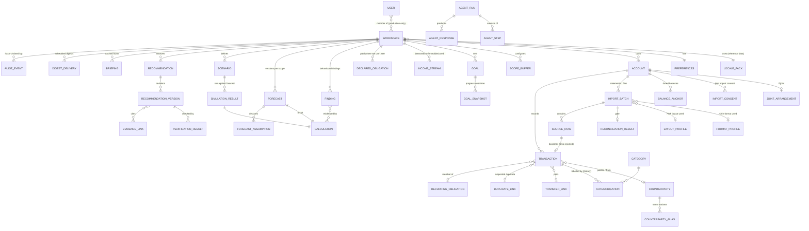

# 07 — Data Model & Financial Modelling

> Phase E. Conceptual data model, edge-case handling, the two generic importers and their format/layout profiles, the forecasting/simulation maths specification, and storage choice.
> Canonical decisions live in [`00-DECISION-REGISTER.md`](00-DECISION-REGISTER.md) (rev 5.2: PostgreSQL everywhere; Workspace, any currency, UK + India locale packs, single-account first). ID prefixes and P1 figures come from §10a there; this document **owns the P3 fixture figures** (§10).
> This is a design document. Field names are normative for implementation; types are logical (mapped to SQLAlchemy in Stage 1, task ING-05).

---

## 1. Modelling principles

1. **Single account is complete on its own.** Every concept works with one Monzo current account (P1). Multi-account, joint and card structures are *additive*: they add rows, never require them. A forecast never needs a second account.
2. **Facts and interpretations are stored separately.** A bank row (fact) is immutable. Categories, `flow_kind`, transfer links, recurring membership and anomalies are *interpretations* with a source (`rule`, `memory`, `llm`, `user`) and a confidence. Re-categorising never rewrites the fact.
3. **Every derived number is a `Calculation`.** Forecasts, simulations, trend statistics, reconciliation results and recommendation impacts are persisted with their inputs hash, parameters, engine version and seed. Anything the UI shows traces back to one (`00` §6.1).
4. **Everything is workspace-scoped.** Every row except reference data (system `Category` rows, global merchant seeds and built-in FormatProfile/LayoutProfile rows) carries `workspace_id`; every repository query requires it (§7).
5. **Append-only where it matters.** Imports, calculations, forecasts, verification results, agent steps and audit events are never updated in place; corrections create new rows that point to the previous one.
6. **Money is integer minor units.** `amount_minor: int` in the currency's ISO 4217 minor unit (pence for GBP, paise for INR, whole yen for JPY; §4.13) + `currency: str(3)`. Sign convention: **negative = money out, positive = money in**, from the account holder's perspective. No floats in storage; NumPy computes in float64 and rounds half-even to the currency’s minor unit on persistence.
7. **Dates are local calendar dates** (`date`, workspace time zone, default `Europe/London`); timestamps (`*_at`) are UTC. Where a source supplies a time (Monzo CSV `Time`), it is kept as `posted_time`.
8. **Detect first, confirm second, ask last** (`00` §6a): the model records *how* each fact about the user was obtained (`provenance`), so the UI can show "detected", "confirmed" or "declared".

---

## 2. Entity-relationship overview



For P1 the live subgraph is small: one `Account`, one `BalanceAnchor` (declared), Monzo `ImportBatch`es, transactions, counterparties, recurring obligations, one `IncomeStream`, one `Goal`. Everything else is either empty or produced by the agents.

| Group | Entities |
|---|---|
| Identity & preferences | `User` (production only), `Workspace`, `LocalePack` (reference data), `Preferences`, `ScopeBuffer`, `Goal`, `GoalSnapshot` |
| Ledger facts | `Account`, `JointArrangement`, `ImportConsent`, `BalanceAnchor`, `ImportBatch`, `FormatProfile`, `LayoutProfile`, `ReconciliationResult`, `SourceRow`, `Transaction` |
| Ledger interpretations | `Counterparty`, `CounterpartyAlias`, `Category`, `Categorisation`, `TransferLink`, `DuplicateLink`, `RecurringObligation`, `IncomeStream`, `DeclaredObligation` |
| Intelligence | `Calculation`, `Finding`, `Forecast`, `ForecastAssumption`, `Scenario`, `SimulationResult` |
| Advice & trust | `Recommendation`, `RecommendationVersion`, `EvidenceLink`, `VerificationResult` |
| Execution & presentation | `AgentRun`, `AgentStep`, `AgentResponse`, `Briefing`, `DigestDelivery` |
| Governance | `AuditEvent` |

---

## 3. Entity definitions

Conventions: `id` is `<prefix>_<ULID>` (`00` §10a). `created_at` UTC on every table (omitted). **[P]** = has `workspace_id` FK. `?` = nullable.

### 3.1 Identity & preferences

**User** (`usr_`) — *production only*. Managed-auth identity (`auth_subject`, `email`); owns ≥ 1 Workspace through `WorkspaceMembership{user_id, workspace_id, role ∈ {owner, member}}`. The hackathon build has one implicit local user and a profile switcher (UI term "Profile" for a workspace); no auth tables are created.

**Workspace** (`wsp_`) — one person's or one household's financial space (`00` §6c). Replaces "profile" in rev 4. Every **[P]** row below carries `workspace_id`.

| Field | Type | Notes |
|---|---|---|
| display_name | str | "Amara", "Mensah household", "Aanya" |
| kind | enum `demo` \| `user` | demo workspaces are resettable; digests from demo workspaces go only to explicitly configured test channels |
| persona_key | str? | `P1`–`P4` for demo workspaces |
| country | str(2) | ISO 3166-1, selects the `LocalePack`: `GB` → `uk`, `IN` → `in` |
| locale_pack | str | `uk` \| `in` (denormalised from country; overridable for tests) |
| home_currency | str(3) | ISO 4217; default from the pack (`GBP`, `INR`). Workspace-level views and the Home briefing use it |
| locale / timezone | str / str | `en-GB` / `Europe/London`; `en-IN` / `Asia/Kolkata` |
| data_version | int | incremented on any ledger mutation; part of forecast cache keys |
| prefs_version | int | incremented on buffer, goal, scope or projection-assumption edits; part of freshness/cache keys |
| deleted_at | datetime? | soft-delete marker before purge (§8) |

**LocalePack** — *reference data, versioned files under `finance_core/locale_packs/<key>/`, not user rows* (`00` §6c). Engine code never branches on country; it reads the pack.

| Part | `uk` | `in` |
|---|---|---|
| default_currency / number format | GBP · `1,234.56` | INR · lakh grouping `1,15,000.00` |
| date formats tried (in order) | `dd/mm/yyyy`, `d MMM yyyy`, `dd MMM yy` | `dd-mm-yyyy`, `dd/mm/yyyy`, `dd-MMM-yy` |
| holiday calendar | `holidays.UK(subdiv="ENG")` | `holidays.IN` + state subdivision (P4: Karnataka) |
| payday conventions | fixed date → previous working day; early December pay; four-weekly | 1st or last working day; previous working day at holidays |
| narration parsers | payment-type codes `DD SO FPO FPI BGC DEB TFR CPT` | `UPI/DR\|CR/<ref>/<payee>/<bank>/<note>`, `NEFT/<ref>/<name>`, `IMPS/<ref>/…`, `NACH/ECS` mandates, `ATM WDL` |
| merchant lexicon | Tesco, Deliveroo, LemFi, PureGym, … | Swiggy, Zomato, Blinkit, Zepto, BigBasket, Ola, Uber, Jio, Airtel, … |
| category additions | council_tax, tv_licence, bnpl, self_assessment, family_support_abroad | emi, sip, rd_fd, ppf, gst_advance_tax, school_fees, upi_rent, family_support (domestic) |
| protected categories | rent, council tax, energy, water, family support abroad, loans/BNPL, **savings & investments (ISA, pension, savings pots)** | rent, EMI, school fees, family support, insurance premiums, **savings & investments (SIP, RD/FD, PPF)** |
| wording notes | FCA guidance-not-advice | SEBI/RBI-neutral; no product recommendations |
| redaction patterns | sort code, account no., card PAN, NI no., UK postcode | IFSC, account no., UPI VPA (`name@bank`), PAN, Aadhaar-like 12-digit, PIN code |

**Preferences** (1:1 with Workspace) **[P]**

| Field | Type | Notes |
|---|---|---|
| buffer_minor | int? | minimum comfortable balance in the workspace home currency (P1 £500 = 50000; P4 ₹40,000 = 4000000). Null → *suggested* default = one month of essential obligations computed from data, labelled `default` until the user accepts it |
| buffer_provenance | enum `default` \| `user_set` | |
| horizon_days | int | default 90, allowed 30–180 (auto-extends to a goal's target date, max 365) |
| default_forecast_scope | enum `mine` \| `household` | only meaningful when a joint account exists |
| digest_channel / digest_target / digest_cron | enum / str? (encrypted) / str | default cron `0 8 * * MON` |
| feasibility_max_cut_pct | int | default 40 — Verifier bound for discretionary cuts below the 3-month median |
| protected_category_keys | list[str] | categories the Advisor may not propose cutting. Default = all categories with `nature ∈ {essential, commitment, debt, tax}` (rent, council tax, energy, water, family support abroad, loan/BNPL repayments, childcare, …) |
| betting_insights_opt_in | bool | default false — betting findings are neutral and only shown if opted in (`00` §6b.6) |

**ScopeBuffer** **[P]** — `scope, scope_account_id?, currency, buffer_minor, provenance`; unique per scope/account/currency. The home-currency Preferences buffer supplies a default, never a converted amount. Missing buffer ⇒ omit buffer-breach probability and prompt to set one.

**Goal** (`goal_`) **[P]**

| Field | Type | Notes |
|---|---|---|
| name | str | "Emergency fund" |
| currency | str(3) | goal and linked account/projection currency; defaults to home currency at creation, then fixed |
| kind | enum `save_by_date` \| `keep_buffer` \| `pay_down` | |
| target_minor / target_date | int / date | P1: 150000 / 2027-03-31 |
| funding_rule | enum `residual` \| `fixed_monthly` | `residual` (earmarked): money stays in the main account; progress = cash above buffer at the target month's pre-salary low (§6.7). `fixed_monthly`: `monthly_contribution_minor` moves to `linked_account_id` (e.g. a Monzo pot, ISA). **P1 = residual.** |
| monthly_contribution_minor / linked_account_id | int? / acct? | for `fixed_monthly` |
| status | enum `active` \| `achieved` \| `abandoned` | |

**GoalSnapshot** **[P]** — `goal_id, as_of, progress_minor, projection_calc_id, status_band (on_track|at_risk|off_track)`. Written on every forecast rebuild; powers advice that adapts as the user gets ahead or falls behind.

### 3.2 Ledger facts

**Account** (`acct_`) **[P]**

| Field | Type | Notes |
|---|---|---|
| name | str | "Monzo Current ••4417" (masked) |
| institution | str? | auto-detected from file format where possible ("Monzo") |
| type | enum `current` \| `savings` \| `credit_card` \| `wallet` \| `cash` \| `loan` | `credit_card`, `loan` are liabilities (balance ≤ 0 normal) |
| owner_relation | enum `self` \| `household_member` | individual account owner relative to the workspace; default self |
| ownership | enum `individual` \| `joint` | default `individual`; **asked only if** a second account or partner-like transfers are detected |
| role | enum? `salary` \| `bills` \| `savings` \| `household` \| `spending` | optional tag; wording/defaults only, never maths |
| tracked | bool | true = we have its transactions. **Untracked accounts exist as counterparty-accounts** (created when a `transfer_to_untracked` or untracked-card payment is confirmed) so they can carry declared obligations and be imported later |
| mask | str(4)? | last 4 digits only; sort codes and full account numbers never stored |
| currency | str(3) | ISO 4217; one currency per account. Multi-currency files (e.g. Revolut pockets) fan out into one account per currency (§4.12) |
| currency_source | enum `column` \| `symbol` \| `profile` \| `home_default` \| `user_confirmed` | how the currency was decided (`00` §6c order: currency column → unambiguous symbol/code → matched Format/LayoutProfile → workspace home currency). Ambiguous symbols (`$`, `kr`, `¥`) set `needs_confirmation` until the user taps to confirm (→ `user_confirmed`) |
| counter_hints | list[str] | narration tokens identifying transfers to/from this account, learned from confirmed pairs |
| statement_cycle | json? | credit cards: `{statement_day, due_day}` inferred from settlements |
| balance_quality | enum `ok` \| `reconstructed` \| `stale` \| `inconsistent` \| `none` | computed (§4.1) |
| include_in_forecast | bool | default = `tracked` |

**JointArrangement** **[P]** — 1:1 with a joint Account: `arrangement: treat_as_household_pot (default) | equal_share | percentage | fixed_contribution`, `user_share_pct?`, `user_contribution_minor?`, `members_count` (default 2), `partner_label?` (a UI nickname; never sent through Mesh). Joint-account spending is **never attributed to a person**.

**ImportConsent** **[P]** — `account_id, import_batch_id, kind: joint_account_partner_data, statement_text, accepted_at`. Required before an import into a joint account can be committed; logged as `AuditEvent(consent.joint_import)`.

**BalanceAnchor** (`bal_`) **[P]** — a dated balance.

| Field | Type | Notes |
|---|---|---|
| account_id / as_of / amount_minor | | end-of-day balance on `as_of` |
| source | enum `file_balance_column` \| `statement_closing` \| `statement_opening_derived` \| `user_entered` \| `demo_seed` | Monzo CSV has no balance → `user_entered` |
| provenance | enum `observed` \| `declared` | `user_entered` ⇒ `declared` (shown with badge). P1: £2,184.50 as of 11 Oct, declared |
| source_row_id / import_batch_id | ? | provenance |

**ImportBatch** (`imp_`) **[P]**

| Field | Type | Notes |
|---|---|---|
| account_id | acct | each batch belongs to one account (multi-table CSVs such as a Revolut consolidated statement fan out into one batch per non-empty table/pocket) |
| importer | enum `csv_statement` \| `pdf_statement` \| `manual` \| `demo_seed` (future: `open_banking`) — XLS/XLSX uses `csv_statement` | only **two generic file importers** (`00` §3); bank specifics live in profiles |
| detection | json | `{importer, profile_match: {format_profile_id | layout_profile_id, score}, signals: ["header:Transaction ID,Date,Time,Type,Name…"], tables_found}` |
| filename / file_sha256 | str / str | same file twice → "already imported" |
| format_profile_id | fmt? | CSV: the `FormatProfile` used (built-in, proposed or user-confirmed) |
| table_index | int? | which table of a multi-table CSV (e.g. Revolut pocket) this batch came from |
| layout_profile_id | lay? | PDF only |
| statement_period | {from, to}? | from file/PDF header |
| source_type | enum `csv` \| `xlsx` \| `xls` \| `pdf` | XLS/XLSX is read into a table (every worksheet is scanned, and every detected non-empty table) and handed to `csv_statement` (`00` §6c, rev 4) |
| format_inference | json | `{decimal_sep: "."\|",", group_sep: ","\|"."\|" "\|"'", grouping: "thousands"\|"lakh", date_order: "DMY"\|"MDY"\|"YMD", date_format, evidence: ["day 23 seen in col 1 → DMY"], source: "profile"\|"inferred"\|"locale_default"\|"user_confirmed"}` — stored so re-parsing is deterministic |
| encrypted | bool | PDF was password-protected (password never stored; decrypted in memory) |
| counts | json | `{rows_read, accepted, duplicates, rejected, zero_value_dropped}` |
| reconciliation_id | rcn? | |
| status | enum `parsed` \| `needs_mapping` \| `needs_review` \| `reconciled` \| `committed` \| `rejected` \| `rolled_back` | a batch with a **failed** reconciliation cannot be committed |

**FormatProfile** (`fmt_`) **[global built-ins, or P when proposed/confirmed]** — bank CSV knowledge as **data**, consumed by the generic `csv_statement` importer.

| Field | Type | Notes |
|---|---|---|
| name / institution_hint | str | "Monzo current account export", "Revolut consolidated statement" |
| header_signature | json | normalised header tokens + order tolerance, e.g. `["transaction id","date","time","type","name","category","amount","currency","local amount","local currency","notes and #tags","address","receipt","description","category split","money out","money in"]`; match score = Jaccard on tokens, ≥ 0.9 auto, 0.6–0.9 "looks like…" confirm |
| table_locator | json | `{mode: "first_row" \| "scan", section_markers?: [...], terminators: ["Total"], separators: ["^-{5,}"]}` — `scan` finds header-like rows anywhere and splits multi-table files |
| columns | json | `[{role: date\|time\|description\|amount\|money_in\|money_out\|balance\|id\|bank_category\|payment_type\|currency\|counterparty_name, header: "Money Out"}]` |
| date_format | str | `"%d/%m/%Y"`, `"%-d %b %Y"` with month-alias table (`Sept` → Sep) |
| sign_convention | enum `signed_amount` \| `separate_in_out` \| `dr_cr_suffix` \| `debit_positive` | |
| skip_rules | json | `{zero_amount: true, row_regex: ["^Total", "^-{5,}"], declined_status: ["DECLINED","REVERTED"]}` |
| id_column | str? | idempotency key column (Monzo `Transaction ID`) |
| has_balance | bool | false for Monzo ⇒ balance gap question |
| account_split | enum? `per_table` \| `per_currency_column` | Revolut: one account per non-empty pocket table |
| currency | str(3)? | saved same-currency format default/confirmation; explicit later file evidence wins |
| source | enum `builtin` \| `proposed` \| `user_confirmed` | `proposed` = Ledger Agent from redacted header + ≤5 **digit-masked** sample rows (never amounts); becomes `user_confirmed` after one confirm and a clean parse |
| proposed_by_step_id | step? | |
| version / confirmations | int | built-ins are versioned with the engine |

Built-in v1 profiles: **Monzo** (no balance, ID column, £0.00 card-check rows skipped, `Time` kept, Monzo `Category` → `bank_category`, pot transfers → `savings_investment`), **Revolut consolidated** (scan + per-pocket tables, `Total` terminators, separators, `2 Sept 2026` dates, running balance). Others (Starling, Barclays, HSBC, Nationwide, Chase, card providers) are added as data when samples are available; until then they go through the mapper/proposal path.

**LayoutProfile** (`lay_`) **[P, or global when promoted]** — a reusable description of one PDF statement layout (the PDF counterpart of `FormatProfile`).

| Field | Type | Notes |
|---|---|---|
| institution_hint | str? | "Nationwide" |
| fingerprint | json | header tokens, page size, column x-ranges (normalised 0–1), date format, header-row text hash |
| columns | json | `[{role: date\|description\|money_in\|money_out\|amount\|balance\|type_code, x_min, x_max}]` |
| date_format | str | `"%d %b %y"`, `"%d %B %Y"` … |
| direction_rule | enum `columns` \| `signed_amount` \| `balance_delta` | `balance_delta` when direction isn't labelled per row (observed on real statements) |
| balance_semantics | enum `opening` \| `end_of_first_day` \| `unknown` | the "Balance on <first day>" trap |
| wrap_rule | json | how continuation lines are merged (no date + no amount ⇒ append to previous description) |
| skip_patterns | list[regex] | repeated page headers/footers, "Balance brought forward" |
| currency | str(3)? | saved layout default/confirmation; explicit later file evidence wins |
| origin | enum `builtin` \| `heuristic` \| `llm_proposed` \| `user_confirmed` | LLM proposals come from **redacted header + ≤5 sample rows**; the LLM never outputs amounts |
| proposed_by_step_id | step? | |
| confirmations | int | times reused with a passing reconciliation |

**ReconciliationResult** (`rcn_`) **[P]** — statement-level gate, computed deterministically (also a `Calculation(kind=reconciliation)`).

| Field | Type | Notes |
|---|---|---|
| import_batch_id | imp | |
| method | enum `running_balance_chain` \| `stated_totals` \| `chain_and_totals` \| `totals_only` \| `none` | `none` for Monzo (no balances): only internal checks (dates in range, no £0 rows, IDs unique) |
| opening / closing (stated, computed) | int? | opening derived as `closing − Σin + Σout` when not stated |
| sum_in / sum_out (stated, computed) | int? | |
| rows_checked / rows_failed | int | |
| failures | json | row-level report: `[{row, page, expected_balance, computed_balance, delta}]` |
| status | enum `passed` \| `passed_low_confidence` \| `failed` \| `not_available` | `passed_low_confidence` = totals-only; triggers a review prompt |
| tolerance_minor | int | 1 minor unit per row or stated-total check (01 FR-05); exact integer reconciliation is expected for all fixtures |

Gate rule: `failed` ⇒ batch `rejected` with the report ("Row 214 on page 6: expected £1,102.37, computed £1,092.37 — a row may be missing"). **Never a silent partial import.**

**SourceRow** **[P]** — `id ("imp_…:r000123"), import_batch_id, row_number, page? (PDF), raw: json (original cells/text lines), parse_status: ok|rejected|duplicate|dropped_zero, reject_reason?`.

**Transaction** (`txn_`) **[P]** — immutable fact.

| Field | Type | Notes |
|---|---|---|
| account_id | acct | |
| posted_on / posted_time? | date / time? | `posted_time` from Monzo CSV |
| amount_minor / currency | int ≠ 0 / str | negative = out; **minor units per ISO 4217 exponent** (§4.13): pence for GBP, paise for INR, whole yen for JPY (exponent 0), fils for KWD (exponent 3); always equals the account's currency |
| original_amount_minor / original_currency | ? | foreign-currency card spend where the file provides it |
| narration_raw | str | e.g. `DELIVEROO LONDON GBR`, `LEMFI PAYMENTS FPO`, `COUNCIL TAX LEEDS CC DD` |
| narration_norm | str | normalised tokens; payment type split out |
| payment_type | enum `card` \| `dd` \| `so` \| `fpo` \| `fpi` \| `bgc` \| `bacs` \| `tfr` \| `atm` \| `chq` \| `fee` \| `other` | from UK codes (DD, SO, FPO, FPI, BGC, DEB, TFR) or Monzo `Type` |
| counterparty_id | cpty? | resolved via aliases (§3.3) |
| external_id | str? | Monzo `Transaction ID` (idempotency key) |
| bank_category | str? | Monzo/Revolut category — a **feature** for categorisation, not ground truth |
| balance_after_minor | int? | when the source gives a running balance |
| source_row_id / entry_method | ? / enum `import` \| `manual` \| `demo_seed` | |
| fingerprint / occurrence_index | str / int | idempotency (§4.4); unique `(workspace_id, fingerprint, occurrence_index)` |
| status | enum `active` \| `excluded_duplicate` \| `excluded_user` | |
| current_category_id / flow_kind / is_transfer / recurring_obligation_id | denormalised | latest interpretation for fast queries |
| is_one_off | bool | large one-offs excluded from the discretionary baseline (§4.6) |

Indexes: `(workspace_id, posted_on)`, `(workspace_id, counterparty_id)`, `(workspace_id, current_category_id, posted_on)`, `(workspace_id, flow_kind, posted_on)`.

**`flow_kind`** — the single switch that decides how a row counts:

| flow_kind | Spending? | Income? | Moves cash in scope? | Example |
|---|---|---|---|---|
| `spending` | yes | — | yes (card spend via settlement) | Deliveroo, Tesco |
| `income` | — | yes | yes | Bacs salary |
| `refund` | reduces its category | no | yes | Amazon refund |
| `reimbursement` / `split_settlement` | offsets the linked spend | no | yes | Friend pays back for dinner (confirmed) |
| `commitment` | **no — shown separately as committed outflows** | — | yes | LemFi family support, child maintenance |
| `transfer_own` | no | no | nets to zero only when both legs are in scope; crossing-boundary flows move scoped cash | Starling → own Chase top-up (P3) |
| `transfer_to_untracked` | no | no | yes (leaves tracked set) | £400/mo to an account we can't see |
| `transfer_from_untracked` | no | **no** (own money) | yes (enters tracked set); projected only if recurring | Top-up from the user's own account at another bank that isn't imported |
| `inflow_unconfirmed` | no (never offsets spending) | **no** — shown as "Other money in (not confirmed)" | yes in balance; **projected only if recurring** (≥3, regular cadence, CV ≤ 20%) as an explicit assumption | £200 from a person, PayPal transfer, one-off company payment |
| `card_settlement` | no (liability settlement) | no | yes on bank; reduces card liability | Nationwide joint → tracked Tesco Bank card |
| `credit_card_bill_unitemised` | **yes** (category of the same name) | no | yes | Capital One payment, card untracked |
| `partner_contribution` | no | **no** | yes in Household scope | Hannah's £1,150 into the joint account |
| `savings_investment` | no | no | reduces tracked cash when destination is excluded/untracked; paired included cash accounts net to zero | Monzo pot, ISA, Vanguard, Moneybox |
| `loan_repayment` | no (obligation) | no | yes | Car finance, personal loan, **BNPL instalments** |
| `betting` / `betting_return` | betting: yes (own category) / return: no | **returns are not income** | yes | Bet365 stake / winnings |
| `fee` | yes (`fees.bank`) | — | yes | overdraft fee |
| `tax` | no (obligation) | — | yes | HMRC Self Assessment (P2) |

Inflow classification ladder and the treatment of unconfirmed inflows: see 00 §6a "Inflows we can't confirm". Detected recurring income is used in the forecast even if the user never confirms it; unconfirmed inflows count in the balance but are never income and never relied on by advice (V-19).

Note: `commitment` is a *spending-like* flow excluded from discretionary analysis and from Advisor cut proposals (protected), but included in "where your money goes" totals as its own band.

### 3.3 Ledger interpretations

**Counterparty** (`cpty_`) **[P]** — the canonical "who" behind narrations.

| Field | Type | Notes |
|---|---|---|
| display_name | str | "Deliveroo", "Hannah Mensah", "Leeds City Council" |
| kind | enum `merchant` \| `person` \| `self` \| `employer` \| `government` \| `bank` \| `platform` | `self` = the user's own name variants (transfers to self) |
| default_category_id | cat? | merchant memory: user corrections override LLM/rule labels |
| memory_hits / last_confirmed_by | int / enum `rule\|llm\|user` | |
| merged_into | cpty? | after a user-confirmed merge |

**CounterpartyAlias** **[P]** — `counterparty_id, alias_norm ("H MENSAH", "HANNAH A MENSAH", "MENSAH H"), source: detected|user, confidence`. Alias proposals come from token similarity (Jaro-Winkler ≥ 0.9 on surname + initial match) and co-occurrence in the same account role; **merges are confirmed by the user** (one tap in "Check what we found" when ≥ 3 variants or money ≥ £100/mo is involved). The user's display name variants are seeded as `self` aliases.

**Category** (`cat_`) — two-level taxonomy. System rows (`workspace_id` null) read-only; v1 keys are fixed, with user-created children deferred. Fields: `key, parent_key?, label, nature (income|essential|commitment|discretionary|transfer|savings|debt|tax), default_flow_kind`.

**Canonical UK category list (v1)**

| Group | Keys (label) | Nature | Default flow_kind | Typical narration signals |
|---|---|---|---|---|
| Income | `income.salary` (Salary), `income.self_employed` (Self-employed income), `income.benefits` (Benefits — Universal Credit, Child Benefit), `income.interest` (Interest), `income.other` | income | income | `BGC`, `BACS`, employer name, `DWP UC`, `HMRC CHILD BENEFIT`, `INTEREST` |
| Refunds | `refund` (Refund) | — | refund | `REFUND`, card credit from a merchant |
| Housing | `housing.rent` (Rent), `housing.mortgage` (Mortgage), `housing.council_tax` (Council tax) | essential | spending | `SO` to letting agent/landlord; lender name; `COUNCIL TAX`, `<city> CC DD` |
| Utilities | `utilities.energy` (Energy), `utilities.water` (Water), `utilities.broadband_tv` (Broadband & TV), `utilities.mobile` (Mobile phone), `utilities.tv_licence` (TV licence) | essential | spending | Octopus, British Gas, EDF, OVO; Yorkshire Water, Thames Water; BT, Virgin Media, Sky, Plusnet; EE, Vodafone, giffgaff; `TV LICENCE` |
| Insurance | `insurance` (Insurance — car, home, contents, pet, life) | essential | spending | Admiral, Aviva, Direct Line, LV= |
| Groceries | `groceries` (Groceries) | essential | spending | Tesco, Sainsbury's, Asda, Aldi, Lidl, Morrisons, Co-op |
| Food | `food.delivery` (Food delivery), `food.eating_out` (Eating out & coffee) | discretionary | spending | Deliveroo, Uber Eats, Just Eat; Pret, Greggs, Nando's |
| Transport | `transport.public` (Public transport), `transport.fuel` (Fuel), `transport.car` (Car costs — parking, MOT, repairs), `transport.taxi` (Taxis & ride-hailing) | essential (public, fuel) / discretionary (taxi) | spending | TfL, Northern, LNER, First Bus; Shell, BP, Esso; NCP, RingGo; Uber, Bolt |
| Shopping | `shopping.general` (Shopping), `shopping.clothing` (Clothing), `shopping.home` (Home & DIY) | discretionary | spending | Amazon, Argos, Primark, IKEA, B&Q |
| Subscriptions | `subscriptions.streaming` (Streaming), `subscriptions.software_cloud` (Apps & cloud), `subscriptions.fitness` (Gym & fitness), `subscriptions.other` | discretionary | spending | Netflix, Spotify, NOW, Disney+, Prime Video; iCloud, Google One; PureGym, The Gym Group |
| Health & care | `health` (Health — pharmacy, dentist, optician, prescriptions), `personal_care` (Personal care) | essential / discretionary | spending | Boots, Superdrug, `NHS PRESCRIPTION`, Specsavers |
| Family | `childcare` (Childcare), `education` (Education & courses), `family_support_abroad` (Family support abroad), `gifts` (Gifts), `charity` (Charity) | essential / essential / **commitment** / discretionary / discretionary | spending / spending / **commitment** / spending / spending | nursery names; LemFi, Wise, WorldRemit, Remitly, Western Union, Lebara Money; `JUSTGIVING` |
| Leisure | `entertainment` (Entertainment), `travel` (Travel & holidays), `betting` (Betting & gaming), `betting_return` (Betting returns) | discretionary | spending / spending / **betting** / **betting_return** | cinemas, Ticketmaster; Ryanair, easyJet, BA, Booking.com; Bet365, Sky Bet, Paddy Power, National Lottery |
| Debt | `debt.bnpl` (Buy now, pay later), `debt.loan` (Loan & car finance), `credit_card_bill_unitemised` (Credit card bill — unitemised) | debt / debt / discretionary-unknown | loan_repayment / loan_repayment / credit_card_bill_unitemised | Klarna, Clearpay, PayPal Pay in 3; Zopa, Close Brothers, Black Horse; `CAPITAL ONE`, `TESCO BANK CREDIT CARD`, any card provider (when untracked) |
| Tax | `tax.self_assessment` (Self Assessment), `tax.other` | tax | tax | `HMRC SELF ASSESSMENT`, `HMRC` |
| Savings | `savings_investment` (Savings & investments) | savings | savings_investment | Monzo pots (`Pot transfer`), ISA providers, Vanguard, Trading 212, Moneybox, Premium Bonds (NS&I) |
| Cash & fees | `cash.withdrawal` (Cash), `fees.bank` (Bank fees & charges) | discretionary / essential | spending / fee | `ATM`, `CASH`; `OVERDRAFT FEE`, `NON-STERLING TRANSACTION FEE` |
| Transfers | `transfer.own` (Between my accounts), `transfer.untracked` (To an account we can't see), `transfer.from_untracked` (From my other account), `transfer.card_settlement` (Credit card payment), `partner_contribution` (Partner contribution), `transfer.reimbursement` (Paid back), `transfer.other_person` (To/from people) | transfer | transfer_own / transfer_to_untracked / transfer_from_untracked / card_settlement / partner_contribution / reimbursement / spending | `TFR`, `FPO`/`FPI` to self-aliases, `PAYMENT RECEIVED THANK YOU`, partner aliases into joint account |
| Unconfirmed inflows | `inflow_unconfirmed` (Other money in — not confirmed) | transfer | inflow_unconfirmed | unknown person/platform credits |
| Other | `other` (Other), `uncategorised` (Needs review) | discretionary | spending (other); direction-aware ladder fallback (uncategorised) | — |

**India locale-pack additions (`in`, v1).** Same keys and natures as above unless listed; these are added (or relabelled) when `locale_pack = in`. UK-only keys (`housing.council_tax`, `utilities.tv_licence`, `tax.self_assessment`, `family_support_abroad`) are hidden in `in` workspaces.

| Group | Keys (label) | Nature | Default flow_kind | Typical narration signals (fictional examples) |
|---|---|---|---|---|
| Housing | `housing.rent` (Rent — often via UPI), `housing.maintenance` (Society maintenance) | essential | spending | `UPI/DR/…/<landlord name>/…/RENT`, `NEFT/…/<landlord>`; society name + `MAINT` |
| Debt | `debt.emi` (EMI — loan instalment) | debt | loan_repayment | `NACH/ECS` mandate to a lender, `EMI`, `<lender> LOAN` |
| Savings | `savings.sip` (SIP — mutual fund), `savings.rd_fd` (RD / FD), `savings.ppf` (PPF) | savings | savings_investment | `NACH/…/<AMC> SIP`, `TRF TO RD`, `FD BOOKING`, `PPF DEP` |
| Tax | `tax.gst_advance` (GST / advance tax), `tax.tds_refund` (Income-tax refund, inflow) | tax / income | tax / income | `GST CHALLAN`, `ADV TAX`, `CBDT REFUND` / `ITD REFUND` (government tax-refund credit follows the income ladder in `00` §6a; one-offs are not projected) |
| Family | `education.school_fees` (School fees), `family_support` (Family support — domestic, **commitment**) | essential / **commitment** | spending / commitment | school name + `FEE`; recurring UPI to a parent/sibling confirmed as family support |
| Utilities | `utilities.mobile` (Mobile & DTH recharge), `utilities.electricity` (Electricity), `utilities.gas_lpg` (Piped gas / LPG) | essential | spending | Jio, Airtel, Vi, Tata Play; BESCOM; Indane, HP Gas |
| Food | `food.delivery`, `groceries` (quick-commerce included) | discretionary / essential | spending | Swiggy, Zomato; Blinkit, Zepto, BigBasket, Swiggy Instamart |
| Transport | `transport.taxi`, `transport.fuel`, `transport.fastag` (FASTag tolls) | discretionary / essential | spending | Uber, Ola, Rapido; `FASTAG RECHARGE` |
| Cash | `cash.withdrawal` | discretionary | spending | `ATM WDL`, `ATW` |

Every key is stable (used by evals and contracts). `bank_category` from Monzo/Revolut is mapped to these as a prior (e.g. Monzo `eating_out` + Deliveroo counterparty → `food.delivery`).

**Categorisation** **[P]** — append-only history: `transaction_id, category_id, flow_kind, method: rule|memory|llm|user (bank_category is an input feature, never a separate assignment method), confidence, rationale?, agent_step_id?, supersedes?`. Latest wins.

**TransferLink** **[P]** — `kind: transfer_own | card_settlement | partner_contribution | reimbursement, out_txn_id?, in_txn_id?, counter_account_id, method: auto|user, score, fee_minor, rule_trace`. Single-leg links (other side untracked) have one txn id null.

**DuplicateLink** **[P]** — `kept_txn_id, duplicate_txn_id, kind: exact|fuzzy, score, resolved_by: auto|user|pending`.

**RecurringObligation** (`rob_`) **[P]** — outflows and non-income recurring inflows.

| Field | Type | Notes |
|---|---|---|
| label / counterparty_id / category_id / account_id | | "Council tax", Leeds City Council, `housing.council_tax`, Monzo |
| flow_kind | enum | `spending`, `commitment`, `loan_repayment`, `savings_investment`, `transfer_to_untracked`, `card_settlement`, `partner_contribution`, `transfer_from_untracked`, `inflow_unconfirmed`, `credit_card_bill_unitemised`, `tax` |
| cadence | enum `weekly` \| `four_weekly` \| `monthly` \| `quarterly` \| `annual` \| `seasonal_monthly` \| `instalments` | `seasonal_monthly` + `active_months` for council tax (Apr–Jan, 10 instalments); `instalments` + `remaining` for BNPL (Pay in 3) |
| active_months | list[int]? | P1 council tax: [4..12, 1] |
| remaining_instalments | int? | BNPL |
| anchor_day / business_day_rule | int? / enum `exact` \| `next_working_day` \| `prev_working_day` \| `last_working_day` | DD/SO falling on weekends/bank holidays → next working day |
| amount_median_minor / amount_mad_minor / day_jitter_days | | |
| occurrences / last_seen_on / next_expected_on | | |
| status | enum `active` \| `ended` \| `user_cancelled` \| `user_confirmed` | ended after 2 missed occurrences |
| source / provenance | enum `detected` \| `user` / `detected` \| `confirmed` \| `declared` | |
| user_marked_unused | bool | the only basis for calling a subscription "unused" |
| detector_calc_id | calc | |

**IncomeStream** (`inc_`) **[P]**

| Field | Type | Notes |
|---|---|---|
| source_label | str | from narration ("Bacs — NORTHWIND QA LTD" — fictional); never asked for |
| kind | enum `salary` \| `self_employed` \| `benefits` \| `other_regular` | |
| account_id | acct | may be untracked when declared |
| amount_minor / amount_mad_minor | int | **net take-home only**; robust median of last ≤6 |
| cadence | enum `monthly` \| `four_weekly` \| `weekly` \| `irregular` | |
| payday_rule | json | P1: `{"rule":"fixed_day","day":28,"weekend":"prev_working_day","december":{"rule":"fixed_date","day":18}}` — the December override is **learned** from last year's December credit (or declared); `{"rule":"irregular"}` for P2 |
| split | json? | salary split across accounts |
| provenance | enum `detected` \| `confirmed` \| `declared` | |
| observed_cycles | int | ≥3 for `detected`; two cycles are candidates only |
| declared_reason | enum? `untracked_account` \| `new_job` \| `raise` \| `too_few_cycles` | |
| divergence_flag | bool | declared vs observed > 10% |
| valid_from / valid_to | date / date? | |

**DeclaredObligation** (`dob_`) **[P]** — `label, paid_from_account_id (untracked), funded_by_rob_id?, amount_minor, cadence, anchor_day, flow_kind, category_id, provenance = declared, created_from_prompt`. If funded by a tracked `transfer_to_untracked`, the transfer moves tracked cash and the declared obligation only *explains* it (no double counting).

### 3.4 Intelligence

**Calculation** (`calc_`) **[P]**

| Field | Type | Notes |
|---|---|---|
| kind | enum | `category_trend`, `recurring_detection`, `anomaly_score`, `balance_reconstruction`, `reconciliation`, `forecast`, `simulation`, `goal_projection`, `intervention_impact`, `backtest`, `aggregate`, `pay_gap` |
| engine_version | str | semver of `finance_core` |
| inputs_hash / data_version / params / seed? | | |
| result | json | typed per kind (§6.9) |
| input_refs | json | txn ids or a `{transaction_query, count, hash}` |
| duration_ms | int | |

`inputs_hash` covers canonical validated inputs, including data/prefs versions, currency, scope/account, as_of, horizon and engine parameters. Unique `(workspace_id, kind, inputs_hash, engine_version, seed)` — identical inputs return the existing row.

**Finding** (`fnd_`) **[P]** — `kind (category_spike, category_drop, new_recurring, price_change, subscription_overlap, recurring_missed, income_delay, large_one_off, buffer_risk, goal_risk, long_pay_gap, coverage_gap, betting_activity, time_pattern, income_change), subject json, severity info|watch|act, score, headline (with {{calc:…}} placeholders), detail, calc_ids (≥1), scope, status candidate|open|acknowledged|dismissed|resolved|superseded|discarded, dedupe_key, first_detected_at, last_confirmed_at`. `betting_activity` findings exist only if `betting_insights_opt_in`.

**Forecast** (`fc_`) **[P]**

| Field | Type | Notes |
|---|---|---|
| version | int | per workspace+scope |
| as_of / horizon_days | date / int | |
| data_version / prefs_version / engine_version / seed | | reproducibility and freshness versions |
| currency | str(3) | exactly one ISO 4217 currency; part of cache/current-forecast identity |
| balance_mode | enum `absolute` \| `relative` | |
| starting_balance_minor / starting_balance_provenance | int? / enum `observed` \| `reconstructed` \| `declared` | P1: declared |
| scope / scope_account_id / account_ids | enum `mine` \| `household` \| `account` / acct? / list | single-account workspaces: `mine` (≡ household; selector hidden) |
| calc_id | calc | |
| trigger | enum `import` \| `manual_entry` \| `schedule` \| `user_request` \| `preference_change` \| `balance_update` | |
| supersedes / is_current | fc? / bool | one current per (workspace, scope, account, currency); cache key additionally includes versions, as_of, horizon and parameters |

**ForecastAssumption** **[P]** — `forecast_id, key, value, source (detected|confirmed|declared|default|user), label`. E.g. `starting_balance = £2,184.50 (declared)`, `salary.december_date = 18 Dec (detected from 2025)`, `discretionary.window = 90 days (default)`, `one_offs_excluded = [car insurance £410, 9 Oct]`.

**Scenario** (`scn_`) **[P]** — `name, origin (lab|conversation|advisor|verifier_recompute|eval), spec (ScenarioSpec §6.5), spec_hash, scope, natural_language?, parse_step_id?, saved`.

**SimulationResult** (`sim_`) **[P]** — `scenario_id, base_forecast_id, calc_id, seed (= base seed), delta_summary`.

### 3.5 Advice & trust

**Recommendation** (`rec_`) **[P]** — `status (drafting|approved|withdrawn|shown|accepted|dismissed|expired|verified_effective|not_effective), current_version_id, trigger_finding_ids, trigger_forecast_id?, goal_id?, scope, expires_on?, user_feedback?`.

**RecommendationVersion** **[P]** — `recommendation_id, revision (0 = first draft), agent_step_id, title, rationale (placeholders), actions (typed InterventionAction list: cap_category, cancel_recurring, downgrade_recurring, defer_purchase, move_purchase_date, set_aside_amount, reschedule_transfer, build_buffer (`06` §4.4)), claimed_impact (Advisor's claim, kept to show disagreements), impact_calc_id (the engine's number — the only one displayed), critique_addressed (ver?)`.

`InterventionImpactResult.monthly_saving_minor` is defined against the **last-30-day run-rate** (what the user is spending now), e.g. P1 food delivery is £286.40 over the last 30 days against a usual £203.10. Forecast deltas (breach probability, lows) come from re-simulation and are therefore smaller when the bootstrap already expects some mean reversion. Both are shown, labelled.

**EvidenceLink** **[P]** — `owner_type, owner_id, ref_type (calc|finding|forecast|transaction|recurring|goal|scenario|income_stream|balance_anchor|reconciliation), ref_id, role (trigger|supporting|impact|counter)`.

**VerificationResult** (`ver_`) **[P]** — `recommendation_version_id, round (1..3), verdict approve|reject|withdraw, checks json, critique, deterministic_passed, judge_step_id?`. Deterministic checks: `evidence_refs_exist`, `impact_matches_recompute` (±1%), `feasibility_cut_bound`, `no_protected_category_cut`, `no_person_attribution` (joint scope), `scope_consistent`; Deterministic generic-advice screening and all V-01–V-20 checks follow `06` §5; LLM-judge handles grounding, specificity, scope and tone after deterministic checks pass.

### 3.6 Execution & presentation

- **AgentRun** (`run_`) — `workflow (ingestion|risk_detection|scenario|recommendation|conversation|digest|eval), trigger, status, thread_id?, graph_version, totals (tokens, cost_usd?), error?`.
- **AgentStep** (`step_`) — `run_id, node, agent (coordinator|ledger|analyst|forecaster|advisor|verifier|system), attempt, kind llm|tool|control, provider (mesh for llm, null otherwise), model?, prompt_version?, input_hash, input_summary (redacted), output (validated), tokens_in/out, cost_usd?, latency_ms, status ok|retried|failed|skipped, tool_name?, calc_ids`.
- **AgentResponse** (`rsp_`) — snapshot of a generated UI response (`08`): `run_id, thread_id?, surface, schema_version, plan, hydrated, data_version, prefs_version, as_of, engine_version`. `stale` computed on read.
- **Briefing** (`brf_`, shown on Home) — `response_id, data_version, prefs_version, engine_version, as_of, forecast_id, generated_at, reason`. Home reads it; regenerated by events, never by a visit (§4.11).
- **DigestDelivery** — `channel, scheduled_for, sent_at?, status, response_id, insight_finding_id, action_recommendation_id, provider_message_id?, error?`.

### 3.7 Governance

**AuditEvent** (`aud_`) **[P]** — append-only, hash-chained (`prev_hash`, `hash` = sha256 over canonical JSON + prev). Fields: `actor (user|agent:<name>|system); scheduler actions use actor=system, action, subject_type, subject_id, before?, after?, run_id?`. Actions include `import.committed`, `import.rejected_reconciliation`, `layout.confirmed`, `balance.declared`, `consent.joint_import`, `income.confirmed`, `income.declared`, `obligation.declared`, `counterparty.merged`, `txn.recategorised`, `transfer.linked`, `forecast.rebuilt`, `recommendation.rejected_by_verifier`, `recommendation.approved`, `recommendation.shown|accepted|dismissed`, `digest.sent`, `workspace.exported`, `workspace.deleted`.

---

## 4. Handling the hard cases

### 4.1 Missing or stale balances

No opening balance is ever *required* when the data contains one.

1. **Anchor discovery.** Revolut CSV and PDF statements have running balances → `file_balance_column` / `statement_closing` anchors (latest per account per day). **Monzo CSV has no balance column** → "Check what we found" asks once: *"What's your Monzo balance today?"* → `BalanceAnchor(source=user_entered, provenance=declared)`. Skipped → relative mode.
2. **Reconstruction.** Balance on date *d* = nearest anchor ± transactions between, as `Calculation(kind=balance_reconstruction)`.
3. **Reconciliation between anchors.** Mismatch >1% of the later anchor magnitude (minimum denominator one currency minor unit) → `balance_quality = inconsistent` ("balance may be off by £X — a statement may be missing"). This is a data-quality notice, not a behavioural finding.
4. **Staleness.** Monthly PDF statements mean anchors can be weeks old (`00` §6b.8). Latest anchor > 7 days old with transactions after it → `reconstructed`; with no transactions after it → `stale`, forecast `as_of` = last data date, and Home prompts "add this month's statement".
5. **Relative mode.** No anchor: start at 0, outputs labelled "vs today"; buffer-breach probability is **not computed** (it would be dishonest); one-tap "add today's balance" unlocks it.
6. **Some banks' "Balance on <first day>"** headers can be end-of-day, not opening; `LayoutProfile.balance_semantics` handles it and the reconciliation chain detects a wrong assumption (first row fails by exactly that day's net flow → auto-retry with the other semantics, then report).

### 4.2 Transfers, cards and coverage gaps

Pairing (`detect_transfer_pairs`): out on tracked A, in on tracked B ≠ A, `amount_in = |amount_out| − fee` with `0 ≤ fee ≤ £2`, dates within ±2 days, and evidence (narration `TFR`/`FPO`/`FPI` to a `self` alias, `counter_hints`, card-settlement patterns `PAYMENT RECEIVED - THANK YOU` ↔ `TESCO BANK CREDIT CARD`). Score ≥ 0.8 auto-link; 0.5–0.8 → confirm list; < 0.5 ignored.

| Situation | flow_kind | Treatment |
|---|---|---|
| P1: Monzo → Monzo pot ("Pot transfer") | `savings_investment` | single account: pots are savings, not spending |
| Both legs tracked | `transfer_own` / `card_settlement` | excluded from spend/income |
| Recurring outflow to an own account not tracked | `transfer_to_untracked` | gap question: *"£400 goes to an account we can't see every month. What does it pay for?"* |
| Card **tracked** (P3 Tesco Bank card) | `card_settlement` on the bank side | card rows are the spending; no double counting |
| Card **untracked** (P3 Capital One) | `credit_card_bill_unitemised` | payments **aggregated across all accounts that pay it** (Starling + Chase) before **one** gap prompt: *"Your Capital One card is paid from two of your accounts. Add its statement?"* |
| Joint inflow from household member | `partner_contribution` | never income |
| Friend repays via FPI matching a prior split (±£1, ≤30 days), confirmed | `reimbursement` | offsets the original spend |
| LemFi / Wise / WorldRemit | `commitment` | protected from cut advice |
| Bet365 winnings | `betting_return` | never income |

### 4.3 Recurring payments (UK specifics)

`detect_recurring` groups by `counterparty_id` (+ ±15% amount band for variable bills). Cadence tests on gaps: monthly [27, 33], four-weekly [27, 29] with ≥ 4 occurrences and drifting day-of-month, weekly [6, 8], quarterly [85, 95], annual [355, 375]. UK rules:
- **DD/SO** falling on a weekend or bank holiday post on the **next working day** (England & Wales bank holiday list 2025–27 shipped as data).
- **Council tax**: 10 monthly instalments Apr–Jan (`seasonal_monthly`, `active_months`), learned from history (gap in Feb–Mar) or default for `housing.council_tax` if history < 12 months — flagged as an assumption. P1: £162 on the 15th, Apr–Jan.
- **BNPL** (Klarna/Clearpay/PayPal Pay in 3): `instalments` with `remaining_instalments` inferred from equal amounts at ~monthly/biweekly gaps; ends automatically.
- **Price change** (≥5%) raises `price_change`. **Overlap**: ≥ 2 active services in the same subscription family or a streaming add-on overlapping a TV package (P1: Netflix overlaps Sky TV) raises `subscription_overlap` — an *overlap*, never a claim of non-use.

### 4.4 Duplicates and idempotency

- **Workspace ID column first**: when the `FormatProfile` has an `id_column` (Monzo `Transaction ID`), it is the idempotency key (`external_id`); re-importing an overlapping export inserts nothing new.
- **Fingerprint otherwise**: `sha256(account_id | posted_on | amount_minor | normalise_ws(narration_raw) | balance_after_minor?)`; identical rows within one batch get `occurrence_index` 0, 1, … so re-imports are idempotent and genuine repeats (two £3.20 coffees) survive. Overlapping PDF statements (same day in two statements) dedupe on fingerprint + running balance.
- **£0.00 rows** (Monzo card checks) are dropped and counted (`zero_value_dropped`).
- **Fuzzy cross-source**: same account, same amount, |Δdate| ≤ 2 days, normalised token Jaccard ≥0.6, different batches (manual entry then CSV) → `DuplicateLink(fuzzy, pending)` in review.

### 4.5 Income: detected, confirmed, declared, irregular

- Detected from ≥3 recurring credits (regular cadence ±3 days, amount CV ≤20%; two observations are confirmation/declaration candidates only); payday rule inferred (P1: 28th, previous working day at weekends — 28 Nov 2026 is a Saturday → Fri 27 Nov). **Early December pay** is learned from the prior December's credit (P1: Fri 18 Dec 2026) or declared; this creates the **long January** (18 Dec → 28 Jan = 41 days) that the `long_pay_gap` detector surfaces.
- Confirmation: "We found your salary: £4,050 on the 28th into Monzo — right?" → `confirmed`.
- Declaration only when unobservable; declared streams carry a badge and a divergence flag if later observations differ > 10%.
- Collected: net take-home only — never gross pay, NI number, date of birth or bank credentials.
- Bonus/back pay (> 1.5× median) excluded as one-off. Four-weekly pay supported (13 paydays/year).
- **Irregular (P2 Jamie)**: monthly income total drawn from the empirical distribution of the last 6–12 months' totals, split into k invoices (k empirical), placed on historical days; known invoices may be added as user-sourced expected inflows. *Engine v1.1 (`fc-1.1.0`):* the detector reports one total per calendar month the ledger fully covers (last 12), **months with no irregular credit count as zero**; the engine draws each horizon month's total from them and lands it on a uniformly random day of that month (k = 1; days on or before `as_of` are dropped, so a part-elapsed month contributes pro rata). Payers the user confirms as income in "Check what we found" (`00` §6a) feed this stream; unconfirmed inflows still never do. Self Assessment payments on account (31 Jan / 31 Jul) are `tax` obligations; when no history exists, a provisioning assumption (declared) can be added.

### 4.6 Uncertain future spending and one-offs

Discretionary spend is block-bootstrapped (§6.2). One-offs (≥3× category median with no recurrence, or known one-off classes such as `insurance` annual renewals, visa/immigration fees, device purchases) are flagged `is_one_off`, **excluded from the bootstrap pool** and listed as assumptions. *Engine v1.1:* rather than assuming none will happen, the forecast carries them as a **compound process** estimated over up to 365 days of history: on each horizon day a one-off arrives with probability (one-offs seen) / (days of history), its size drawn from those seen. Rows in a category too rare to have its own median (< 3 rows) are judged against the median of all outflows. Backtests showed that assuming no future one-offs left the P10–P90 band far too narrow (`09` E-FC). P1: car insurance renewal £410 on 9 Oct — explains why October is tight without inflating future months.

### 4.7 Provenance chain

UI figure → `calc_` → transaction ids → `SourceRow` (row number, PDF page) → `ImportBatch` (file name, sha256, importer, `FormatProfile` or `LayoutProfile`) → `ReconciliationResult`. Declared inputs (balance, income, obligations) are separate nodes with `provenance = declared`. The Evidence drawer renders this chain.

### 4.8 Forecast versions

Rebuilt on `data_version` change, preference change, daily roll-over (06:30 workspace-local time), new declared balance, or explicit request. New row with `supersedes`; old forecasts retained → **live accuracy** is measured by comparing old forecasts with later actuals, in addition to synthetic backtests.

### 4.9 Coverage gaps

`detect_coverage_gaps` after every import; at most 3 surfaced at once, all skippable:

| Gap | Detected from | Question | Stored as |
|---|---|---|---|
| No balance in file (Monzo) | `FormatProfile.has_balance = false` | "What's your balance today?" | declared `BalanceAnchor` |
| Stale balance | anchor > 7 days, no later data | "Add this month's statement?" | — |
| Untracked own account | recurring `transfer_to_untracked` | "£X goes to an account we can't see. What does it pay for?" | untracked `Account` + `DeclaredObligation`s, or relabel `savings_investment` |
| Untracked card | `credit_card_bill_unitemised` (aggregated across payers) | "Add the {issuer} statement?" | — |
| No observed income | no qualifying stream with ≥3 cycles | "Add the account your pay goes into · Tell us your take-home · Continue without income" | optional declared `IncomeStream` or recurring-inflow-only forecast |
| Joint arrangement unknown | joint account detected | "How do you two fund this account?" + consent tick | `JointArrangement`, `ImportConsent` |
| Counterparty variants | ≥ 3 aliases / ≥ £100/mo | "Are these the same person?" | `CounterpartyAlias` merge |

For P1 only the first appears.

### 4.10 Joint accounts (P3)

Consent before commit; partner deposits are `partner_contribution`; joint spending is household spending (`no_person_attribution` Verifier check); Mine/Household scope maths in §6.10.

### 4.11 Briefing caching

`Briefing` keyed by `(workspace_id, data_version, forecast_id)`. Home performs one read of the complete hydrated snapshot; its values never change inside old prose (`08` §10). Material-change/event refresh and 06:30 daily rollover create a new edition. Stale briefing keeps its as-of values and shows "Updating…" while the event-triggered background run executes (debounced 30 s).

### 4.12 Multi-currency accounts and workspaces

Each account has exactly one currency. Multi-currency files (e.g. Revolut-style pockets) fan out into one `Account` per non-empty currency table. A workspace may therefore hold accounts in several currencies (fixture `G4-mixed`, §10b).

**Per-currency forecast rule (`00` §6c.4).** A `Forecast` has exactly one `currency`. `build_forecast(scope)` resolves the scope's account set, then keeps only accounts whose currency equals the forecast currency (default: workspace `home_currency`). Every excluded account is listed on the result as `excluded_accounts: [{account_id, currency, reason: "different_currency"}]` and appears in the UI as a separate balance line ("EUR pocket · €212.40 · not in this forecast"). A forecast for a non-home currency can be requested explicitly (`currency="EUR"`), producing its own `Forecast` row. **No FX conversion and no combined cross-currency totals** (they would need an external rates source). Card spend abroad from a GBP account uses the GBP settled amount; `original_amount_minor/original_currency` is kept for display only.

### 4.13 Money semantics for any currency

`amount_minor` is an integer in the currency's **ISO 4217 minor unit**. The exponent is looked up from a vendored ISO 4217 table (`finance_core/money/iso4217.json`), never assumed:

| Currency | Exponent | `amount_minor` for one unit | Example |
|---|---|---|---|
| GBP | 2 | 100 | £2,184.50 → 218450 |
| INR | 2 | 100 | ₹1,15,000.00 → 11500000 |
| EUR | 2 | 100 | €1.234,56 → 123456 |
| JPY | 0 | 1 | ¥12,800 → 12800 |
| KWD | 3 | 1000 | 1.250 KWD → 1250 |

Rules: arithmetic only within one currency (a `Money` value type raises on mixed-currency addition); source amounts parse exactly into integer minor units; unsupported fractional minor units require review rather than silent rounding. Float64 forecast results round half-even to minor units on persistence. Percentage feasibility bounds are currency-independent; absolute detector/materiality thresholds come from the locale pack. Display formatting follows `08` §3.2b.

### 4.14 Number and date format inference

Stored on `ImportBatch.format_inference` and the confirmed FormatProfile/LayoutProfile so re-parsing is deterministic. Explicit file evidence wins over saved defaults; conflicts require review.
1. **Format/layout profile first**: a matched Format/LayoutProfile fixes separators and date format.
2. **Otherwise infer** from the amount column(s): if the last separator is followed by exactly the currency exponent digits, it is the decimal separator (`1.234,56` → decimal `,`); grouping is `lakh` when groups after the first are 2 digits (`1,15,000`), else thousands. Zero-exponent currencies have no decimal part.
3. **Date order**: a saved/built-in date format or unambiguous dates resolve it: first field > 12 ⇒ DMY; second field > 12 ⇒ MDY; four-digit first field ⇒ YMD. Otherwise H13 asks once with the pack’s preference (`uk`, `in`: DMY) pre-selected; locale alone never commits the batch. Number of distinct days does not decide ambiguity.
4. Month names are matched against the pack's list (incl. `Sept`).
5. Unresolved separator ambiguity ⇒ `needs_review` pending H13. Inconsistent separators or rows that fail the confirmed format ⇒ batch `rejected` with offending rows (FR-77), never silent coercion.

---

## 5. Importers (`ImportSource` interface) — two generic importers, bank knowledge as data

```text
class ImportSource(Protocol):
    key: str                                   # "csv_statement" | "pdf_statement"
    def sniff(file: bytes, filename: str) -> Detection          # importer + best profile match + signals
    def parse(file, profile, options) -> ParsedStatement       # accounts[], rows[], anchors[], stated_totals?
    def reconcile(parsed) -> ReconciliationResult               # deterministic gate
```

There are exactly **two file importers** (`00` §3, rev 3.1). Neither contains bank-specific code; banks differ only in the **profile** they match. Future sources (Open Banking, OFX) implement the same interface; nothing downstream changes.

| Importer | Format/layout profile type | Flow | Anchors | Reconciliation | Tier |
|---|---|---|---|---|---|
| `csv_statement` | `FormatProfile` | (1) **table locator** scans for header-like rows (not assuming row 1) and splits multi-table files; (2) match each table's header against `FormatProfile.header_signature` (built-ins: Monzo, Revolut); (3) no saved/built-in match → confident heuristic mapping, otherwise **Ledger Agent proposes a format/layout profile** from the redacted header + ≤ 5 digit-masked rows (column roles, date format, sign convention, skip rules — never amounts) → user confirms once (column roles shown on their sample rows) → saved `user_confirmed`; (4) parse with the FormatProfile: skip rules (zero amounts, `Total`, separators, declined), id column → `external_id`, bank category → `bank_category`; (5) reconcile | balance column if the FormatProfile has one; otherwise the one-time balance question (Monzo) | `running_balance_chain` (+ `stated_totals` when the table has a `Total` row) or `none` with internal checks (dates in range, unique IDs, no zero rows) | **1** |
| `pdf_statement` | `LayoutProfile` | words with coordinates (pdfplumber) → header row by synonyms → column x-clustering → wrapped-line merge, repeated-header skip → (no confident layout) Ledger Agent proposes a `LayoutProfile` from the redacted header + ≤ 5 masked rows → deterministic extraction; direction from columns or balance movement; opening = closing − Σin + Σout → **reconciliation gate**. Password → prompt, decrypt in memory. No text layer → "scanned PDFs aren't supported yet". | statement closing/opening | `chain_and_totals`; totals only → `passed_low_confidence` + review; mismatch → **reject with row report** | **2** |

Detection on drop: PDF magic bytes → `pdf_statement`; XLS/XLSX magic bytes → read the sheet(s) into tables → `csv_statement`; anything else → `csv_statement`; then profile matching, currency detection (§3.2 `Account.currency_source`) and number/date format inference (§4.14). Per-file status in onboarding step 1 shows importer, matched profile ("Looks like a Monzo export"), rows read, date range, and reconciled ✓ / rejected with reason.

## 6. Forecasting & simulation specification (`finance_core`)

All functions are pure: `(inputs, params, seed) → result`. No I/O, no clock reads.

### 6.1 Inputs

- `today`, horizon `H` (default 90; extended to goal target ≤ 365), `seed`, `N = 500` paths, `scope` + resolved account set, **`currency`** (default workspace `home_currency`; accounts in other currencies are excluded and listed, §4.12).
- Calendar from the workspace's `LocalePack` (holidays, payday conventions); the engine itself is locale-free.
- `B₀`: sum of **cash** accounts in scope (current/savings/wallet/cash) **in the forecast currency** from anchors/reconstruction; card and loan balances are liabilities entering through settlements (§6.3a). P1: £2,184.50 (declared).
- Active `IncomeStream`s, `RecurringObligation`s (incl. commitments, savings transfers, BNPL instalments, seasonal council tax) and `DeclaredObligation`s that move tracked cash.
- Discretionary pool: last `W = 90` days of active rows with `flow_kind ∈ {spending, fee, betting}` minus refunds, not recurring, not one-off, from all accounts in scope (cards included, routed via the card cycle). *Engine v1.1:* callers pass every **unscheduled outflow** (any non-recurring outflow except `transfer_own` and `card_settlement`, so ad-hoc savings transfers, extra family support and tax payments count) for up to 365 days; the engine splits one-offs from everyday spend itself (`split_history`, §4.6), bootstraps everyday spend from the last 90 days (never reaching before the first day of history) and estimates the one-off process over the whole span. Leaving ad-hoc savings sweeps out made forecasts too optimistic for users who move surplus by hand.

Seed: `seed = int(sha256(f"{workspace_id}|{data_version}|{scope}|{scope_account_id or '-'}|{currency}")[:8], 16)`. **Simulations reuse the baseline seed** (common random numbers) so Δ is attributable to the scenario; scenario-specific randomness uses a spawned child stream.

### 6.2 Discretionary spend: stationary block bootstrap

1. Daily discretionary outflow series `x₁…x_W` (0 on no-spend days), per category.
2. Fill days 1…H with blocks of length `L ~ Geometric(p = 1/7)`; block starts are **weekday-aligned** (same weekday as the target day) to keep weekend effects; **payday-aligned option** (default on): for the first 3 days after a payday, blocks are drawn from historical post-payday days (captures payday splurges).
3. All categories use the same block positions (coherent per-path category totals — needed for caps).
4. No trend extrapolation in v1; backtests compare W = 60/90/120 (v1.1 sweep on dev origins: W ∈ {90, 120, 180, 365} × mean block {7, 14, 30} days changed P1 coverage by < 0.02, so the defaults stay).
5. *Engine v1.1:* **parameter uncertainty** (posterior predictive, not plug-in). Each path first re-weights the history days with Dirichlet(1, …, 1) weights (Bayesian bootstrap) before drawing blocks, and the one-off process draws its rate per path from the Gamma(n + ½, days) posterior (Jeffreys prior) with Bayesian-bootstrap weights on the sizes. A short history therefore gives a wider band; with a year of data the effect is small.

### 6.3 Known flows: calendar

For each obligation/income occurrence in the horizon, dates from cadence + `anchor_day` + business-day rule (holiday calendar from the workspace’s locale pack; England & Wales for P1) + payday overrides; amounts fixed when MAD/median < 2%, else `median + MAD·ε`, `ε ~ t₅` clipped ±3; date jitter uniform in `[−j, +j]` (j ≤ 3) except rule-bound items.

### 6.3a Credit cards (tracked)

Card spend accrues to liability `C[p, t]`; on `statement_day` statement `S = C`; on `due_day` a cash outflow `S` (or median paid fraction if history shows partial payment; carried balance accrues at a stated APR assumption) from the paying account. A statement already issued is a fixed known flow. Untracked cards: their aggregated unitemised payments are recurring `credit_card_bill_unitemised` outflows (median of last 3, MAD noise).

### 6.4 Path assembly and outputs

`balance[p, t] = B₀ + Σ_{s≤t} (income[p,s] + recurring_in[p,s] − recurring_out[p,s] − discretionary_cash[p,s] − card_settlement[p,s] + scenario_flow[p,s])`

Outputs (`Calculation.kind = forecast`):
- Daily **P10 / P50 / P90** (`np.quantile`, linear). *Engine v1.1:* computed exactly in integers (same linear interpolation, halves rounded up to a whole minor unit), so adding a constant to every path moves every quantile by exactly that constant (SIM-3 holds to the penny).
- `p_breach_buffer(window)` = fraction of paths whose minimum over the window < buffer. Windows: today → day before next payday; each subsequent pay cycle; whole horizon.
- **Pre-salary lows** per pay cycle (P10/P50/P90 of the path minimum in the cycle, and its modal date) — the primary summary for salaried users.
- `min_balance` (P50 path-wise minimum and modal date), `month_end` quantiles, `drivers` (top contributors to the change from today to the low: recurring by obligation, discretionary by category, commitments separately), `assumptions`.
- Relative mode: same series offset to 0; no breach probability.

Canonical P1 fixture (`00` §10a, generated in `design/fixture/fixture.json`): before the car repair, P50 low 27 Oct £812 (P10 £745 / P90 £874), `p_breach_buffer = 0`; after the £650 repair on 14 Oct, pre-salary lows P50 27 Oct £162 (P10 £95 / P90 £224) · 26 Nov £1,009 · 17 Dec £2,243 · 27 Jan £2,660 · 25 Feb £3,551 · 25 Mar £4,448; `p_breach_buffer(12–27 Oct) = 1.00`.

### 6.5 `ScenarioSpec`

```json
{
  "schema": "scenario_spec/1",
  "name": "Holiday",
  "scope": "mine",
  "currency": "GBP",
  "horizon_days": 170,
  "assumptions": [],
  "modifiers": [
    {"type": "one_off_outflow", "date": "2026-11-06", "amount_minor": 120000, "label": "Holiday", "category_key": "travel"}
  ]
}
```

| `type` | Fields | Semantics |
|---|---|---|
| `one_off_outflow` / `one_off_inflow` | `date, amount_minor, label, category_key?` | fixed flow in every path |
| `split_outflow` | `start_date, amount_minor, instalments, cadence` | e.g. pay a holiday with Klarna Pay in 3 |
| `income_delay` | `income_stream_id, days, occurrences (1\|"all")` | shift next N paydays, business-day rule re-applied |
| `income_change_pct` | `income_stream_id\|"all_income", pct, from_date, to_date?` | −100 = temporary income loss |
| `recurring_add` / `recurring_change` / `recurring_cancel` | as named | e.g. rent £1,250 → £1,300 from 1 Feb |
| `category_cut_pct` | `category_key, pct, from_date, to_date?` | scale bootstrapped draws |
| `category_cap` | `category_key, monthly_cap_minor, from_date` | per calendar month per path, truncate cumulative category spend at the cap |
| `move_to_goal` | `goal_id, amount_minor, cadence, anchor_day` | for `fixed_monthly` goals |
| `buffer_override` | `buffer_minor` (≥0) | change the threshold only; cash paths remain identical |

Validation: `schema=scenario_spec/1`, `name`, `currency` (must equal baseline and all referenced monetary entities), `scope` (`mine|household|account`), `scope_account_id` required only for account scope; horizon 30–180 or up to 365 for a goal. Dates within horizon; amounts >0; referenced IDs exist in workspace and scope; income-change `pct ∈ [−100, 300]`, cut `pct ∈ [0, 100]`; 0–12 modifiers (empty = baseline identity); protected categories cannot be cut by Advisor-origin scenarios (user-origin allowed with a note). Invalid → `ScenarioSpecError` with field path → one Forecaster repair attempt.

`delta_summary`: Δ each pre-salary low, Δ month ends, Δ `p_breach_buffer` per cycle, first cycle whose P50 low < buffer, goal impact.

Canonical P1 fixture: £1,200 on 6 Nov → P50 low **26 Nov −£148** (P10 −£273 / P90 −£29), `p_breach_buffer` 1.00. The same £1,200 paid from 28 Nov → 17 Dec low £1,086 (£936–£1,218, £586 above the £500 buffer, 0%); end of March £7,188. What-if: £800 → £1,486 (0%, £7,588); £1,500 → £786 (1%, £6,888).

### 6.6 Behaviour detectors (summary; thresholds in `00` §13 / `01` FR-37–FR-41; agent tools in `06`)

- **Category trend**: last-30-day spend `s` vs median `m` of the three prior 30-day windows; robust `z = (s − m)/(1.4826·MAD + ε)`; spike if `z ≥ 2.0` and `|s − m| ≥ max(£25, 15% of m)`. P1: £286.40 vs £203.10 (+41%), 23 orders. Excluded before comparing: `uncategorised` (mixed merchants, not a behaviour), one-offs (rows ≥ 3× the category median over the four windows **when such rows are rare there**, at most two; where large amounts are routine they are behaviour), and categories with `m = 0` (no baseline: a new-merchant finding, not a trend). Known limitation: a MAD over three window totals can be near zero by chance, which makes noisy low-volume categories look like spikes (E-ANOM false positives); a sampling-noise floor on the scale was measured and rejected because it also hides the +41% food-delivery spike (16 → 23 orders is within compound-Poisson noise). Choosing the scale is an owner decision.
- **Long pay gap**: next pay interval ≥35 days → `long_pay_gap` with the cycle's projected low (P1: 41 days, 18 Dec → 28 Jan).
- **Subscription overlap**, **price change**, **new merchant spike**, **large one-off**, **recurring missed** (expected + jitter + 3 working days), **income delay** (salary not seen by expected + 2 working days), **betting activity** (opt-in only; neutral wording; net of returns).

### 6.7 Goal projection

- `fixed_monthly`: contributions on schedule, skipped in a path if they would take that path below buffer.
- `residual` (earmarked): no money moves; `progress[p] = max(0, pre_salary_low[p, target cycle] − buffer)`. Any scenario outflow before the target lowers progress one-for-one and also appears in the cash dip — one pool of money seen two ways, not double counting. `progress_now` = P50 of the **next** pre-salary low − buffer (floored at 0) — honest "what is genuinely spare".
- Output: P10/P50/P90 at target, `p_achieve`, band `on_track` (p ≥ 0.5, P50 meets target), `at_risk` (0.25–0.5), `off_track` (< 0.25), **required monthly change** to reach p ≥ 0.5 (bisection on a uniform monthly saving uplift, ≤ 20 iterations, rounded to the locale pack’s same-currency goal-change increment (UK: £10); unsupported currencies use one major unit, never an FX conversion).
- P1 fixture: no goal is defined. Goal behaviour is covered by unit tests and other personas; the P1 demo uses the March outlook (£8,388 with the checked plan vs £8,345 with no action).

### 6.8 Backtesting hook

`backtest(workspace, origins[], horizons)` truncates the ledger at each origin, rebuilds with the same engine version and compares to reconstructed actuals: MAE/MAPE at 7/30/60 days (90 days reported separately), pre-salary-low error, P10–P90 coverage (target ≈ 80%). Methodology in `09`.

### 6.9 Result schemas (abridged)

```text
ForecastResult { as_of, horizon_days, balance_mode, currency /* exactly one */, scope, account_ids,
  excluded_accounts: [{account_id, currency, reason}],
  starting_balance: {minor, provenance},
  series: {dates[H+1], p10[], p50[], p90[]}, history: {dates[], balance[]},
  buffer_minor|null, p_breach_buffer: [{window_start, window_end, value}],
  pay_cycles: [{payday, low: {p10, p50, p90, date}}],
  min_balance: {p50_minor, date}, month_end: [{month, p10, p50, p90}],
  drivers: [{label, kind, ref_id, impact_minor}], assumption_ids[], n_paths, seed }
SimulationResult { base_calc_id, scenario_id, (same series/pay_cycles shape), delta }
GoalProjectionResult { goal_id, target_minor, target_date, progress_now_minor, p10, p50, p90,
  p_achieve, status_band, required_monthly_change_minor, trajectory }
InterventionImpactResult { actions, monthly_saving_minor (vs last-30-day run-rate),
  p_breach: {window, before, after}, delta_low_minor: [{cycle, before, after}], goal_delta_minor? }
ReconciliationCalcResult { method, stated, computed, rows_checked, rows_failed, failures[] }
AggregateResult { query, value_minor|count, breakdown? }
```

### 6.10 Forecast scope (only when > 1 account)

| Scope | Cash accounts | Flows |
|---|---|---|
| `household` (default with a joint account) | all tracked cash accounts | own transfers and partner contributions between tracked accounts net out |
| `mine` | user's individual tracked accounts + user's share of joint | `equal_share`/`percentage` → joint balance and flows × share; `fixed_contribution` → joint excluded, user's contribution is an outflow; `treat_as_household_pot` → joint excluded, contributions are outflows |
| `account` | one account | everything, including transfers |

Single-account workspaces: one scope, selector hidden. Each scope and currency has its own Forecast, seed component and optional buffer; the Preferences buffer is only the default for the home currency and is never reused as another currency’s amount. Aggregate cash **paths** before taking quantiles; never sum account quantiles. Internal tracked transfers cancel once (except fees); Hannah’s external partner contribution remains a household cash inflow. Individual ownership also records an owner relation (self/household_member) so Mine excludes Hannah’s Tesco Bank card while Household includes its settlement cycle.

---

## 7. User-level isolation

- Repository methods take a `WorkspaceContext` and inject `workspace_id`; no unscoped query API outside migrations/evals; a CI test fails on raw queries outside `storage/repositories/`.
- Agent tools are bound to the `WorkspaceContext` at graph construction; tool signatures do not accept `workspace_id`, so an LLM cannot address another workspace.
- Calculation memo keys include `workspace_id`. ULIDs are not authorisation; ownership is always checked.
- Production: Postgres row-level security as defence in depth.

## 8. Privacy, retention and deletion

1. **Minimisation before Mesh**: categorisation receives normalised narration + amount bucket + payment type — no balances, sort codes, account numbers, card numbers, references that look like account numbers, phone numbers or emails (redacted by `normalise_narration`; unit-tested on a narration corpus). PDF layout proposals receive a redacted header and ≤ 5 rows with amounts masked to shape (`£#,###.##`).
2. **What we never collect**: gross pay, NI number, date of birth, bank credentials, statement passwords (used in memory only). Partner data exists only as joint-account rows imported under `ImportConsent`; `partner_label` never leaves the server.
3. **Secrets**: `digest_target` encrypted (Fernet, key from env); `.env` gitignored.
4. **Prompt storage**: off by default outside dev (hash + redacted summary).
5. **Uploaded files are not stored** — only parsed `SourceRow.raw` and the file hash.
6. **Deletion**: soft-delete then hard purge of all workspace rows (immediate in the hackathon build); a non-identifying deletion counter remains.
7. **Export**: JSON + CSV bundle of facts, interpretations, recommendations, verification results and audit log.
8. **No real data on the server**: the deployed database (owner's VPS, `05` §12) holds only demo workspaces re-seeded from the generator on each deploy and short-lived public-demo uploads purged daily; the Postgres volume is not exposed outside the app's private network.
9. **No real data in the repo**: public fixtures/eval rows are synthetic or independently authored fictional holdout rows; transformed private rows remain in the private vault (`00` §4); the owner's private validation runs are local only.

## 9. Storage evaluation

| Option | Pros | Cons | Verdict |
|---|---|---|---|
| **PostgreSQL 16** via SQLAlchemy 2.0 + Alembic | concurrent writers (API, scheduler, LangGraph checkpoints), row-level security, JSONB, `PostgresSaver`; one engine in CI, local, judge and deployed environments | needs a server: Docker Compose locally and on the VPS, a service container in CI | **Chosen (rev 5.2), everywhere** |
| SQLite (WAL) | zero-ops, one file | single writer under concurrent scheduler + API + checkpoint writes; no RLS; a second engine to keep identical | Rejected (rev 5.2) |
| DuckDB | fast analytics | not an app DB; two stores | Rejected (pandas over thousands of rows suffices) |
| Event store | perfect audit semantics | complexity | Rejected; append-only tables + hash-chained audit |
| Vector DB | — | no semantic retrieval need; answers come from deterministic queries | Rejected |

Physical mapping: `JSONB` for snapshot/evidence payloads (never filtered on); enums as strings + check constraints; money `BIGINT` minor units; ULIDs `String(32)`; `timestamptz` for `*_at`, `DATE` for posting dates; LangGraph `PostgresSaver` and APScheduler's job store share the database in their own tables. Alembic migrations run on backend boot. Workspace isolation: repository layer (`WorkspaceContext`) from Stage 1; Postgres row-level security policies on `current_setting('app.workspace_id')` added in Stage 3 (hardening).

## 10. P3 fixture figures (owned here; fictional, GBP)

**Kofi & Hannah Mensah**, Nottingham. As of 12 Oct 2026.

| Account | Importer · profile | Owner / tracking | Key flows |
|---|---|---|---|
| Starling Current ••2290 | `csv_statement` · LLM-proposed profile, user-confirmed | Kofi, individual, tracked; running balance **£612.40** on 11 Oct | Salary **£2,610** net on the last working day (Fri 30 Oct); → joint **£1,150** on the 1st (`transfer_own`); → Chase top-ups **£150** on the 1st and 15th (`transfer_own`); → Capital One **≈ £180**/mo (`credit_card_bill_unitemised`) |
| Nationwide Joint ••5531 | `pdf_statement` · fictional layout code `L1` (09 §3.2) | **joint**, `treat_as_household_pot`, consent recorded; statement closing balance **£1,036.18** on 30 Sep (→ reconstructed) | In: Kofi £1,150 (own transfer), Hannah **£1,150** on the 1st (`partner_contribution`; Hannah appears under aliases "H MENSAH", "HANNAH A MENSAH", "MENSAH HA" → one `cpty_`). Out: rent **£1,450** (SO, 1st), council tax **£176** (DD, 1st, Apr–Jan), energy **£112**, water **£48**, broadband & TV **£44**, TV licence **£14.54**, Tesco Bank card settlement (statement ≈ **£420**, due 22nd → `card_settlement`) |
| Chase ••8814 | `csv_statement` · LLM-proposed profile, user-confirmed | Kofi, individual, tracked; running balance **£96.22** on 11 Oct | Day-to-day spending; → Capital One **≈ £95**/mo |
| Tesco Bank credit card ••0067 | `csv_statement` · LLM-proposed profile, user-confirmed | joint-use card, individual (Hannah), **tracked**, settled from Nationwide | Groceries (Tesco, Aldi), fuel ≈ £420/mo |
| Capital One credit card ••1009 | — | **untracked** | Paid from Starling (≈ £180) and Chase (≈ £95) → aggregated **≈ £275/mo** → one gap prompt |

Illustrative forecast fixtures (not engine output): Household P50 low before 30 Oct **£640** (joint + Starling + Chase; buffer £500 → p_breach 0.31); Mine (Kofi: Starling + Chase, joint excluded as household pot) P50 low **£118** on 29 Oct. Money map edges: Starling → Nationwide £1,150; Hannah (external) → Nationwide £1,150; Starling → Chase £300; Starling → Capital One £180; Chase → Capital One £95; Nationwide → Tesco Bank card £420.

P3 eval-only assertions (see `09`): own-transfer pairing finds 3 links/month; Tesco Bank card settlement not double counted; Capital One prompt shown once (aggregated across two payers); Hannah's deposits never counted as Kofi's income; no recommendation attributes joint spend to a person; Nationwide-joint PDFs rendered in 3 fictional layouts reconcile row-by-row. Multi-pocket CSV handling is exercised by S14 (Revolut-style export), not P3.

## 10a. P4 fixture figures (owned here; fictional, INR, `in` pack)

**Aanya Rao**, Bengaluru (Karnataka holidays). One savings account at a **fictional** Indian bank ("Saffron Ledger Bank" ••7731), exported as **XLS** (primary), with an equivalent XLSX variant and a balance column, dd-mm-yyyy dates and lakh-grouped amounts; imported through `csv_statement` with an **LLM-proposed FormatProfile confirmed once** (no built-in Indian profiles are claimed). As of 12 Oct 2026.

| Item | Value | Notes |
|---|---|---|
| Balance | **₹84,620.00** on 11 Oct | from the file's balance column (observed anchor); `amount_minor` 8462000 |
| Salary | **₹1,15,000** net, `NEFT/…/<employer>/SALARY OCT` | last working day: Sat 31 Oct → **Fri 30 Oct** (`holidays.IN(subdiv="KA")` + weekend rule) |
| Rent | **₹32,000** on the 3rd | `UPI/DR/<ref>/<landlord>/…/RENT` → `housing.rent` |
| SIP | **₹5,000** on the 5th | `NACH/…/<AMC> SIP` → `savings.sip`, `savings_investment` (not spending) |
| Subscriptions | 7, **₹3,186**/mo | Netflix ₹649, Prime ₹299, JioHotstar ₹299 + Zee5 ₹199 (overlapping streaming), Spotify ₹119, iCloud ₹75, Cult.fit ₹1,546 |
| Finding: food delivery | **₹14,860** in last 30 days vs 3-month median **₹10,540** (**+41%**), 23 orders (Swiggy 14, Zomato 9) | same detector and thresholds as P1 |
| Buffer | **₹40,000** (user-set) | |
| Baseline forecast | P50 pre-salary low **₹47,850 on 29 Oct** (P10 ₹41,200 / P90 ₹53,900); p(below buffer before payday) **0.07** | illustrative fixture, not engine output |

P4 eval-only assertions (see `09`): amounts parse to the exact minor units (lakh grouping); every row's date parses DMY; UPI payee extracted for ≥ 95% of UPI rows; SIP classified `savings_investment`; payday rule = last working day with Karnataka holidays; all displayed amounts use en-IN grouping.

## 10b. Currency-generality fixtures (fictional)

| Fixture | Workspace | Accounts | What it proves |
|---|---|---|---|
| `G1-eur` | home EUR, `de-DE`-style file | one current account, `1.234,56` amounts, `dd.mm.yyyy` dates, balance column; closing balance **€2.418,30** | decimal-comma inference, DMY dates, EUR minor units |
| `G2-jpy` | home JPY | one account, amounts like `¥12,800`, no decimals; closing balance **¥286,400** | exponent 0: `amount_minor` = 286400, no decimal part ever displayed |
| `G4-mixed` | home GBP | GBP current **£1,850.00** + EUR pocket **€212.40** (Revolut-style multi-table CSV) | per-currency forecast: the GBP forecast lists the EUR pocket under `excluded_accounts` (`different_currency`); no combined total; an explicit EUR forecast is a separate row |

Fixture ids are aligned with `09` (stress variants); figures above are canonical for those fixtures.

## 11. Volumes & performance assumptions

Single workspace ≤ 5,000 transactions/year; N = 500 × H = 90 paths vectorised in NumPy — expected sub-second per forecast on a laptop (to be **measured** in Stage 1, not assumed). Calculation memoisation avoids recomputation on identical inputs.
