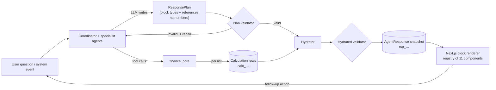

# 08 — Structured Generative UI Contracts

> Phase F. How agents choose interface components without generating code, how every number in those components is hydrated from real calculations, and how responses are stored and reloaded.
> Canonical decisions: [`00-DECISION-REGISTER.md`](00-DECISION-REGISTER.md) §7. Entities referenced (`Calculation`, `AgentResponse`, `EvidenceLink`…) are defined in [`07-DATA-MODEL.md`](07-DATA-MODEL.md).
> Example payloads: [`design/contracts/`](../design/contracts/) — all data is **fictional** (P1 Amara, GBP, files 01–05; P4 Aanya, INR, file 06).

---

## 1. The idea in one diagram



Three rules make this trustworthy:

1. **LLMs pick, the engine fills.** The LLM emits a `ResponsePlan`: which blocks, in which order, with references (`calc_…#path`, `fnd_…`, `rec_…`, a typed transaction query). It never emits a series, an amount or a percentage.
2. **The hydrator is deterministic.** Given the same plan and the same persisted calculations it produces byte-identical hydrated JSON.
3. **The client renders only known components.** No HTML, JS, CSS or arbitrary chart specs come from the model. The frontend has a fixed registry keyed by `type` + `schema_version`.

---

## 2. Source of truth and type generation

- **Pydantic v2 models** in `backend/app/ui_contracts/` are the source of truth (discriminated union on `type`).
- `make contracts` exports JSON Schema (`model_json_schema()`) → `frontend/src/ui-contracts/schema.json` → TypeScript types (`json-schema-to-typescript`) and Zod validators (`json-schema-to-zod`).
- CI fails if generated files are out of date (`git diff --exit-code` after regeneration).
- The **plan schema** (LLM-facing) is a separate, smaller set of Pydantic models; its JSON Schema is passed to the model as the structured-output / tool schema through Mesh (OpenAI-compatible `response_format: json_schema` where the selected model supports it; otherwise tool-call arguments; otherwise JSON mode + validation).

---

## 3. Shared primitives

### 3.1 References

```text
Ref           := CalcRef | EntityRef
CalcRef       := "calc_<ULID>#<json-pointer-ish path>"   e.g. "calc_01JA9H…#result.min_balance.p50_minor"
EntityRef     := "<prefix>_<ULID>"                        prefixes: fnd_ fc_ scn_ sim_ rec_ ver_ goal_ rob_ txn_ run_ imp_ acct_ bal_ inc_ dob_ cpty_ fmt_ lay_ rcn_
ULID          := [0-9A-HJKMNP-TV-Z]{26}
```

Path grammar: dot-separated keys and integer indices (`result.month_end.2.p50`). Paths are resolved against the stored `Calculation.result` (plus `params`, `as_of`), never against free text.

### 3.2 Value types (hydrated)

```jsonc
// Money — always ISO 4217 minor units + currency + server-formatted display string (locale from the workspace; §3.2b)
{ "kind": "money", "minor": 128450, "currency": "GBP", "display": "£1,284.50", "precision": "exact" }
{ "kind": "money", "minor": 24200,  "currency": "GBP", "display": "£242", "precision": "rounded" }
{ "kind": "money", "minor": 11500000, "currency": "INR", "display": "₹1,15,000.00", "precision": "exact" }   // en-IN lakh grouping
{ "kind": "money", "minor": 286400, "currency": "JPY", "display": "¥286,400", "precision": "exact" }         // exponent 0
// Percent / probability (stored 0–1, displayed rounded)
{ "kind": "percent", "value": 0.78, "display": "78%" }
// Percent change (signed)
{ "kind": "pct_change", "value": 0.41, "display": "+41%" }
// Percentage-point change between two probabilities
{ "kind": "pp_change", "value": 0.83, "display": "+83 pts" }
{ "kind": "count", "value": 23, "display": "23" }
{ "kind": "date", "value": "2026-10-29", "display": "29 Oct" }
{ "kind": "days", "value": 18, "display": "18 days" }
```

**Precision signals certainty** (hydrator rule, not LLM choice): observed and declared amounts (transactions, sums of transactions, balances, subscription prices, intervention savings computed from observed run-rates) display **exact minor units** (`£286.40`, `₹14,860.00`); forecast, simulation and goal-projection quantiles display **whole major units** (`£242`, `₹47,850`) because they are uncertain. `precision: "exact" | "rounded"` tells the client which was applied.

Every hydrated value additionally carries `"ref": "calc_…#path"` so the client can open the Evidence drawer for exactly that number.

### 3.2a Scope and provenance (hydrated)

```jsonc
// Forecast scope (00 §6a, 07 §6.10) — present on every forecast-derived block
{ "kind": "mine" | "household" | "account", "label": "Mine" | "Household" | "Monzo Current ••4417",
  "account_ids": ["acct_…"], "switchable": true }   // switchable=false for one tracked account; Household option only with joint data

// Provenance badge — on Evidence items and on any value derived from user-supplied facts
"provenance": "observed" | "detected" | "confirmed" | "declared" | "user_set" | "default"
```

For single-account workspaces the hydrator emits `kind=mine`, the actual account label (P1: Monzo Current ••4417; P4: Saffron Ledger Bank Savings ••7731), and `switchable=false` and the renderer shows no scope selector.

`declared` (user-entered because not observable — e.g. P1's balance, because Monzo CSV exports carry no balance column — e.g. income landing in an untracked account, obligations paid from an untracked account) is always rendered as a visible **"declared"** badge; `default` (e.g. suggested buffer) as **"default"**. A value whose calculation depends on any declared input inherits `"depends_on_declared": true`.

### 3.2b Money formatting contract (any currency)

The **server** formats every money value; the client never re-formats `minor` (it may only compact axis ticks with the same rules).

```text
format_money(minor: int, currency: ISO4217, locale: BCP47, precision: exact|rounded) -> display
  exponent  = ISO4217[currency].exponent          // GBP 2, INR 2, EUR 2, JPY 0, KWD 3
  major     = minor / 10^exponent                  // exact Decimal arithmetic, never float
  exact     → exactly `exponent` decimals ("£286.40", "₹14,860.00", "¥286,400")
  rounded   → whole major units (half-up), no decimals ("£242", "₹47,850")
  grouping  → from locale: en-GB thousands (1,234,567); en-IN lakh/crore (12,34,567); de-DE "." groups + "," decimal
  symbol    → locale placement: "£1,284.50", "₹1,15,000.00", "1.234,56 €" (de-DE), "¥286,400"
  negative  → U+2212 minus before the symbol: "−£122", "−₹4,500"
```

Implemented with Babel (CLDR) on the server; locale comes from `Workspace.locale` (`en-GB`, `en-IN`). Axis ticks may be compacted per locale (`£1.2k`; `₹1.15L`, `₹2.4Cr` for `en-IN`). Zero-exponent currencies never show a decimal part. Snapshot tests cover GBP, INR, EUR, JPY and KWD.

### 3.3 Tone and status tokens

`tone ∈ {neutral, positive, negative, caution, accent, simulated}` maps 1:1 to the colour tokens in `00` §9. `tone` is **computed by the hydrator** from rules (e.g. below buffer → `negative`), never chosen by the LLM.

### 3.4 Follow-up actions

```text
FollowUpAction {
  action_id: str                       // stable within response, e.g. "fu_1"
  label: str (≤ 48 chars)              // "Simulate a £180 cap" — digits only via {{ }} placeholders in the plan
  kind: "ask" | "simulate" | "open_lab" | "open_evidence" | "filter_transactions"
        | "accept_recommendation" | "dismiss_recommendation" | "adjust_scenario"
        | "set_buffer" | "mark_unused" | "switch_scope"
  payload: (typed per kind, see below)
  requires_confirmation: bool           // true for accept/dismiss/mark_unused/set_buffer (state-changing)
}
ask                     → { "question": str, "context_refs": Ref[] }
simulate                → { "scenario_spec": ScenarioSpec }           // validated server-side before run
open_lab                → { "scenario_id"?: scn, "prefill_spec"?: ScenarioSpec }
open_evidence           → { "ref": Ref }
filter_transactions     → { "txn_query": TxnQuery }
accept_/dismiss_recommendation → { "recommendation_id": rec }
adjust_scenario         → { "scenario_id": scn, "modifier_index": int, "field": str, "min": num, "max": num, "step": num }
set_buffer              → { "suggested_minor": int }
mark_unused             → { "recurring_obligation_id": rob }
switch_scope            → { "scope": "mine" | "household" | "account", "account_id"?: acct }   // re-hydrates from that scope's current forecast; no LLM re-run; missing scope forecast is explicitly built deterministically
```

Follow-up *labels* may be LLM-written in the plan (≤ 48 chars, no digits except via `{{ }}` placeholders — §6), payloads are validated like any input. A follow-up is never executed automatically; it is a button.

**Chart interactions** produce context, not code: clicking a point on `CashFlowForecastChart` or a bar on `SpendingBreakdownChart` attaches a `selection` `{block_id, kind: "date"|"category"|"range", value}` to the composer. The next question is sent with `context_refs` (the block's refs) and the selection, so "why does it drop here?" is answerable from data.

### 3.5 TxnQuery (typed, executed by the server)

```text
TxnQuery {
  date_from?: date, date_to?: date,        // default last 30 days
  category_keys?: str[], counterparties?: str[], recurring_obligation_ids?: rob[],
  direction?: "in" | "out", min_minor?: int, max_minor?: int,
  hour_from?: 0–23,                         // only honoured when the import supplied times (Monzo exports include `Time`; most statements and PDFs are date-only)
  include_transfers: bool = false,
  sort: "date_desc" | "amount_desc" = "date_desc",
  limit: 1–50 = 20
}
```

Executing a query creates a `Calculation(kind=aggregate)` with the matched IDs, count and total, so table totals are receipts too.

---

## 4. The response envelope

### 4.1 Plan (LLM output) — `response_plan/1`

```text
ResponsePlan {
  schema: "response_plan/1"
  intent: "spending_question" | "affordability" | "scenario" | "risk_review" | "goal_check"
          | "transaction_lookup" | "recommendation_review" | "explain_number" | "smalltalk_or_unsupported"
  blocks: BlockPlan[1..8]
  follow_ups: FollowUpPlan[0..4]
}
```

Routing intents in `06` §4.0 map deterministically to this presentation enum:

| Routing intent | ResponsePlan intent |
|---|---|
| spending_breakdown, trend_or_change, subscription_review | spending_question |
| transaction_lookup | transaction_lookup |
| affordability | affordability |
| scenario | scenario |
| goal_status | goal_check |
| risk_check, advice_request | risk_review |
| explain_recommendation | recommendation_review (or explain_number for a calculation-specific follow-up) |
| smalltalk_or_out_of_scope | smalltalk_or_unsupported |

The Coordinator does not invent a second routing taxonomy when composing blocks. Clarifications use Narrative plus typed `ask` follow-ups, not an unregistered ClarifyingQuestion component.

### 4.2 Hydrated response — `agent_response/1`

```text
AgentResponse {
  schema_version: "agent_response/1"
  response_id: rsp_…, run_id: run_…, thread_id?: str
  surface: "ask" | "briefing" | "lab" | "digest"
  question?: str
  created_at: datetime (UTC)
  as_of: date                       // financial "today" used
  workspace_id: wsp_…
  currency: str(3)                  // response money currency (workspace home currency unless a block declares its own)
  locale: str                       // BCP 47 from the workspace (en-GB, en-IN)
  data_version: int                 // workspace.data_version at hydration
  prefs_version: int                // workspace.prefs_version at hydration
  forecast_id?: fc_…
  engine_version: str
  status: "complete" | "degraded"   // degraded = ≥1 block replaced by fallback (§9)
  blocks: Block[1..10]
  follow_ups: FollowUpAction[0..4]
  verification?: { recommendations: [{ recommendation_id, verdict, revisions }] }
  provenance: { calc_ids: calc_[], finding_ids: fnd_[], recommendation_ids: rec_[] }   // union of all refs
}
```

Computed on read (not stored): `stale: bool = data_version != workspace.data_version or prefs_version != workspace.prefs_version or engine_version != current_engine_version or as_of != workspace_local_today`.

### 4.3 Common block fields

```text
BlockBase {
  block_id: str              // "b1", "b2" … (unique within response)
  type: <discriminator>
  title?: str (≤ 80)         // e.g. "Your balance to payday"
  caption?: str (≤ 200)      // narrative with placeholders allowed
  currency?: str(3)          // † set by the hydrator on every block that contains money; exactly one currency per block
  evidence: Ref[]            // refs the block was hydrated from (≥1 except Narrative-without-placeholders)
  actions: FollowUpAction[0..3]
}
```

---

## 5. Component contracts

Each component lists: **purpose**, **plan fields** (what the LLM may say), **hydrated fields** (what the client receives), **constraints**. Hydrated fields marked † are filled by the server only.

### 5.0 `Narrative`

| | |
|---|---|
| Purpose | Prose explanation; the only free text block. |
| Plan | `text` (≤ 900 chars, Markdown-lite: `**bold**`, lists, line breaks), with value placeholders `{{calc_…#path\|format}}`, entity mentions `{{fnd_…}}` / `{{rec_…}}` / `{{ver_…}}` rendered as inline evidence chips. |
| Hydrated | `segments[]`: `{kind:"text", text}` \| `{kind:"value", value: <Value>}` \| `{kind:"entity", ref, label}` † |
| Constraints | **No financial numerals outside placeholders**. Dates such as `30 Oct` must resolve to a cited date; counts ≤10 may be spelled in words but still need evidence when a financial claim depends on them. The validator rejects monetary/percentage literals (patterns `[£$€₹]\s?\d` and `\d+(\.\d+)?\s?%`) and checks all remaining numeric claims against evidence; it does not allow unsupported one- or two-digit amounts. |

### 5.1 `FinancialMetricGroup`

| | |
|---|---|
| Purpose | 2–4 headline figures with optional comparison. |
| Plan | `metrics[]`: `{label, value_ref: CalcRef, format: money\|percent\|pct_change\|count\|date\|days, compare_ref?: CalcRef, compare_label?}` |
| Hydrated | `metrics[]`: `{label, value: Value, compare?: {label, value: Value, delta: Value}†, tone†, emphasis: "primary"\|"secondary"†}` (first metric primary) |
| Constraints | 2 ≤ metrics ≤ 4; refs must resolve to a scalar of a type compatible with `format`. |

### 5.2 `SpendingBreakdownChart`

| | |
|---|---|
| Purpose | Where money went: by category, over time, or a category vs its baseline. |
| Plan | `mode: "by_category" \| "over_time" \| "vs_baseline"`, `source_ref?: CalcRef` *or* `query: {group_by: "category"\|"week"\|"month"\|"counterparty", period: {from, to}, category_keys?, compare_to?: "median_3m"\|"previous_period"}`, `highlight_keys?: str[]` |
| Hydrated | `mode`, `period: {from, to}`, `currency: ISO4217`, `series[]: {key, label, nature: essential\|commitment\|discretionary\|debt\|savings\|tax, value: Money, baseline?: Money, share?: Percent, tone†}` (commitments such as family support abroad are drawn as their own band, never mixed into discretionary) (by_category/vs_baseline) or `x: str[]` (bucket labels/date ranges), `series[]: {key, label, values: int[]}`, `baseline?: Money` (over_time, drawn as a reference rule), `total: Money`, `highlight_keys` |
| Constraints | ≤ 8 categories (rest → "Other"); `over_time` ≤ 26 buckets; a `query` is executed into a `Calculation(kind=aggregate)` whose id becomes `source_ref`. |

### 5.3 `CashFlowForecastChart`

| | |
|---|---|
| Purpose | Past balance + future fan with buffer and events. The signature chart. |
| Plan | `forecast_ref: fc_…`, `history_days: 0..90 (default 30)`, `horizon_days?: ≤ forecast horizon`, `annotate: (rob_… \| scn_…)[] ≤ 6`, `highlight_window?: {from, to}` |
| Hydrated | `as_of`, `scope` (§3.2a), `balance_mode`, `resolution: "daily"\|"weekly"\|"sampled"`, `history: {dates, balance_minor[]}`, `forecast: {dates, p10[], p50[], p90[]}`, `buffer_minor?`, `events[]: {date, label, amount: Money, kind: "income"\|"obligation"\|"commitment"\|"one_off"\|"scenario"}`, `pay_cycles[]: {payday: date, low: Money (rounded), low_date: date, below_buffer: bool}` (salaried users; drives the "pre-salary low" markers), `summary: {min_balance: Value, min_date: Value, p_breach_buffer?: Value, breach_window_end?: date, starting_balance: Money + provenance}`, `highlight_window?` |
| Constraints | `scope` is taken from the referenced Forecast (never chosen independently by the LLM); ≤ 200 points per series (server downsamples with min/max preservation); relative mode or missing same-currency scope buffer ⇒ `buffer_minor` null and `p_breach_buffer` omitted; data grammar from `00` §9 is enforced by the renderer, not configurable. |

### 5.4 `ScenarioComparison`

| | |
|---|---|
| Purpose | Baseline vs 1–3 simulated futures, with assumptions and verdict. |
| Plan | `baseline_ref: fc_…`, `simulation_refs: sim_…[1..3]`, `emphasis_metric: "min_balance"\|"p_breach_buffer"\|"goal_progress"\|"month_end"` |
| Hydrated | `scope` (§3.2a), `baseline: {label, series: {dates, p50[]}}`, `scenarios[]: {simulation_id, scenario_id, label, series: {dates, p50[], p10[], p90[]}, modifiers_summary: str[]†}`, `comparison_rows[]: {metric_label, baseline: Value, scenarios: Value[], delta: Value[], tone[]}`, `verdict: {kind: "comfortable"\|"tight"\|"breaches_buffer"\|"goes_negative", text†}`, `assumptions[]: {label, value, source}` |
| Constraints | All simulations must share `base_forecast_id = baseline_ref`, seed **and scope** (else hydration error: comparison would be misleading). `verdict` is a deterministic rule over **every pay cycle in the horizon**, not just the nearest: goes_negative if any cycle's P50 low < 0; breaches_buffer if any cycle's P50 low < buffer (the verdict text names the cycle — e.g. affordable in December but the January low falls under the buffer); tight if any P10 low < buffer; else comfortable. Relative mode or a missing same-currency buffer omits the affordability verdict and shows that the balance/buffer is needed before affordability can be assessed. |

### 5.5 `TransactionTable`

| | |
|---|---|
| Purpose | Show the actual rows behind a claim. |
| Plan | `query: TxnQuery`, `columns?: subset of ["date","narration","counterparty","category","amount","payment_type","source"]` |
| Hydrated | `columns`, `rows[]: {txn_id, date, narration_display, counterparty, category: {key,label}, amount: Money (exact), payment_type, source: {import_id, row_number, page?}?}`, `total: Money`, `count: Count`, `has_more: bool`, `query` (echo, for "show all" → Ledger filter) |
| Constraints | `narration_display` is the redacted narration (no account numbers, sort codes, card numbers, phone numbers or emails); `limit` ≤ 50. |

### 5.6 `RiskAssessment`

| | |
|---|---|
| Purpose | "What could go wrong, how likely, by when." |
| Plan | `risks[]: {finding_ref?: fnd_…, metric_ref?: CalcRef}` (1–4) |
| Hydrated | `risks[]: {risk_id, level: "low"\|"watch"\|"high"†, headline (from Finding, placeholders hydrated)†, probability?: Value, window?: {from, to}, impact?: Money, drivers[]: {label, impact: Money, ref}, status: open\|acknowledged}` |
| Constraints | `level` derived: high if probability ≥ 0.6 or finding severity `act`; watch if ≥ 0.3 or `watch`; else low. |

### 5.7 `InterventionCard`

| | |
|---|---|
| Purpose | One verified recommendation with impact and controls. |
| Plan | `recommendation_ref: rec_…` (that's all — content comes from the persisted RecommendationVersion) |
| Hydrated | `recommendation_id`, `version_id`, `title`, `rationale_segments` (Narrative segments), `actions[]: {type, label, detail}`, `impact: {monthly_saving: Money (exact; vs last-30-day run-rate — labelled "at your current rate"), p_breach_before: Percent, p_breach_after: Percent, p_breach_window: {from, to}, low_deltas?: [{cycle_label, before: Money, after: Money}], goal_delta?: Money}`, `verification: {verdict: "approved", revisions: int, checks_passed: int, checks_total: int, verification_id}`, `triggered_by: Ref[]`, `status` |
| Constraints | **Only versions with a persisted APPROVE verdict can be rendered as InterventionCard**, including approved/shown/accepted and outcome states; drafting/withdrawn versions and expired unaccepted advice are excluded. Rejected/withdrawn versions are visible only via `AgentExecutionTimeline` / `EvidencePanel`. Default actions: Accept (confirm), Simulate in Lab, Not for me. |

### 5.8 `GoalProjection`

| | |
|---|---|
| Purpose | Will I hit my goal, and what changes would help? |
| Plan | `goal_ref: goal_…`, `projection_ref: CalcRef` (kind goal_projection), `scenario_projection_refs?: CalcRef[] ≤ 2` |
| Hydrated | `scope` (§3.2a), `goal: {goal_id, name, target: Money, target_date: Value, funding_rule}`, `progress_now: Money`, `projection: {p10, p50, p90: Money, p_achieve: Percent, status_band}`, `trajectory: {dates, p10[], p50[], p90[]}`, `scenarios[]: {label, p50: Money, p_achieve: Percent, status_band}`, `required_monthly_change?: Money` |

### 5.9 `EvidencePanel`

| | |
|---|---|
| Purpose | The receipts: what calculations and data support this answer. Inline in responses and the same contract powers the global Evidence drawer. |
| Plan | `refs: Ref[1..8]` |
| Hydrated | `items[]`: one per ref, `{ref, kind: "calculation"\|"finding"\|"recommendation"\|"forecast"\|"transactions"\|"verification"\|"income_stream"\|"declared_obligation"\|"balance_anchor"\|"reconciliation"\|"format_profile"\|"layout_profile"\|"account_coverage", title, provenance: observed\|detected\|confirmed\|declared\|user_set\|default, summary_lines: str[]†, scope?, engine_version?, inputs?: {transaction_count?, date_range?, params?}, source_chain?: {import_id, filename, importer: "csv_statement"\|"pdf_statement"\|"manual", source_type?: csv\|xlsx\|xls\|pdf, profile?: {kind: "format"\|"layout", id, name, source: builtin\|proposed\|user_confirmed}, rows: str, reconciliation?: {status, method}, format_inference?: {decimal_sep, group_sep, grouping: thousands\|lakh, date_order, date_format, source}}, checks?: VerificationCheck[], critique?: str, reproducible?: {seed?, inputs_hash, data_version}}` (`checks`/`critique` only on verification items) |
| Constraints | Every forecast/simulation item lists its **inputs by provenance** (e.g. "Starting balance: £1,284.50 · declared", "Salary: £2,940 on the 28th · confirmed", "Council tax: £162, Apr–Jan · detected") and **coverage** (tracked vs untracked accounts in scope), so declared inputs are never hidden. Every ref must resolve; this block is also auto-appended (collapsed) by the composer when a response contains an InterventionCard or ScenarioComparison and the plan forgot it. |

### 5.10 `AgentExecutionTimeline`

| | |
|---|---|
| Purpose | Show the agents working, including the Verifier loop. |
| Plan | `run_ref: run_…`, `detail: "summary"\|"full"` |
| Hydrated | `run_id`, `workflow`, `duration_ms`, `steps[]: {step_id, agent, node, label, status: ok\|rejected\|retried\|error, started_at, duration_ms, model?, tokens?, outputs: Ref[], note?}`, `loops[]: {kind: "verification", recommendation_id, attempts: [{version_id, verdict, failed_checks: str[]}]}`, `cost: {tokens, usd: number|null}` (usd null until Mesh pricing for the chosen model is known) |
| Constraints | Built entirely from `AgentStep` and `VerificationResult` rows — the LLM can only choose to include it. |

---

## 6. Validation pipeline

**Step 1 — plan validation** (Pydantic, then semantic):

| Rule | Failure handling |
|---|---|
| Schema-valid JSON for `response_plan/1` | 1 repair attempt with validator errors appended; then fallback |
| Every `Ref` matches the ULID regex and **exists for this workspace** | drop block |
| `CalcRef` kind is compatible with the block (table below) | drop block |
| Narrative numeral rule (§5.0) | 1 repair; then strip offending sentence and log `narrative.numeral_violation` |
| ≤ 8 blocks, ≤ 1 `CashFlowForecastChart` + ≤ 1 `ScenarioComparison` per response | truncate by plan order |
| `InterventionCard.recommendation_ref` must point to a version with APPROVE (eligible lifecycle states in §5.7) | drop block, log (this is a safety rule) |
| Follow-up payloads valid (e.g. ScenarioSpec validation from `07` §6.5) | drop follow-up |
| Joint-account scope: no text attributes household spending to a person (`no_person_attribution`: partner label / pronoun + spend verb) | 1 repair; then strip sentence |
| A value that depends on declared inputs must be rendered with its badge (hydrator sets `depends_on_declared`) | enforced by hydrator, not LLM |
| **One currency per block**: every money value in a chart, metric group, table, comparison or goal block has the block's `currency`; a ref resolving to a calc in another currency makes the block invalid (there is no FX conversion, `00` §6c) | drop block, log `currency_mix`; the plan may request one block per currency |
| Narrative: values in different currencies may appear in one sentence only if each carries its own symbol and no arithmetic/comparison word joins them | 1 repair; then strip sentence |

Compatibility:

| Block | Accepted ref kinds |
|---|---|
| FinancialMetricGroup | any calc with scalar at path |
| SpendingBreakdownChart | `aggregate`, `category_trend` |
| CashFlowForecastChart | `fc_` (→ `forecast` calc) |
| ScenarioComparison | `fc_` + `sim_` |
| GoalProjection | `goal_` + `goal_projection` calc |
| RiskAssessment | `fnd_`, `forecast`/`simulation` calc paths to probabilities |
| InterventionCard | `rec_` |
| EvidencePanel | any |
| AgentExecutionTimeline | `run_` |

**Step 2 — hydrated validation**: the hydrated object is validated against the `agent_response/1` schema before persistence (guards hydrator bugs). Failures are logged as `hydration_error` and the block is replaced by fallback.

**Step 3 — client**: Zod validation per block; an invalid block renders `BlockError` ("This view couldn't be displayed — the underlying numbers are still available") with an Evidence link, never a blank screen.

---

## 7. Chart and component selection rules

The Coordinator's composer prompt contains this table; the validator enforces the "must" column.

| Intent / situation | Must include | Usually add | Avoid |
|---|---|---|---|
| "How much did I spend on X?" (`spending_question`) | FinancialMetricGroup (total, vs baseline) | SpendingBreakdownChart `vs_baseline` or `over_time`; TransactionTable (top rows) | Forecast charts |
| "Where is my money going?" | SpendingBreakdownChart `by_category` | Narrative, FinancialMetricGroup | Tables > 20 rows |
| "Can I afford X?" (`affordability`) | ScenarioComparison + verdict | CashFlowForecastChart (highlight the dip), GoalProjection if a goal exists, EvidencePanel | Advice without simulation |
| "What if …?" (`scenario`) | ScenarioComparison | FinancialMetricGroup of deltas, follow-up `open_lab` | — |
| "Will I get through January?" / long pay gap | CashFlowForecastChart (with `pay_cycles`, highlight the gap) | RiskAssessment, ScenarioComparison of a smoothing change | — |
| "Am I OK this month?" / proactive risk (`risk_review`) | CashFlowForecastChart + RiskAssessment | InterventionCard (if approved rec exists), AgentExecutionTimeline (summary) | — |
| Goal questions (`goal_check`) | GoalProjection | ScenarioComparison of helpful changes, InterventionCard | — |
| "Show me / which transactions …" (`transaction_lookup`) | TransactionTable | FinancialMetricGroup (count, total) | Charts for < 5 rows |
| "Why did you recommend …?" (`recommendation_review`, `explain_number`) | EvidencePanel | AgentExecutionTimeline (`full`), TransactionTable | New recommendations |
| Unsupported / out of scope (investment picks, tax filing) | Narrative explaining limits | follow-ups to supported questions | Any numbers |

Chart-type principles (aligned with `04` visual grammar): time → line/fan; part-to-whole of ≤ 8 → horizontal bars sorted descending (no pies/donuts); a category vs its own baseline → bar with baseline tick; scenario differences → overlaid lines on shared axes plus a delta table. Uncertainty is always shown as a band with the words "likely range (P10–P90)".

---

## 8. Hydration from Calculation records

```text
hydrate(plan, workspace_ctx):
  for block_plan in plan.blocks:
      refs   = collect_refs(block_plan)
      rows   = repo.load_many(workspace_ctx, refs)           # scoped; missing → BlockDropped
      check_kind_compat(block_plan.type, rows)
      block  = BUILDERS[block_plan.type](block_plan, rows, workspace_ctx.locale)   # money via §3.2b
      block.tone/fields marked † computed by deterministic rules
      block.evidence = refs (+ transitive: forecast → its calc_id, rec → impact_calc_id, trigger findings)
  provenance = union(evidence)
  persist EvidenceLink(owner=rsp_…, ref) for each provenance item
```

- Value at path: `resolve(calc.result, "min_balance.p50_minor")` → `int` → `Money` formatted per §3.2b with the workspace locale (`en-GB`, `en-IN`), with display precision per the rule in §3.2 (exact currency minor units for observed/declared, whole major units for projections); exact currency minor units always kept in `minor`.
- Transaction queries execute *during hydration* and persist an `aggregate` Calculation, so the response remains reproducible even if later data changes.
- Placeholders in finding headlines and recommendation rationales are resolved the same way, so a Finding written last week still shows the numbers it was written with.

---

## 9. Fallbacks and degraded responses

| Failure | Behaviour | User sees |
|---|---|---|
| Plan JSON invalid after 1 repair | Deterministic template for the classified intent (e.g. affordability → ScenarioComparison + CashFlowForecastChart from the Forecaster's outputs, Narrative from fixed template) | Full answer, `status: degraded`, small "simplified view" note |
| Single block invalid / ref missing | Drop block; insert `Narrative` "I couldn't show the {block label}; the figures are in the evidence." | Rest of answer |
| Hydrator exception | Same as invalid block; error logged with `run_id` | Rest of answer |
| Mesh unavailable | Coordinator skips LLM composition entirely → template response; ingestion falls back to rules + memory categorisation with `needs_review` flags | Banner "AI explanations unavailable; numbers are unaffected" |
| Client-side Zod failure | `BlockError` component | Error tile with Evidence link |

Because numbers never depend on the LLM, every fallback still shows correct figures.

---

## 10. Snapshots, reload and staleness

- On completion, `AgentResponse(plan, hydrated, data_version, schema_version)` is persisted. **Opening a past thread, briefing or Lab result reads the hydrated snapshot — no agent or engine re-run.**
- `stale` is computed on read. Stale responses keep their numbers (they are true *as of* their date) and show a quiet "as of 12 Oct · data has changed" label with two actions: **Re-run with current data** (new run, new `rsp_`, linked via `supersedes`) and **Compare** (opens both).
- Briefing (`surface: briefing`) uses the same snapshot mechanism; the Home page performs one read.
- Digests render from the same hydrated JSON into Telegram Markdown/email HTML via server-side templates (subset of blocks: Narrative, FinancialMetricGroup, InterventionCard rendered as text + link).

## 11. Versioning

- `schema_version` on every response (`agent_response/1`) and plan (`response_plan/1`); components may add **optional** fields within a major version; removing/renaming fields bumps the major.
- The client registry maps `(type, major)` → renderer. Unknown `type` → `BlockError` "needs a newer app"; older majors keep a legacy renderer as long as snapshots of that major exist.
- The hydrator records `engine_version` so numeric changes from engine upgrades are explainable ("forecast engine 0.3 → 0.4").

## 12. Security notes

- No model-provided URLs, HTML, Markdown links or images are rendered; Markdown-lite allows bold, italics, lists only.
- All text is rendered as text nodes (React escaping); no `dangerouslySetInnerHTML`.
- Follow-up payloads are re-validated server-side when invoked; state-changing follow-ups require explicit confirmation and are audited (`AuditEvent`).

## 13. Example payloads

All in [`design/contracts/`](../design/contracts/), as of 12 Oct 2026. Files 01–05: fictional persona P1 (Amara Nwosu, one Monzo account, GBP). File 06: fictional persona P4 (Aanya Rao, one Indian savings account, INR, `en-IN`). Each file contains `plan` (what the LLM produced) and `response` (what the client receives), so the plan → hydration relationship is visible.

| File | Scenario | Blocks |
|---|---|---|
| `01-spending-question.json` | "Why is my food spending so high?" | Narrative, FinancialMetricGroup, SpendingBreakdownChart (`over_time`), TransactionTable, EvidencePanel |
| `02-trip-affordability.json` | "Can I afford £640 flights home for Christmas?" — fine in December, January low under buffer | Narrative, ScenarioComparison (baseline · flights · flights + verified change), CashFlowForecastChart, GoalProjection, EvidencePanel |
| `03-proactive-risk-alert.json` | Briefing: buffer risk before payday + verified intervention | Narrative, CashFlowForecastChart, RiskAssessment, InterventionCard, AgentExecutionTimeline |
| `04-goal-projection.json` | "Am I on track for my emergency fund?" | Narrative, GoalProjection, FinancialMetricGroup |
| `05-verification-loop-timeline.json` | "Why did you recommend this?" — rejected-then-revised trail | Narrative, AgentExecutionTimeline (`full`), EvidencePanel |
| `06-india-spending-question.json` | P4: "Why is my food delivery so high?" — INR, lakh grouping, UPI narrations, equivalent XLSX variant via a proposed format profile (primary generated export: XLS) | Narrative, FinancialMetricGroup, SpendingBreakdownChart, TransactionTable, EvidencePanel |

Figures in the examples are the **design fixtures** from `00` §10a (P1) and `07` §10a (P4), not engine results. Series are `resolution: "sampled"` (a handful of points) to keep files readable; real responses carry daily points (≤ 200).
