# 10 — Implementation Roadmap

> Phase I. From the end of design (12 Oct 2026) to submission (**20 Oct 2026, 23:00 IST**; our target is 18:00 IST).
> Canonical decisions: `00-DECISION-REGISTER.md` (**rev 5**: owner decisions — one builder, staged release behind feature flags, non-blocking real-data check, continuous deployment). Evaluation: `09`.
> **Full scope stays the target, delivered as a staged release.** Every feature sits behind a flag in `features.yaml` and is switched on in the deployed app, and claimed in the README, **only when its eval suite is green**. Anything unfinished is listed under **"Not shipped (planned)"** in the generated README and never shown half-built. The only exclusions are Open Banking and scanned/image (OCR) PDFs (§10).
> **Ordering principle:** one stream, in score order. Stages 0–3 hold everything the judging criteria and mandatory requirements need; Stage 4 holds Tier 2 items, each attempted only if the previous one is green. The app is deployed from day one and grows feature by feature.
---

## 1. Calendar at a glance

| Date (IST) | Stage | Theme | Exit gate (details §7) |
|---|---|---|---|
| Mon 12 Oct | **Stage 0** Foundations + live pipeline | Register (closes **17 Oct 23:00**), repo public, organiser CI + secrets green, Mesh catalogue + fallback model per agent, holdout annotator named, feature flags, **deployment pipeline live** (API host + Next.js host, auto-deploy on green CI, demo workspaces only, flags off) | Organiser critical checks green on `main`; deployed URL live |
| Tue 13 – Wed 14 Oct | **Stage 1** Deterministic single-account spine | `csv_statement` + table locator + built-in Monzo FormatProfile + generic mapper, flow classification, income/recurring, `uk` LocalePack + any-currency core, forecast + simulation, generator P1, first committed eval numbers (categorisation, forecast vs baselines), thin engine-only API **deployed** | `make eval` commits real P1 numbers with no LLM; API-00 live |
| Thu 15 – Fri 16 Oct | **Stage 2** Agents + core loop + AI Workspace | LangGraph Coordinator + 5 agents via Mesh, Advisor⇄Verifier loop with mandatory claimed impact, audit chain, cassettes committed, E-ORC/E-VER/E-GRD, AI Workspace **deployed** | **`submittable-1` tagged by Fri 16 Oct 23:00** |
| Sat 17 – Sun 18 Oct | **Stage 3** Experiences, proactive, goals | Landing, onboarding, Home, Decision Lab, Transactions, Activity, `/quality`, Evidence drawer; scheduler + Telegram digest; adaptive goals; live eval committed; each surface **deployed** when green | `submittable-N` moves forward daily |
| Any time before the freeze, only after Stage 3 | **Stage 4** Tier 2, flag-gated, in order | (a) multi-account/joint (P3) → (b) generic `pdf_statement` + private real-data run → (c) India `in` pack + P4 + external India set → (d) extra currency variants beyond G1-eur → (e) polish | Each item's flag turns on only when its suites are green |
| **Mon 19 Oct 12:00** | **Feature freeze** | After this: bugs, final eval, generated README, video | — |
| **Mon 19 Oct 18:00** | **Code freeze** | After this: no code changes except release blockers; time-boxed private real-data run (PRV-04a, PRV-04b if Stage 4(b) shipped, PRV-05, PRV-06) results are final; final eval + README generation run on the frozen SHA | — |
| Mon 19 – Tue 20 Oct | **Stage 5** Hardening + submission | Final live eval, bug bash, generated README, docs refresh, video, submit | Submitted by **20 Oct 18:00 IST** (5 h buffer) |

> **Legacy milestone names.** Earlier revisions used M0–M6. Mapping: M0 → Stage 0; M1 → Stage 1; M2 → Stage 1 (engine, data layer, generality G1/G3/G5) and Stage 4(a) (multi-account layer); M3 → Stage 2; M4 → Stage 2 (Ask, shell, renderers) and Stage 3 (other experiences); M5 → Stage 3 (proactive, goals, live eval) and Stage 4(b)/(c); M6 → Stage 5. Any remaining "M*n*" reference in other docs resolves through this table.

---

## 2. Capacity: one builder

**Team: one person (the owner) with AI coding assistance.** There are no parallel workstreams; everything runs as a single stream in the order of §5. The holdout annotator (PLT-10) is a different person, and their labelling hours (EVL-03, EVL-18) are not counted below.

| | Hours |
|---|---|
| **Available**: 12 Oct → 20 Oct 18:00 IST, ≈ 8.5 days × ~10 productive h | **≈ 85–100 h** |
| Stages 0–3 + Stage 5 (everything mandatory or judged) | **≈ 283 h** (S0 19.25 · S1 80.5 · S2 96 · S3 66 · S5 21.5) |
| Stage 4 (Tier 2: a 20 · b 26 · c 16.5 · d 1 · e 6) | **≈ 70 h** |
| **Full target** | **≈ 353 h** |

**The gap, stated plainly:** at ideal-hour estimates, the mandatory stages alone are **≈ 2.8–3.3× the available time**, and the full target ≈ 3.5–4.2×. AI assistance will shorten some tasks, but this plan does not assume it closes the gap. What follows from that:

1. **Stage dates are targets, not promises.** The order is fixed; the dates are where we expect to be if estimates prove pessimistic.
2. **Only finished, measured work ships.** Flags plus the `submittable-N` tag guarantee that whatever is live and submitted at any moment is complete and evaluated.
3. **Stage 4 is realistic only if Stages 1–3 run well ahead of estimate.** It remains the target and is attempted strictly in order.
4. **Within each stage, tasks are listed in score order**, so a stage that runs out of time loses its least valuable tasks first, and those land under "Not shipped (planned)".
5. **Daily check (R14):** if Stage 1 is not green by Wed 14 Oct 18:00 IST, the owner re-plans that evening. Nothing is dropped silently.

---

## 3. Build-order graph

```mermaid
flowchart LR
  S0[Stage 0 · 12 Oct<br/>register · public repo · CI + secrets<br/>Mesh + fallbacks · flags · deploy pipeline] --> S1
  S1[Stage 1 · 13–14 Oct<br/>csv_statement + Monzo profile + mapper<br/>CSV reconciliation · uk pack + any-currency · income/recurring<br/>forecast + simulate · P1 evals · API-00 deployed] --> S2
  S2[Stage 2 · 15–16 Oct<br/>Coordinator + 5 agents via Mesh<br/>Advisor⇄Verifier loop · audit · cassettes<br/>AI Workspace deployed] --> SUB1{{submittable-1<br/>Fri 16 Oct 23:00}}
  SUB1 --> S3[Stage 3 · 17–18 Oct<br/>Onboarding · Home · Lab · Transactions · Evidence<br/>scheduler + Telegram digest · goals · live eval]
  S3 --> SUBN{{submittable-N<br/>daily}}
  S3 --> S4a[4a multi-account / joint] --> S4b[4b pdf_statement + private run] --> S4c[4c India pack + P4 + external set] --> S4d[4d currency variants] --> S4e[4e polish]
  SUBN --> FZ[Feature freeze<br/>19 Oct 12:00]
  S4e -.only if green before freeze.-> FZ
  FZ --> S5[Stage 5 · 19–20 Oct<br/>final eval · generated README · video · submit]
```



Task-level dependencies are in the **Depends** column of §5; every task belongs to exactly one stage.

---

## 4. Critical path (single stream)

```
PLT-01 register → PLT-02 repo → PLT-03 organiser CI → PLT-04 mesh_client → PLT-12 flags → PLT-11 deploy pipeline →
EVL-01 generator P1 → ING-01 csv_statement → ING-01b FormatProfile + Monzo → LOC-01 any-currency + uk pack →
ING-02 rules → ENG-08 income + ENG-01 recurring → ING-04 anchors → ING-15 CSV reconciliation → ENG-02 forecast → ENG-03 simulate →
EVL-05 backtest + baselines → ENG-07 calc store → ING-05 persistence → API-00 thin API (deployed) →
ENG-04 detectors + ENG-05 full ScenarioSpec → AGT-01 graph → AGT-04/05 → AGT-06 Advisor → AGT-07 Verifier loop →
AGT-09/11 cassettes → EVL-08 LLM suites → AGT-10 composer → API-02 → WEB-01..03 → WEB-06 AI Workspace (deployed) → submittable-1 →
WEB-04 onboarding → WEB-05 Home → PRO-01 scheduler → PRO-03 digest → WEB-07 Lab → … → feature freeze →
EVL-14 final eval → DOC-01 generated README → DOC-03 video → DOC-04 submit
```

- **Nothing in Stage 4 is on the submission path.** DOC-01 and DOC-04 depend on EVL-14 and the generated README only; the real-data check (PRV-06) is time-boxed and non-blocking (its privacy scan is always blocking).
- **Deploy every stage.** Each stage ends with its flags switched on in the deployed app once its suites are green; the deployed URL is in the README from Stage 0.
- **Submittable checkpoint:** from Fri 16 Oct 23:00 a `submittable-N` git tag marks a commit that could be submitted as is (§7 SUB); it moves forward only when CI and evals stay green.

---

## 5. Engineering task list (one stream, in build order)

> **UI build plan.** The frontend is built from `.design/foresight/TASKS.md` (generated from `DESIGN_BRIEF.md`, `INFORMATION_ARCHITECTURE.md` and `design/tokens/tokens.css`; visual reference `design/hifi/`, "Atelier light"). The WEB-* IDs below are kept stable; each row names the TASKS.md items it covers. Routes: `/`, `/start`, `/home`, `/workspace`, `/lab`, `/transactions`, `/activity`, `/insights/[id]`, `/settings`, `/quality`.

Estimates are ideal owner-hours with AI coding assistance. `EVL-03` and `EVL-18` are **annotator** hours (a different person, named in PLT-10) and are not counted against the owner's capacity. Task IDs are stable from rev 4.x; only their stage changed.

### Stage 0 — Foundations and live pipeline (Mon 12 Oct)

Everything that makes later work submittable and visible: registration, public repo, organiser CI, Mesh, flags, and the deployed URL (empty but live).

| ID | Task | Est (h) | Depends | Acceptance criteria |
|---|---|---|---|---|
| PLT-01 | Register the team; record `SUBMISSION_TOKEN`; obtain the Mesh key | 0.5 | — | Registration confirmed; both secrets set in GitHub Actions |
| PLT-02 | Repo skeleton (00 §11). **First read the downloaded organiser workflow** and pin `requires-python` to the interpreter its compile step uses (avoid 3.12-only syntax until confirmed). Root `requirements.txt` lists `fastapi` and `openai` **directly** (no `-e .` / `-r` indirection); extras go in `requirements-dev.txt`. `.gitignore`: `.env`, `private/`, `node_modules/`, `.next/`, and the canonical statement-file rule (09 §17.1). `.env.example`; Makefile | 2 | — | Clean clone → `pip install -r requirements.txt` + `make test` succeed; every `.py` in the repo (incl. `evals/`, `tools/`) compiles under the organiser's interpreter |
| PLT-03 | Add the organiser workflow `.github/workflows/agent-arena-2026-checks.yml` unmodified | 0.5 | PLT-01, 02 | Critical + advisory checks green on `main` |
| PLT-03b | **Get the organiser check recorded.** The organiser workflow ran on 12 Oct: 4/4 critical and 3/3 advisory checks passed, but results are only recorded once submissions open (**15 Oct 2026 03:30 UTC / 09:00 IST**). Push to `main` after that time and confirm the dashboard shows the recorded result; repeat after the final submission push | 0.25 | PLT-03 | Dashboard shows a recorded passing run on or after 15 Oct |
| PLT-08 | **Make the repo public** and confirm the organiser checks see it; README stub in place | 0.25 | PLT-03 | Repo visible logged-out; CI green on the public repo |
| PLT-04 | `backend/mesh/mesh_client.py`, the **sole** LLM gateway (base URL `https://api.meshapi.ai/v1`, `MESH_API_KEY`, timeouts, retries ≤ 2, usage capture, structured output); read the Mesh model catalogue and record model IDs in 00 §12.1 | 3 | PLT-02 | Live smoke call returns usage; a grep test proves no other module imports `openai`; the import-linter forbidden contract (05 §3.1) and the `LANGSMITH_TRACING`-off test pass |
| PLT-09 | **Mesh capacity**: check credits, rate limits and latency for the chosen models; pick **one fallback model per agent tier** and record both in 00 §12.1; budget alarm | 1 | PLT-04 | Fallback IDs recorded; a forced primary failure falls back in a smoke test |
| PLT-12 | **Feature flags** in one `features.yaml` (one flag per feature/stage item, each linked to the eval suite(s) that must be green): the API, the UI and the README generator all read it; a flag can only be switched on in the deployed app if its linked suites are green in `latest.json` (CI check); anything off is listed under **"Not shipped (planned)"** in the generated README and hidden in the UI (never shown half-built) | 2 | PLT-02 | CI fails if a flag is on while its suite is red or missing; the README section is generated, not typed |
| PLT-11 | **Deployment pipeline live from day one (owner's VPS, 05 §12)**: Dockerfiles for `backend` and `frontend` (Next.js standalone, `/api/*` rewrite to the backend); production compose project `foresight` (frontend on the Caddy network; backend + `postgres:16` on a private app network, named volume, no host ports; `restart: unless-stopped`, `no-new-privileges`, log rotation, Watchtower scope `foresight-staging`); `publish.yml` builds and pushes `foresight-backend` / `foresight-frontend` to GHCR with `sha-<commit>` + `main` tags **only on `workflow_run` success of CI on `main`** (PRs build without pushing); backend boot runs `alembic upgrade head` and seeds demo workspaces (DEMO-01); secrets only in the server-side `.env` (`.env.example` committed); **no real data ever deployed**; all feature flags default off; deployed URL added to the README immediately | 3 | PLT-03, PLT-06, PLT-12, PLT-13 | A green merge to `main` publishes images and Watchtower updates the live URL within 15 min; `/healthz` shows the new SHA; the URL loads with every flag off and shows the 'Not shipped yet' state; `docker ps` on the server shows no published app ports |
| PLT-13 | **Onboard Foresight onto the owner's VPS platform** — a separate PR in the owner's private infra repository, following its new-project onboarding steps: GHCR image names and pull access, `.env` example and server-side secrets, Caddy route for `foresight.olaheavy.dev` (DNS via Cloudflare), compose file under the platform's app directory, Watchtower scope `foresight-staging`, smoke tests, app-registry entry, wiki update. No infrastructure details are copied into this public repo | 2 | PLT-01 | Public URL returns 200 over TLS; the infra PR is merged; smoke tests pass; app appears in the platform's app registry |
| PLT-05 | Pre-commit: ruff, mypy (strict for `finance_core`), `tools/check_no_private_data.py` (UK sort codes, account/card numbers, NI numbers, private deny-list) | 1.5 | PLT-02 | Planted fake sort code + account number is blocked |
| PLT-10 | **Name the holdout annotator(s)**: someone who will not write the rules labels the UK holdout (and, if India stays, the India `constructed` holdout and the external sample). If no such person exists, record that and describe the holdout's provenance honestly in 09 and the README | 0.25 | — | Annotator(s) named in 00 §13, or the provenance note committed |
| DOC-05 | Check the organiser's **resubmission policy** before submitting (can the repo/link be updated before the deadline?) and plan the final push accordingly | 0.25 | PLT-01 | Policy noted in 00 §13 |
| DOC-00 | Docs 00–10 reviewed; open decisions assigned owners | 1 | — | Every OPEN item in 00 §12 has an owner and a date |
| QA-02 | `tests/test_no_fixture_literals.py`: fails if any 00 §10a design figure (e.g. `2,184.50`, `286.40`, `8,388`) appears in `backend/`, `frontend/src` or `frontend/app` outside tests; `design/` exempt (labelled illustrative) | 0.5 | PLT-02 | Planting `2,184.50` in a backend module fails CI |
| PLT-06 | Docker Compose for local and judges: `postgres:16` + backend + frontend; `make demo` = `docker compose up` + migrations + demo seeding; CI uses a `services: postgres:16` container with transactional rollback per test | 1.5 | PLT-02 | One command starts all three on a clean clone; CI tests run against Postgres |

*Stage total ≈ 19.25 owner-hours.*

### Stage 1 — Deterministic single-account spine (Tue 13 – Wed 14 Oct)

Tasks within each stage are listed in score order. No LLM calls. Ends with real P1 forecast numbers committed and the engine-only API deployed.

| ID | Task | Est (h) | Depends | Acceptance criteria |
|---|---|---|---|---|
| EVL-01 | Seeded generator v1: P1-base + P1-clean (**one Monzo account**), UK calendar (previous working day, England & Wales bank holidays, December early pay, council tax Apr–Jan), UK narrations, export writers for **Monzo CSV** and **generic CSV**; truth files; `MANIFEST.json` | 6 | PLT-02 | `--verify-manifest` byte-identical on two machines |
| ING-01 | `ImportSource` interface + importer routing (CSV vs PDF) + **`csv_statement` core**: **table locator** (scan for header-like rows, split multi-table files, skip preambles/totals/separators), heuristic column mapper (date, description, amount or in/out, balance, id, bank category), sign and date-format detection | 5 | EVL-01 | P1 generic exports parse to truth rows (P/R 1.000); table locator finds every table in the generated files |
| ING-01b | **`FormatProfile` engine** (data, not code: column roles, date format, sign convention, skip rules, id column, header signature) + matching by header signature + saved FormatProfiles + **built-in Monzo profile** (`Transaction ID` idempotency, skip £0.00 rows, bank `Category` as a feature only, no balance → gap flag) | 3 | ING-01 | P1 Monzo export matched to the built-in profile; row P/R = 1.000; re-import adds 0 rows; no Monzo-specific code path (grep test) |
| LOC-01 | **Any-currency core + `LocalePack` engine + `uk` pack** (00 §6c): money as integer minor units with the ISO 4217 exponent table (never assume pence); currency detection ladder (currency column → unambiguous symbol/code → matched profile → workspace home currency; ambiguous `$`/`kr`/`¥` ⇒ one confirm question); number-format inference (decimal/grouping separators, lakh grouping, brackets, `CR`/`DR`) and date-order inference (saved/built-in format or unambiguous dates, else H13 with locale pre-selected); `LocalePack` loaded as **data** (holiday calendar via `python-holidays`, payday conventions, category rules + merchant lexicon, narration parsers, protected categories, wording); `uk` pack populated from ING-02/ENG-08 rules | 4 | ING-01 | P1 imports with `currency=GBP` from detection, not a default; ING-02 and ENG-08 read UK codes/payday rules from the `uk` pack (grep test: no UK constants in engine code) |
| ING-02 | Normaliser (narration parsers from the active `LocalePack`; v1 = `uk`) for UK payment-type codes (DEB, DD, SO, FPO, FPI, BGC, TFR, CPT) and Monzo/Revolut types → channel, counterparty, reference; rules + merchant memory with confidence, incl. `family_support_abroad`, `betting`, council tax, BNPL | 5 | ING-01b, LOC-01 | Rules-only arm runs on the P1 test split; accuracy recorded (any value) |
| ING-03 | Duplicate (exact/near) detection; idempotent re-import | 2 | ING-01 | Re-importing any file adds 0 rows; near-duplicates flagged |
| ING-04 | Balance anchors (00 §6.5): from balance columns or declared; reconstruction; **relative mode**; stale flag; single gap question when the file has no balance | 3 | ING-01b | P1 with declared £2,184.50 → anchored; S2 → relative mode |
| ING-15 | **CSV reconciliation (Tier 1, F-13)**: where a balance column exists, every row must chain on the running balance (exact, per-row report on failure, batch not committed); where it doesn't, continuity and totals checks only, and the file is labelled **"not reconcilable (no balance column)"**, never "reconciled"; result stored as `ReconciliationResult` | 2 | ING-01, ING-04, EVL-02 | 20/20 `CSV-CORRUPT` files rejected or flagged with the correct row; 0 clean files rejected; P1 Monzo (no balance) never shown as reconciled |
| ENG-08 | Income-stream detection: robust median net amount, **UK payday rule** (fixed date → previous working day; December override learned from history), four-weekly cadence, one-offs (bonus/arrears), declared/confirmed provenance, > 10% divergence flag, irregular income as a distribution | 4 | ING-02 | INC-2/INC-3 pass on P1 |
| ENG-01 | Recurring detection: cadence, robust amount, day rule, **active-month pattern** (council tax Apr–Jan), price change, overlap (Sky TV ↔ NOW), commitments (`family_support_abroad`), one-off exclusion | 4 | ING-02 | E-REC runs on P1; council-tax month pattern exact |
| ENG-02 | Forecast engine: income + obligation calendar, block-bootstrap discretionary (N=500, seeded), P10/P50/P90, breach probability, min-balance date, pre-salary lows | 6 | ENG-01, ENG-08, ING-04 | Same inputs → identical hash; schema matches `07` |
| ENG-03 | `simulate(ScenarioSpec)` v1: one-off outflow, income delay, with common random numbers | 3 | ENG-02 | SIM-1, 2, 3 pass |
| EVL-05 | Rolling-origin backtest + baselines B0–B3 + metrics (`09` §7), incl. the long-January check | 4 | ENG-02 | `--suite forecast` writes non-null MAE/coverage vs baselines |
| EVL-02 | **Generator v2, single-account part (EVL-02a)**: P2 (generic CSV, irregular income) and the single-account stress variants S1, S2, S4, S5, S8–S11, S13, S14 with clean variants; **held-out unseen CSV layouts C1–C4** (authored here, frozen by sha256 in the manifest before any FormatProfile heuristic or prompt is tuned); **`CSV-CORRUPT`** (20 files: broken running balance, dropped row, duplicated row, shifted column, wrong sign convention) | 5 | EVL-01 | All these datasets reproduce from the manifest; C1–C4 and CSV-CORRUPT hashes frozen; Stage 1 AC 7 (S2-noanchor) and the P2 forecast backtest run |
| EVL-15 | **Eval in the workflow**: `make eval-fast` (< 60 s) and `make eval`; `evals/results/baseline.json` + `evals/CHANGELOG.md`; CI regression gate per 09 §16 (fails on any headline metric worsening beyond tolerance unless the baseline and changelog are updated in the same commit) | 2 | EVL-05, PLT-02 | A deliberately degraded categoriser rule makes CI fail; restoring it passes |
| EVL-16 | Generator generality variants, **Stage 1 part (EVL-16a)**: **G1-eur** (semicolon, comma decimals, dd.mm.yyyy), **G3-dollar** (ambiguous `$`), **G5-ambiguous-date** (no day > 12); `E-LOC` deterministic checks E-LOC-1…E-LOC-7 on these and **E-LOC-13 (H13: batch uncommitted until answered, 0 LLM calls, answer saved on the FormatProfile)**. **Stage 4(d) part (EVL-16b)**: **G2-jpy** (zero decimals), **G4-mixed** (GBP + EUR pocket) + their E-LOC rows | 2 + 1 | LOC-01, EVL-01 (16a); ING-14, EVL-02b (16b) | E-LOC-1…E-LOC-7 = 100% / exact; G3 and G5 each raise exactly one confirm question and commit nothing until answered; re-import asks 0; G4 has 0 cross-currency sums |
| ENG-07 | `Calculation` store `{id, kind, inputs_hash, params, result, engine_version}`; recompute-by-id | 3 | ENG-02 | 50 random calcs recompute to identical hashes |
| ING-05 | SQLAlchemy models per `07` (incl. `Account`, `IncomeStream`, `DeclaredObligation`, `Counterparty`, `LayoutProfile`), all workspace-scoped (`Workspace` with country, home currency, locale, timezone); repositories; isolation tests | 5 | ING-02 | Cross-workspace reads fail in tests |
| API-01 | Pydantic models for 11 block types + `AgentResponse` (`08`); JSON Schema → TS types; fixtures | 4 | PLT-02 | Fixtures validate in Pydantic and Zod |
| API-00 | **Thin engine-only API** (FastAPI): import, ledger, forecast, simulate, calculations — no agents — so the UI can integrate against real engine numbers from 14 Oct | 3 | ENG-07, ING-05, API-01 | API contract tests (generated from the OpenAPI schema) pass; P1 import → forecast → simulate returns engine output with no agent running |
| DEMO-01 | **Seed demo workspaces (not optional)**, staged with the flags: P1 and P2 from Stage 1; P3 when Stage 4(a) ships; P4 when Stage 4(c) ships. Generated from the seeded generator and imported through the real importers on first run / `make demo` / every deploy — no hand-written rows | 1.5 | EVL-01, ING-05 (P2: EVL-02; P3: EVL-02b) | `make demo` on a clean clone shows P1's Briefing from generated data; values change with the seed |
| EVL-07 | Deterministic suites wired: E-ING (`csv_statement`: table locator, built-in profile match, parse accuracy, CSV reconciliation on CSV-CORRUPT), E-XFER, E-REC + report renderer v1 (README table generator; null → "—") | 3 | ING-01b, ING-15, ENG-01 | `make eval` (deterministic) writes a report with real numbers |
| PRV-01 | Private vault outside the repo (`~/.foresight-private/`), inventory of the owner's files (12 monthly PDF statements, two banks' CSV exports), deny-list for the hook | 1 | PLT-05 | No real file under the repo tree (hook + `git status` check) |
| EVL-03 | **UK holdout labelling starts** (independent annotator; `09` §3.4) | 6 (spread) | — | ≥ 150 double-labelled rows by the end of Stage 1 |

*Stage total ≈ 80.5 owner-hours (EVL-03 is annotator time, not counted).*

### Stage 2 — Agents, the core loop and the AI Workspace (Thu 15 – Fri 16 Oct) → `submittable-1` by Fri 16 Oct 23:00

Coordinator + 5 agents via Mesh, the Advisor⇄Verifier loop with mandatory claimed impact, audit chain, cassettes, and the AI Workspace deployed.

| ID | Task | Est (h) | Depends | Acceptance criteria |
|---|---|---|---|---|
| ENG-04 | Detectors: category trend (robust z / MAD vs trailing median), new-merchant spike, price change, overlapping subscriptions, income irregularity, long-gap (Dec→Jan) insight; betting findings only on opt-in | 5 | ENG-02 | E-ANOM runs on P1-base/clean; sensitivity sweep produced |
| EVL-07b | Wire **E-ANOM** (injected anomalies, clean-persona false-positive rate, sensitivity sweep) into `make eval` and the README table | 1 | ENG-04, EVL-07 | E-ANOM numbers in `latest.json` |
| ENG-05 | Full ScenarioSpec: income loss %, recurring add/change/cancel, category cut %, rent increase from date, BNPL instalments, multi-modifier composition | 4 | ENG-03 | SIM-4…SIM-12 pass |
| AGT-01 | LangGraph StateGraph: state schema, Coordinator, fixed route table for system events, intent classification, budget guard (**12 LLM calls / 60k tokens per run**, 01 FR-60), `PostgresSaver` checkpointer | 5 | PLT-04, ING-05, ENG-07 | Graph diagram exported; ORC-8, ORC-10 pass |
| AGT-02 | `AgentRun`/`AgentStep` persistence + `AuditEvent` | 3 | AGT-01 | Every node writes ≥ 1 step |
| AGT-03 | **Ledger Agent**: batched LLM fallback (< 0.85 confidence), structured output, merchant memory write-back | 4 | AGT-01 | Hybrid arm runs; LLM call rate recorded |
| ING-13 | **LLM-proposed FormatProfile** (Tier 1): Ledger Agent `propose_format_profile` tool from the redacted header + ≤ 5 digit-masked sample rows (never amounts); user confirms once; saved and reused with 0 LLM calls | 3 | AGT-03, ING-01b | ORC-15 passes; E-ING §4.1.3 runs both arms on C1–C4 |
| AGT-04 | **Behaviour Analyst**: ranks findings, writes text citing `fnd_` IDs | 3 | AGT-01, ENG-04 | Numeric-claim check passes on all finding text |
| AGT-05 | **Forecaster**: NL → ScenarioSpec (+ `needs_clarification`), simulate, explain drivers | 4 | AGT-01, ENG-05 | E-SCN runs on 80 prompts |
| AGT-06 | **Advisor**: typed InterventionProposals citing IDs; impacts from `simulate`; never cuts `family_support_abroad` unless asked | 4 | AGT-04, AGT-05 | P1 proposals cite only existing IDs |
| AGT-07 | **Verifier** + loop: deterministic checks (refs, recompute impact **±1%**, feasibility **≤ 40% below the 3-month median**, essentials/commitments (01 FR-50), generic advice, betting neutrality) → LLM judge; REJECT → critique → Advisor (≤ 2) → APPROVE/WITHDRAW; persist every VerificationResult | 6 | AGT-06 | ORC-4, ORC-5 pass; the loop loops on the adversarial set; the P1 live run shows whatever it produces, and the committed live traces report the observed revision distribution (round > 1 counts) |
| AGT-08 | Error recovery: retries, JSON repair once, Narrative fallback, per-node timeouts and run deadlines, Mesh circuit breaker (05 §6.4) | 3 | AGT-01 | ORC-6, ORC-7 pass; breaker opens on 5 recorded failures and the answer says "AI explanation unavailable" |
| AGT-09 | Cassette record/replay in `mesh_client` (`CassetteMiss` on drift; each cassette stores Mesh response id, model, usage, timestamp, live-run sha) | 3 | PLT-04 | LLM suites run offline |
| AGT-10 | Response composer: block choice + refs → hydrate from the calc store → validate → `rsp_` snapshot | 4 | AGT-07, API-01 | ORC-12 passes |
| AGT-11 | **Commit replay cassettes** for every LLM suite and the canonical journeys **before** CI runs LLM suites in replay; cassettes carry Mesh response id, model, usage, live-run sha | 1 | AGT-09 | `eval-replay` CI job runs LLM suites with 0 `CassetteMiss` |
| AGT-12 | **Ask pipeline front half** (05 §4.2 stages 0–2): intake (`client_msg_id` idempotency, limits, Unicode clean-up), stage-1 rule-pack screen, one `fast` Understand call (standalone rewrite + intent + slots + flags; replaces AGT-01's separate intent call), `WorkspaceSnapshot` prefetch in parallel | 4 | AGT-01 | ORC-9 passes; the standalone question is stored on the message; prefetch overlaps the Understand call in the step timings |
| AGT-13 | **Injection defence** (05 §7.4a): imported text only in masked, length-capped `data` fields; `suspicious_text` flag at import (rules-only, never sent verbatim); prompt canary + compose-time output screen; `AuditEvent prompt_leak_blocked` | 3 | AGT-03, AGT-12 | SEC-1…SEC-4 pass on the committed cassettes |
| AGT-14 | **Run event stream**: `GET /runs/{id}/events` with the typed events of 05 §4.2 (templated labels, never model text), `Last-Event-ID` replay from `AgentStep`, heartbeat; run independent of the connection | 2 | AGT-02, API-02 | Reconnect mid-run replays missed events; closing the tab still stores the answer |
| EVL-21 | `injection_cases.jsonl` (80 + 20 dev) and `followup_cases.jsonl` (40 conversations, 20 paraphrase + 20 near-miss pairs), frozen by sha256; **E-SEC** wired into `make eval` (E-CTX wired with AGT-15) | 4 | EVL-08 | E-SEC numbers in `latest.json` |
| EVL-04 | `bad_proposals.jsonl` (60 incl. `cut_commitment`, `non_neutral_betting`, 4 × `cross_currency_arithmetic` for V-20) + good (40); `orchestration_cases.jsonl` (30); `scenario_prompts.jsonl` (80, UK) | 5 | — | Committed with defect taxonomy |
| EVL-06 | E-SIM property suite, golden fixture frozen | 3 | ENG-05 | 100% pass; golden hash committed |
| EVL-08 | E-CAT, E-GRD, E-VER, E-ORC, E-AUD, E-SCN wired, replay-capable | 5 | AGT-07, AGT-09, EVL-04 | `make eval` runs all suites in replay |
| API-02 | FastAPI routers: workspaces, imports (multi-file drop, importer routing + profile match, per-file status, FormatProfile confirm, H13 currency/date confirmation, joint consent), transactions, ask (SSE), scenarios, recommendations, evidence, briefing, goals, settings | 6 | ING-05, AGT-10 | OpenAPI generated; contract tests pass |
| WEB-01 | App shell (TASKS: *App shell*, *Icon set and core primitives*): "Atelier light" tokens (`app/tokens.css`, 00 §9), sidebar ≥1024 px / bottom tabs below, top bar with avatar menu (Switch profile · Settings · Quality · theme), routes from 00 §10 | 4 | PLT-02 | Light and dark render; AA contrast verified; matches `design/hifi/` |
| WEB-02 | Chart kit (TASKS: *Chart kit*): CashFlowChart, ScenarioComparison, SpendingBars as inline SVG ported from `design/hifi/assets/charts.js`; observed/forecast/scenario grammar, P10–P90 band, Today rule, buffer, pay-cycle-low markers, data-table fallback | 6 | WEB-01 | Matches `design/hifi/`; screen-reader data table; no NaN paths |
| WEB-03 | Typed API client, block renderers (11 types) with Overview/tab placement + Evidence drawer (calc, findings, run timeline, verification history, provenance badges incl. "declared") | 8 | API-01, WEB-02 | All fixtures render; invalid block → Narrative |
| WEB-06 | **AI Workspace** `/workspace` (TASKS: *AI Workspace shell*, *Answer canvas* ×2, *Clarifying-question and fallback blocks*, *Agent progress*): threads, pinned follow-up input, streaming steps, the answer skeleton (`08` §7a: fixed Overview slots; tabs Overview · Details · Recommendation · Transactions · How it was checked), follow-up actions | 7 | WEB-03, API-00; agent answers via API-02 | Canonical P1 questions render the expected Overview; input visible at every breakpoint |

*Stage total ≈ 110 owner-hours (rev 7 added AGT-12…14 and EVL-21, about 14 h, for the Ask pipeline and injection defence). This is more than two days for one builder; if Stage 2 runs late, AGT-14's replay and the E-CTX half of EVL-21 move to Stage 3 first. AGT-13 and E-SEC do not move: injection defence ships with the first agent that reads imported text.*

### Stage 3 — Experiences, proactive and goals (Sat 17 – Sun 18 Oct) → `submittable-N` daily

Landing, Home, Insight detail, Decision Lab, Transactions, Activity, `/quality`, Evidence drawer completion, onboarding, scheduler + Telegram digest, adaptive goals, live eval committed and deployed.

| ID | Task | Est (h) | Depends | Acceptance criteria |
|---|---|---|---|---|
| WEB-04 | **3-step Onboarding** `/start` (00 §10b): (1) Drop statements: one drop zone, multi-file, per-file importer + matched profile + rows + date range + reconciled/rejected status, one-time FormatProfile confirm for unknown CSV layouts; (2) Check what we found: income, bills, subscription count, **gap questions only where detected** (no balance, stale, untracked card/account), money map + joint arrangement + consent **only if > 1 account or joint**; (3) Home with inline buffer. Alternatives: demo profile, manual entry | 7 | WEB-03, API-00 (engine-only), later API-02 for agent features | P1 Monzo CSV → Home in ≤ 3 screens and < 90 s of user time; P1 shows no multi-account UI |
| WEB-05 | **Home** `/home` + **Landing** `/` (TASKS: *Home*, *Landing*): hero, four metric cards, pay-cycle-lows chart, Financial briefing (≤4), proactive insights (≤3); Landing with *Explore the live demo* / *Import a CSV statement*, sign-in disabled; reads cached `brf_` | 5 | WEB-03, API-00 | First visit computes the briefing and caches it (no scheduler needed before PRO-01); later visits make 0 LLM calls; PRO-01 swaps in the scheduled path without UI change |
| PRO-01 | APScheduler (PostgreSQL job store): daily re-analysis, on-import trigger, briefing regeneration only on material change | 4 | AGT-07 | ORC-11 passes; repeated visits reuse `brf_` |
| PRO-03 | Digest (one insight + one action) via Telegram + SMTP, **fired by the scheduler** (the video shows a real scheduled fire with a near-future schedule, not a manual `--run-now`) | 4 | PRO-01 | Telegram digest from a scheduled trigger; audit event logged |
| WEB-07 | **Decision Lab** `/lab`: typed scenario builder + NL input, baseline vs simulated, thresholds, assumptions, interventions, **single scenario and a two-scenario compare** (comparing three and combination search are POL-01) | 8 | WEB-02, API-00, ENG-05 | "£1,200 holiday, paid 6 Nov" and "paid from 28 Nov" show engine numbers exactly |
| ENG-06 | Goals: projection, `funding_rule=residual`, at-risk logic, required monthly contribution | 3 | ENG-05 | SIM-11 passes on goal fixtures (P1 defines no goal) |
| PRO-02 | Adaptive goals: goal flip → Advisor re-run → re-verified recommendation | 3 | ENG-06, AGT-07 | A goal or plan flip produces a revised, checked rec |
| PRO-04 | **Accept → planned change → outcome (F-43)**: accepting a checked recommendation adds a visible, removable planned change to the forecast (re-forecast immediately); after the period ends, the target metric is recomputed from new transactions and the outcome stored (`worked` / `no change yet` / `didn't work`) with evidence; E-REC outcome check on a generated follow-up import | 4 | AGT-07, ENG-05, ENG-10 | Accepting the P1 recommendation re-forecasts with the planned change; a generated follow-up month produces the correct outcome label; flag `intervention_outcome` turns on only when this check is green |
| EVL-10 | Holdout frozen (sha256), run, κ reported | 1 | EVL-03 | ≥ 300 rows; κ recorded |
| EVL-09 | **Stage 3 live eval** (5 seeds) over every shipped suite → cassettes + timestamped report → `latest.json` (rerun by EVL-14 after freeze) | 4 | EVL-08, EVL-10 | Drift check passes; suites of unshipped Stage 4 items are listed as 'not shipped', never as passed |
| WEB-08 | **Transactions** `/transactions` + **Activity** `/activity` (TASKS: *Transactions*, *Activity*): transactions (filter, correct category/flow class, merge counterparties), review queue, imports (importer, profile, reconciliation report), recurring obligations; Activity feed | 5 | WEB-03 | A correction updates merchant memory and triggers re-analysis |
| ENG-10 | **Forecast self-correction** (06 §10.4): on each new import, score the previous forecast vs actuals, log `ForecastOutcome` + `forecast_scored` audit event, apply the documented recalibration rule, report calibration before/after in E-FC | 3 | ENG-02, ING-05, EVL-05 | A second P1 import scores the first forecast and records the calibration used by the next one |
| WEB-09 | Insight detail `/insights/[id]` and proactive states (TASKS: *Insight detail*, *Follow-up actions*): recommendation states, goal-at-risk, "intervention worked" (behind flag `intervention_outcome`, off until PRO-04's eval is green), long-January insight | 4 | WEB-05, PRO-04 | Every P1 state in `04` reachable; P3/India states only behind their flags |
| WEB-10 | Settings `/settings` + public **Quality** `/quality` (TASKS: *Settings*, *Quality*): profile (name, country, home currency), buffer, goals, digest, export/delete, betting-insights opt-in; Quality reads `latest.json` | 3 | WEB-03 | Delete removes all workspace rows |
| SEC-01 | **Postgres row-level security** (hardening, defence in depth): enable RLS on every workspace-owned table with policies on `current_setting('app.workspace_id')`; the session sets it from `WorkspaceContext`; the app role is not a superuser and cannot bypass RLS | 2 | ING-05, API-00 | A deliberately unscoped query from the app role returns 0 rows for another workspace; isolation tests pass with RLS on |
| WEB-11 | States, responsive, dark mode and accessibility passes (TASKS: *Interactions & States*, *Responsive & Polish*, *Design review*) | 5 | WEB-04…10 | axe: 0 serious on every shipped surface; screenshots at 375/768/1280/1440 match `design/hifi/` |
| AGT-15 | **Exact answer cache** (05 §4.2 stage 3), flag `answer_cache`: key over intent, canonical slots and every version; `cached` step and "Same data as your answer at …" label; never caches clarify, small talk or refusals. **E-CTX** wired | 2 | AGT-12, EVL-21 | CTX-4 ≥ 0.90 and CTX-5 = 0 before the flag goes on |
| EVL-22 | **Ablation runner** `python -m evals.ablate` (09 §10d): new E-FC arms (naive calendar, no recurring obligations), Verifier-off and judge-off arms, rewrite-off, screen-off, cache-off, sequential prefetch; README "What moves the numbers" table, biggest lever auto-filled | 3 | EVL-09, AGT-15 | Every arm has a value or an explicit "not run" in `latest.json` |
| EVL-23 | **Wording quality, human-rated** (09 §10e, owner decision 13 Oct 2026): pick and freeze 30 answers + rubric; owner and one other person rate blind; κ per dimension; optional verifier-tier judge used only if Spearman ρ ≥ 0.7 against people; README row | 3 (+ ~1.5 h per rater) | EVL-09 | Ratings committed; WRD-1/2 in `latest.json`; judge marked validated or "not validated" |
| OPS-01 | `GET /ops/metrics` (owner session, aggregates only) and the Activity run waterfall from `AgentRun`/`AgentStep` (05 §8) | 2 | AGT-02, WEB-08 | p50/p95 per workflow and node, cache hit rate, calls per answer, rejection rate, breaker openings |
| PRV-04a | **Private importer validation, CSV half** (time-boxed 1 h slot at the end of Stage 3, independent of Stage 4): `csv_statement` on the owner's two CSV exports; categorisation coverage (share of rows at confidence ≥ 0.85) and the inflow-ladder class mix; `--llm=off`; aggregates only | 1 | ING-01b, ING-15 | Per-file result for both CSVs written to `~/.foresight-private/results/` |

*Stage total ≈ 73 owner-hours (rev 7 added AGT-15, EVL-22, OPS-01).*

### Stage 4 — Tier 2, flag-gated, strictly in this order (only if the previous item is green, and only before the 19 Oct 12:00 freeze)

Each item ships behind its flag only when its suites are green; otherwise it is listed under "Not shipped (planned)".

**(a) Multi-account / joint layer (P3)**

| ID | Task | Est (h) | Depends | Acceptance criteria |
|---|---|---|---|---|
| EVL-02b | **Generator v2, multi-account part**: P3 multi-bank (Starling, Chase and Tesco Bank card CSVs in non-built-in layouts, joint Nationwide as generic CSV now and as PDF in EVL-12) and the P3-based variants S3, S6, S7, S12 | 2 | EVL-02 | All P3 datasets reproduce from the manifest |
| ING-06 | **Account model** (00 §6a): type, ownership, joint arrangement, role, tracked; import batch → account; joint consent | 2 | ING-05 | P3 imports as Starling, joint Nationwide, Chase, Tesco Bank card; Capital One untracked |
| ING-07 | **Flow classifier** across accounts: own-transfer pairing, `transfer_to_untracked` + one gap per destination, **card paid from several accounts → one prompt**, `card_settlement` vs `credit_card_bill_unitemised`, `savings_investment` (pots/ISA), `loan_repayment` (loans/BNPL), `partner_contribution`, reimbursements/settlements/refunds/`betting_return` excluded from income | 5 | ING-06 | ACCT-1…ACCT-8 run; card double-counting invariant exact on P3 |
| ING-08 | **Counterparty aliasing**: `Counterparty{aliases[]}`, high-confidence and lower-confidence merge suggestions, all requiring user confirmation, self name variants | 3 | ING-07 | E-ALIAS runs on P3 and S12 |
| ING-09 | **Built-in Revolut FormatProfile** on the table locator: summary sections skipped, one table per currency pocket → account, `Total`/separator rows skipped, `2 Sept 2026` dates, per-row running-balance reconciliation | 2 | ING-01b | S14 Revolut-style export (3 pockets): tables found exactly; row P/R = 1.000; no Revolut-specific code path |
| ENG-09 | Forecast **scopes**: Mine / Household / single account; Household default only when a joint account exists | 3 | ENG-02, ING-06 | ACCT-7 exact on P3; ACCT-0 (P1 shows no scope UI) |
| EVL-11 | E-ACCT, E-INC, E-ALIAS suites + README rows | 3 | ING-07, ING-08, ENG-08, ENG-09, EVL-02b | Non-null results for every listed persona |

*≈ 20 h*

**(b) Generic `pdf_statement` + private real-data run**

| ID | Task | Est (h) | Depends | Acceptance criteria |
|---|---|---|---|---|
| EVL-12 | Fictional PDF renderer (ReportLab, deterministic): layouts **L1–L4 + novel L5** with fictional bank names; `PDF-CORRUPT` (60) + awkward-but-clean (12); P3 joint Nationwide emitted as L1 PDFs | 5 | EVL-02b | PDFs byte-identical from the manifest |
| ING-10 | `pdf_statement` extraction: words with coordinates, header detection by synonyms, x-clustering, wrapped-line merge, repeated-header removal, direction from columns or balance movement, opening = closing − Σin + Σout; password prompt (decrypt locally, never stored) | 6 | EVL-12 | L1–L4 row recall ≥ 0.995 on accepted files |
| ING-11 | **Reconciliation gate**: running-balance chain + stated totals; reject with a row-level report (never partial import); totals-only + `confidence=low` + review prompt when there is no running balance | 3 | ING-10 | **60/60 corrupted PDFs rejected**; ≤ 1/12 awkward-clean rejected |
| ING-12 | **LayoutProfile**: Ledger Agent `propose_layout_profile` tool (redacted header + ≤ 5 sample rows; never amounts) when the heuristic isn't confident; profile accepted only if reconciliation, independent parse checks and first-use H11 confirmation pass; saved profiles reused with 0 LLM calls | 4 | ING-11, AGT-03 | ORC-14 passes; E-ING §4.3 runs both arms |
| EVL-13 | E-ING PDF suites (per-layout parse, reconciliation pass rate, corrupted rejection, LayoutProfile LLM vs heuristic-only) + README rows | 2 | ING-12 | Non-null results per layout |
| PRV-02 | `tools/redact.py` (UK): names → `PERSON_n` (consistent per file), own name → `SELF`, sort code/account/card/reference → same-shape random, postcodes/phone/email removed; amounts ×U(0.85, 1.15), per-file date shift; refuses output with residual PII | 3 | PRV-01 | Planted-PII fixture → 0 residual matches; second-person spot check |
| PRV-03 | `tools/realism_stats.py` + generator calibration; commit `realism_calibration.md` (stats only) | 2 | PRV-02, EVL-01 | Comparison table committed; no real rows in the repo |
| PRV-04b | **Private importer validation, PDF half** (Stage 4(b) only): product `pdf_statement` on the owner's 12 PDF statements (re-run of the design-time 594/594 check); aggregates only | 1 | ING-11, PRV-04a | Per-file reconciliation result for the 12 PDFs written to `~/.foresight-private/results/` |

*≈ 31 h*

**(c) India `in` pack + P4 + external India set**

| ID | Task | Est (h) | Depends | Acceptance criteria |
|---|---|---|---|---|
| ING-14 | **XLS/XLSX reader** (openpyxl/xlrd via pandas) → table → the same `csv_statement` table locator + FormatProfile path; no separate importer | 1.5 | ING-01b | P1 truth emitted as XLSX imports to the identical canonical set as the CSV (per-row hash equal) |
| LOC-02 | Freeze the non-GBP thresholds in 00 §12.13, then **`in` LocalePack**: UPI/NEFT/IMPS/NACH/ATM narration parsers, Indian lexicon (Swiggy, Zomato, Blinkit, BigBasket, Ola, Jio, BESCOM…), national + Karnataka holidays, last-working-day payday, `savings_investment` (SIP/RD/FD/PPF), `loan_repayment` (NACH EMI), domestic family support, SEBI/RBI-neutral wording; **no built-in Indian FormatProfiles claimed** | 4 | LOC-01, AGT-03 | P4 categorised end to end with the `in` pack selected by workspace country |
| EVL-17 | Generator **P4-base / P4-clean** (Aanya, fictional "Saffron Ledger Bank"): XLS + CSV + password-protected PDF layout `L6`; India narrations, lakh grouping, dd-mm-yyyy | 3 | LOC-02, ING-14, EVL-12 | Byte-identical from the manifest; E-LOC-7 XLS↔CSV parity exact |
| EVL-18 | **India `constructed` holdout** (200 rows, 09 §3.4a), hand-written by an annotator who does not author the `in` rules; double-labelled, κ, frozen before `in` tuning. Labelling starts once Stage 3 is green (spread; annotator hours) | 4 (spread) | — | Frozen sha256 in the manifest before LOC-02 tuning |
| EVL-19 | `E-LOC` India rows: E-LOC-8 (password prompt, never persisted), E-LOC-9 (India payday/income), E-LOC-10 (India categorisation, hybrid vs rules-only vs LLM-only, cassettes), E-LOC-11 (India flow classes); every India metric labelled "synthetic / constructed" | 2 | EVL-17, EVL-18, ING-10 | Non-null results; label present in `summary.json` and README |
| EVL-20 | **External India set** (09 §3.4b): `evals.external.fetch` with pinned revisions + sha256; commit the 3 AyonPal PDFs + expected outputs and a seeded 300-description AgamiAI sample with `NOTICE.md` and upstream licences; label the sample (double-labelled, κ), freeze; implement E-LOC-14/15/16 | 4 (spread) | Freeze acquisition/labels before LOC-02 tuning; runner wiring: EVL-18, ING-10, LOC-02 | `make eval` (replay, offline) produces E-LOC-14–16 labelled `external_synthetic`; at the pinned SHA/revision the upstream LICENSE (MIT / Apache-2.0) is verified to cover the files taken; the 3 PDFs are checked to contain only fictional banks and no real PII; `NOTICE.md` states modifications per Apache-2.0 §4(b) (sampling seed, labelling, any trimming); README credits both sources; fetch fails loudly on a hash mismatch |
| WEB-12 | India locale in the UI: ₹ with lakh grouping (`en-IN`), Switch profile shows P4, onboarding password prompt for protected PDFs | 2 | WEB-04, LOC-02 | P4 Home renders ₹1,15,000 correctly; password never in logs |

*≈ 16.5 h*

**(d) Extra currency variants beyond G1-eur**

| ID | Task | Est (h) | Depends | Acceptance criteria |
|---|---|---|---|---|
| — | (EVL-16b — see EVL-16) | 1 | — | — |

*≈ 1 h*

**(e) Polish**

| ID | Task | Est (h) | Depends | Acceptance criteria |
|---|---|---|---|---|
| POL-01 | Stage 4(e) polish: night edition beyond the token swap, Decision Lab combination search, third simultaneous scenario | 6 | WEB-07, WEB-11 | Each behind its own flag; on only if its Playwright journey is green |

*≈ 6 h*

### Stage 5 — Freeze, hardening and submission (Mon 19 – Tue 20 Oct) — **feature freeze 19 Oct 12:00 IST**

After the freeze: bugs, the final eval, the generated README, the video, submission ≥ 5 h early.

| ID | Task | Est (h) | Depends | Acceptance criteria |
|---|---|---|---|---|
| EVL-14 | **Final live eval run** over every shipped suite (incl. PDF and India suites only if their flags are on) → `latest.json`, README table regenerated | 2 | EVL-09, feature freeze | Drift check green on the submission SHA; unshipped items appear under 'Not shipped (planned)' |
| QA-01 | Bug bash on the canonical journeys (`03`) for P1 (primary), then P3 **only if Stage 4(a) shipped** | 6 | Stage 3 | 0 open P0 |
| PRV-05 | Private forecast backtest on the real 12 months (E-FC method, Household/Mine scopes where applicable; aggregates only) | 2 | PRV-04a, EVL-05 | MAE/MAPE at 7/30/60 days, P10–P90 coverage and skill vs B1 recorded, or marked "insufficient" with the reason |
| PRV-06 | **Real-data check, time-boxed and non-blocking.** Runs before the **19 Oct 18:00 code freeze** regardless of Stage 4: (1) both real CSV exports through `csv_statement` (PRV-04a); (2) the 12 real PDF statements through `pdf_statement` **only if Stage 4(b) shipped** (PRV-04b); (3) the PRV-05 backtest; (4) `evals/results/private_summary.json` (aggregates only: file/row counts, reconciliation pass rate, categorisation coverage, forecast error and coverage; no names, narrations, transaction dates or individual amounts) generated and committed, reporting **what was actually measured** (e.g. "11/12 statements reconciled; 1 rejected: page-break header"). If Stage 4(b) did not ship, the CSV half still runs and the summary states that the PDF half did not run. (5) **The privacy scan is always blocking** on the whole repo | 2 | PRV-04a, PRV-05, PLT-05 (PRV-04b if 4(b) shipped) | `python -m evals.private_gate` exits 0 on the privacy scan; the summary reflects the measured state; DOC-01/DOC-04 do **not** wait for anything else in this task |
| DOC-01 | Submission README, **generated** where possible: (1) what we built; (2) agent table — agent → prompt file → tools → code path; (3) Mesh-only proof — `backend/mesh/mesh_client.py`, the import-linter contract, the egress allow-list test; "no embeddings, no OCR, no client-side AI"; (4) **headline numbers on the first screen**: categorisation accuracy/macro-F1 and forecast MAE/P10–P90 coverage vs baselines, linked to result JSONs and dataset paths; (5) one-command run and the replay command needing no key; (6) key decisions; (7) private section generated from `private_summary.json` stating exactly what ran (e.g. "importers and forecast run on one person's 12 monthly statements from one bank plus two CSV exports (private, n = 1); 11/12 reconciled"), or that the PDF half did not run; (8) **"Built / Not shipped (planned) / limitations", generated from `features.yaml` + eval status**; the deployed URL; (9) "Guidance, not regulated financial advice"; (10) credits for external datasets | 4 | EVL-14 (and `private_summary.json` if present) | Fresh clone following the README works |
| DOC-02 | Refresh docs 00–10 to the as-built system | 2 | Stage 3 | No doc/code contradictions (spot check) |
| DOC-03 | Demo video (≤ 5 min, P1 judge path): **open by uploading a fresh CSV** → check → briefing → food-delivery anomaly → a paraphrase of "Can I afford flights home in December?" → Decision Lab (January below buffer) → recommendation with **its real verification history from the run trace** (if the run approved first time, show the adversarial-set rejection separately and label it as such) → evidence drawer → **accept → re-forecast → the resulting goal status as the engine computes it → the Lab option that would put it on track (e.g. move the date to 30 Apr)** → digest fired by the scheduler → eval results; a 30-second segment per Stage 4 item **that shipped** (none shown otherwise); any recorded segment is disclosed on screen | 3 | QA-01 | Linked |
| DOC-04 | **Submit** | 0.5 | EVL-14, DOC-01, DOC-03, DOC-05 | By **20 Oct 18:00 IST**; final CI green on the submitted SHA; deployed URL live on the same SHA |

*Stage total ≈ 21.5 owner-hours.*

## 6. Test requirements

| Layer | Tooling | Gates |
|---|---|---|
| `finance_core` | pytest, hypothesis | ≥ 85% line coverage (NFR-12; 90% stretch); E-SIM 100%; leakage guards; golden fixture |
| Adapters | pytest on every generated export + malformed fixtures | Monzo/Revolut/generic row P/R = 1.000; malformed rows reported, never crash; PDF gate 60/60 |
| UK calendar | pytest with the England & Wales bank-holiday table | Previous-working-day and December-override cases exact |
| Storage | pytest against a `postgres:16` service container (transactional rollback per test); Alembic upgrade/downgrade test | Workspace isolation on every repository method; RLS policy tests once Stage 3 hardening ships |
| Agents | pytest + cassettes; nightly live smoke | ORC-1…15; per-agent tool allow-list; prompt hashes recorded |
| Mesh compliance | import-linter forbidden contract + egress allow-list (ORC-13) + tracing-off test | No outbound connection except `api.meshapi.ai`, Telegram, SMTP; no AI SDK imported outside `backend.mesh` |
| Privacy | pre-commit hook test; redaction fixture test; cassette payload scan | No real PII in the repo or in LLM payloads |
| API | pytest + httpx; schemathesis | Contract tests; 4xx on cross-workspace IDs |
| API end-to-end | pytest + httpx against the running app and `postgres:16` (`tests/e2e_api/`) | Full flow over HTTP per stage: import CSV → categorise → forecast → simulate → evidence chain resolves to source rows; Stage 2 adds the AI Workspace with cassettes (verifier loop visible in the response) |
| Contracts | JSON Schema ↔ Zod round-trip | All `08` fixtures valid both sides |
| Frontend | Vitest + Testing Library (every block renderer rendered from every `08` fixture, incl. invalid-block fallback); Playwright journeys run in CI **against the real `docker compose` stack** (postgres + api + web, demo workspace seeded, Mesh in replay); axe inside Playwright | Journeys green; 0 serious a11y issues; a disabled feature flag hides its surface (asserted) |
| Post-deploy smoke | GitHub Actions job after each publish: poll `https://foresight.olaheavy.dev/healthz` until it reports the new SHA, then one Playwright smoke journey against the live URL | New SHA live within 15 min; smoke green; failure alerts the owner and keeps the previous `sha-` tag for rollback |
| Evals | `make eval` in CI (replay) | All suites complete; README drift check; manifest hash check; includes `E-UI` (09 §10a) |

---

## 7. Acceptance criteria per stage

| Stage | Acceptance criteria (all must hold before the stage's flags go on) |
|---|---|
| **Stage 0** | (1) Registered; `SUBMISSION_TOKEN` + `MESH_API_KEY` secrets set. (2) Organiser critical checks green on a **public** repo. (3) `mesh_client` live smoke passes; model IDs and one fallback per agent recorded. (4) Pre-commit blocks a planted sort code/account number. (5) **Deployed URL live** from `main` on green CI, all flags off, no real data. |
| **Stage 1** | §8, plus: (0) CSV reconciliation (ING-15): 20/20 `CSV-CORRUPT` files rejected or flagged at the right row, 0 clean files rejected, balance-free files never labelled "reconciled"; (a) E-SIM properties pass incl. the golden fixture; (b) calculations recompute identically; (c) workspace isolation passes; (d) contract fixtures valid in Pydantic and Zod; (e) E-LOC-1…E-LOC-7 and E-LOC-13 exact on G1-eur, G3-dollar, G5-ambiguous-date and the P1 data; cross-currency sums = 0; (f) API-00 deployed with the P1 demo workspace seeded from the generator. |
| **Stage 2** | (0) LLM-proposed FormatProfile succeeds on held-out C1–C4 and is reported against heuristic-only. (1) A P1 import run invokes the Coordinator and all 5 agents, persisted. (2) The loop loops (ORC-4) and terminates (ORC-5) on the adversarial set; the live P1 revision distribution is committed as observed. (3) All LLM suites run in replay offline from committed cassettes. (4) `E-AUD` = 1.00 on P1. (5) No LLM-produced number reaches a response. (6) E-LOC-12: V-20 rejects 4/4 `cross_currency_arithmetic` proposals. (7) Ask flag on in the deployed app. |
| **SUB** (from Fri 16 Oct 23:00, re-checked daily) | `submittable-N` moves forward only if **all** hold on that commit: (1) organiser CI green and repo public; (2) single-account spine with forecast + simulation; (3) Coordinator + 5 agents with the Verifier loop, passing in replay; (4) deterministic eval results committed; (5) README generated from `latest.json` and `features.yaml` (no hand-typed numbers or claims); (6) the AI Workspace works end to end on P1 in the deployed app (Home too from Stage 3). If a later day breaks any of these, the tag stays where it was. |
| **Stage 3** | Per surface, before its flag goes on: (1) Onboarding completes in 3 steps on P1 with no multi-account UI. (2) Home visit makes 0 LLM calls. (3) Scheduler-driven Telegram digest delivered with an audit event. (4) Goal flip → re-checked recommendation. (4a) Accepting the P1 recommendation re-forecasts with the planned change; the "Intervention worked" state stays off until PRO-04's outcome check is green. (5) Decision Lab equals engine output exactly. (6) Holdout frozen, run, κ reported. (7) Live 5-seed eval committed to `latest.json`. (8) Playwright journey green and axe 0 serious on each shipped surface, both editions AA. |
| **Stage 4** | Per item, before its flag goes on: **(a) `multi_account`** — E-ACCT, E-INC, E-ALIAS measured on P2/P3; P3 card double-counting invariant exact; exactly one Capital One gap prompt; money map + joint consent on P3. **(b) `pdf_import`** — L1–L4 reconcile; 60/60 corrupted rejected; LayoutProfile arms reported; PRV-06 summary generated from what actually ran. **(c) `locale_in`** — P4 imports from XLS/XLSX and protected PDF; E-LOC-8…E-LOC-11 and E-LOC-14…E-LOC-16 non-null and labelled "synthetic / constructed / external_synthetic". **(d) `currency_variants`** — G2-jpy and G4-mixed E-LOC rows exact. **(e) `polish_*`** — each journey green. |
| **Stage 5** | (1) Fresh-clone setup ≤ 10 min (NFR-06). (2) Final CI green on the submitted SHA. (3) Video linked. (4) Submitted ≥ 5 h early. (5) README generated: shipped features from flags, a **"Not shipped (planned)"** list, and a private section reflecting what actually ran. (6) Privacy scan clean on the whole repo. (7) The deployed URL serves the submitted SHA. |

---

## 8. Recommended first implementation stage: **Stage 1 "Deterministic single-account spine"**

**Why first:** forecasting and simulation are the core of the track (judging #2–#3), and self-evaluation is "rewarded heavily". Both depend only on deterministic code. Single-account first (00 §3) is also the judge's path. This milestone gives the submission a real, measured, reproducible core whatever happens later, and it fixes the data shapes that agents and UI consume.

**In scope:** EVL-01, ING-01, ING-01b, LOC-01, ING-02, ING-03, ING-04, ING-15, ENG-08, ENG-01, ENG-02, ENG-03, EVL-05, EVL-02 (2a), EVL-15, EVL-16a, ENG-07, ING-05, API-01, API-00, DEMO-01 (P1), EVL-07, PRV-01 (+ EVL-03 by the annotator).
**Out of scope for Stage 1:** any LLM call, multi-account, PDF, UI. (Persistence ING-05, the calc store ENG-07 and the thin engine-only API API-00 close Stage 1 so it can be deployed.)

**Measurable acceptance criteria** (P1 = Amara, one Monzo account, seed 1729; expected values come from the generator's truth files, and the 00 §10a figures are design fixtures):

1. `python -m evals.generator --persona P1 --seed 1729 --verify-manifest` reproduces byte-identical P1-base and P1-clean on two machines.
2. The P1 **Monzo CSV** goes to `csv_statement`, matches the **built-in Monzo FormatProfile** by header signature, and imports with row precision/recall = 1.000. £0.00 card-check rows are dropped. Re-import adds 0 rows (Transaction ID). Monzo's category column is stored but not used as the label.
3. The same P1 truth emitted as **generic CSVs** (`generic_signed`, `generic_inout`) is parsed by the same `csv_statement` importer through the heuristic mapper (no profile) into the identical canonical transaction set (per-row hash equal). The codebase has no bank-specific importer (grep test).
4. The rules-only categoriser runs on the P1 test split, and accuracy, macro-F1 and flow-class accuracy are written to `summary.json`. **Any value is acceptable**: the criterion is that it is measured.
5. **Income:** Amara's salary is detected as one stream, with net amount within **±2% of £4,050** and payday rule "28th, previous working day at weekends/bank holidays". The December override is learned from history, so the next paydays are predicted as **Wed 28 Oct**, **Fri 27 Nov** (weekend move), **Fri 18 Dec** (December override) and **Thu 28 Jan** (the 41-day gap). No refund credit is counted as income.
6. **Recurring:** rent (£1,250, SO, 1st), council tax (£162, DD, 15th), the £400 savings transfer (15th), energy, water, broadband, Sky TV and the subscriptions (PureGym, Netflix, Spotify and others) are detected. LemFi `family_support_abroad` is detected as a recurring commitment. The **£650 car repair** (14 Oct) is classified as a one-off and excluded from the discretionary baseline.
7. **Balance:** with no balance column, exactly **one** balance gap question is raised. With the declared £2,184.50 anchor, the forecast is anchored (provenance `declared`). Without it (S2-noanchor), the forecast runs in **relative mode** without error.
8. `build_forecast(P1, seed)` returns 90-day P10/P50/P90 daily balances, buffer-breach probability (buffer £500), min-balance date and pre-salary lows. Two runs give an identical result hash, baseline <2 s; simulation <1.5 s P95 on the recorded laptop benchmark for N=500 (NFR-02).
9. `simulate` passes SIM-1, SIM-2 and SIM-3 exactly. "£1,200 one-off on 6 Nov" lowers every quantile by exactly £1,200 from 6 Nov onward.
10. `python -m evals.run --suite forecast` writes non-null MAE(7/30/60), MAPE, P10–P90 coverage, breach Brier and the long-January error for Foresight **and** baselines B0–B3 on P1-base, plus skill vs B1. **Values are reported as measured.** Missing a target does not fail Stage 1.
11. **ACCT-0:** the P1 pipeline produces no multi-account artefacts (no scope, money-map or joint prompts).
12. The UK holdout has ≥ 150 double-labelled rows from an annotator who has not seen the rule set.
13. **Any-currency core:** P1's currency is *detected* as GBP (not defaulted); amounts are stored as minor units via the ISO 4217 table; UK payment codes, holidays and payday rules are loaded from the `uk` LocalePack data (grep test: no UK-specific constants in `finance_core` engine code).

---

## 9. Risks and mitigations

| # | Risk | L | I | Mitigation | Trigger → response |
|---|---|---|---|---|---|
| R1 | Mesh model unavailable / rate-limited during the live eval or demo | M | H | Catalogue verified in Stage 0; fallback model per agent; cassettes; budget guard | 2 consecutive CI failures → fallback IDs; if the demo must use a recorded run, the video says so on screen |
| R2 | Poor forecast accuracy (P2 irregular income; long January) | M | M | Baselines, honest reporting, ablation B3; P2 reported separately | Skill < 0 vs B1 → tune bootstrap on the dev split only, report both |
| R3 | The Verifier never rejects on real runs | M | H | Adversarial set; strict deterministic checks; revision distribution logged | 0 revisions on P1–P3 → show adversarial evidence; review the Advisor prompt |
| R4 | Circular categorisation evaluation | M | H | Independent UK holdout frozen before tuning | — |
| R5 | Frontend scope overruns | H | M | Contract-first build against API-01 fixtures and the thin API-00; `design/hifi/` and `.design/foresight/TASKS.md` as spec; surfaces ship one at a time behind flags | A Stage 3 surface not green by 18 Oct 20:00 → its flag stays off and the README lists it under "Not shipped (planned)" |
| R6 | Registration or CI secrets missed | L | Critical | PLT-01 on day 0 | — |
| R7 | Real personal data leaks into the repo or an LLM call | L | Critical | Vault outside the repo, gitignore, pre-commit PII hook, redaction refusal, cassette payload scan, aggregate-only reporting | Any hook hit → stop, purge history, re-check |
| R8 | LLM numbers disagree with the engine | M | H | Hydration from `calc_` refs; numeric-claim gate | — |
| R9 | LangGraph complexity slows Stage 2 | M | M | Simple typed state; per-node tests with a stub LLM | Graph not running by the end of 15 Oct → defer crash recovery; keep the required human-review interrupt/resume path |
| R10 | VPS downtime or a bad image during judging (single shared host) | L | M | Always-on backend container with `restart: unless-stopped`; APScheduler job store in Postgres; images published only on green CI; rollback by pinning `sha-<commit>`; `/healthz` monitored; demo data reproducible from the generator | `/healthz` fails → pin the previous `sha-<commit>` tag the same hour |
| R11a | **Unknown CSV layouts defeat the heuristic mapper** | M | M | Table locator + LLM-proposed FormatProfile confirmed once; held-out C1–C4 measure it honestly | Proposal success < target → add built-in profiles for common UK banks (data only) |
| R11 | **PDF layout variety defeats the heuristic** | M | M | LayoutProfile proposal + reconciliation gate plus independent parse-truth checks; Tier 2 only; private real-PDF check already reconciled 594/594 at design time | Over its time box → the `pdf_import` flag stays off; CSV paths unaffected; PRV-06 reports the CSV half only |
| R12 | **UK calendar edge cases** (bank holidays, December early pay, four-weekly pay) | M | M | Explicit E&W bank-holiday table; S11 variant; INC-3/INC-4 tests | — |
| R13 | Monzo CSV has no balance → user confusion | M | L | One gap question; relative mode; "declared" badge | — |
| R14 | **Schedule overrun** — one builder: ≈ 283 h of Stage 0–3 + 5 work and ≈ 70 h of Stage 4 against ≈ 85–100 h available (§2) | H | Critical | Score-ordered single stream; feature flags; daily deploys; `submittable-N` from 16 Oct; feature freeze 19 Oct 12:00 | **If Stage 1 is not green by Wed 14 Oct 18:00 IST → the owner re-plans that evening** (Stage 4 formally deferred, Stage 3 surfaces re-ordered); nothing is dropped silently |
| R15 | **Deployment drift or outage** (live URL differs from the submitted code, or the host fails during judging) | M | H | Auto-deploy only on green CI; deploy SHA shown in the app footer and README; demo workspaces re-seeded on every deploy; no real data on the host | Deployed SHA ≠ `main` for > 1 h → fix the pipeline before any feature work |

---

## 10. Explicit scope exclusions

Only these are excluded (00 §3, §8):

1. **Open Banking / Account Aggregator connections.** The `ImportSource` interface accommodates them later.
2. **Scanned/image PDF statements (OCR).** Text-based PDFs are in scope as Tier 2.

Non-goals by nature of the hackathon: production multi-tenant auth (single local user + profile switcher, 00 §8/§6c), investment or product advice, native mobile apps.

---

## 11. Build order and what ships (replaces the contingency cut list)

There is no cut list any more. The **build order** (§5, Stages 0 → 5, tasks in score order within each stage) is the priority, and **feature flags decide what ships**:

1. A feature's flag is switched on in the deployed app, and the feature is claimed in the README, only when its linked eval suites are green in `latest.json` (CI enforces this, PLT-12).
2. Anything not finished by the 19 Oct 12:00 freeze stays off, is hidden in the UI, and is listed under **"Not shipped (planned)"** in the generated README with one line on what exists. Nothing is shown half-built.
3. Stage 4 items are attempted strictly in order — (a) multi-account/joint → (b) `pdf_statement` + private run → (c) India → (d) currency variants → (e) polish — each only if the previous one is green.
4. Mandatory and judged items (forecast, simulation, Advisor⇄Verifier loop, Coordinator + 5 agents, Mesh routing, organiser CI, audit chain, committed evals, CSV ingestion + categorisation, anomaly detection, AI Workspace, scheduled digest) all sit in Stages 0–3 and are built first.
5. The real-data check (PRV-06) is time-boxed and non-blocking: it reports exactly what ran (for example "11/12 statements reconciled", or "CSV half only; PDF importer not shipped"). **Its privacy scan is always blocking.**
6. Any change to this order is the owner's decision and is recorded in `00` and the README.
