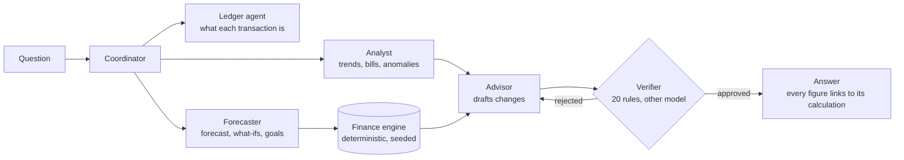

# Foresight: case study source

Source material for the Foresight case study on olaheavy.dev. Every figure links to where it is measured in this repository. Figures are as of eval run `evalrun_20261025T040935Z_c12d103` (25 Oct 2026); results come from fictional personas, and suites that use a model are scored on recorded model responses (replay), as the README explains.

## Meta

| | |
|---|---|
| What | An agent-native personal-finance workspace: a 90-day cash-flow forecast, checked advice and a receipt for every number |
| Role | Sole designer and engineer |
| When | 12 Oct 2026 onwards; built for the Agent Arena 2026 hackathon (submission 20 Oct), maintained since |
| Stack | Next.js 16 and React 19, FastAPI, LangGraph, PostgreSQL 16, OpenAI (GPT-6 Sol, GPT-6.1 Sol, GPT-6 Luna), Docker, GitHub Actions |
| Live | https://foresight.olaheavy.dev (fictional demo profile) |
| Code | https://github.com/olaheavy-dev/Foresight |

## TL;DR

- Foresight forecasts where your money is heading, explains it, and suggests changes, and **no number on screen is written by a model**: every figure comes from a deterministic engine and links to its calculation.
- Advice is **checked before you see it**: a separate Verifier, on a different model from the Advisor, applies 20 rules and rejects drafts that don't hold up.
- **A feature ships only when its evaluation passes.** 17 suites run in CI on every push, and the README's "Built" list is generated from them.
- Built by one person in about a week for a hackathon, then hardened: guest sessions, a warm demo pool, a single model gateway and recorded evals that cost cents to refresh.

## Outcomes

| Outcome | Figure | Source |
|---|---|---|
| Forecast accuracy, P1 persona | 30-day MAE £443 vs £643 for the best naive baseline (MASE 0.495) | README "Headline"; `evals/results/latest.json` (E-FC) |
| Bad advice caught | 65 of 65 authored bad proposals rejected; 0 of 31 good ones falsely rejected | `evals/results/20261025T040935Z_c12d103_deterministic/verifier.json` (E-VER) |
| Categorisation | 0.942 accuracy on a generated test split (n = 498), vs 0.205 for the majority class | README "Headline" (E-CAT) |
| Import safety | 20 of 20 corrupted CSV statements caught by reconciliation | README "Headline" (E-ING) |
| Cost and speed of advice | $0.0186 mean per advice answer, p50 15.2 s (all answers $0.0044) | README "Core metrics" (E-EFF) |
| Engineering | 17 evaluation suites; 87 backend and 23 frontend test files, 12 browser journeys | `evals/suites/`, `tests/`, `frontend/e2e/` |

Honest limits, stated in the README: on the P2 and S4 personas the median forecast is not yet more accurate than the simplest baseline (its likely range is better calibrated); categorisation has no independent hand-labelled holdout yet; the conversation suite (E-CTX) still misses two follow-up targets.

## How it works

Numbers come from code; words come from models.

- **Coordinator and five specialists** (LangGraph). Each agent has one job; the Verifier is a separate agent so self-checking is an orchestration fact, not a prompt trick (`docs/06-AGENT-ORCHESTRATION.md` §1).
- **One gateway for AI.** Only `backend/llm/client.py` may call a model; an import contract fails the build otherwise (README "Model calls go through one gateway").
- **Generated UI with contracts.** The model picks answer blocks; the API fills every value from stored calculations and validates the result (`docs/08-GENERATIVE-UI-CONTRACTS.md`).
- **Evidence chain.** Each recommendation links to the Verifier's checks, the finding that triggered it, the exact transactions it counts and the file they came from (`.design/foresight/DESIGN_REVIEW_APP.md`, 23 Oct).

## V1 → V2: choosing models by evaluation, not preference

- **V1:** during the hackathon every model call had to go through its gateway (Mesh), with the Advisor on Claude Sonnet 5.5 and the Verifier judge on a different provider (GPT-6.1 Sol), so the judge never shared the Advisor's blind spots.
- **Why change:** after leaving the hackathon (20 Oct), the gateway rule no longer applied. One provider and one contract were simpler to run, at the cost of some independence: the judge became a different model from the same provider (`docs/00-DECISION-REGISTER.md` §12 item 14; alternatives in `docs/11-MODEL-PROVIDERS.md`).
- **How it was decided:** a trial on 18 dev cases compared Advisor and judge pairings. GPT-6 Sol as Advisor with GPT-6.1 Sol as judge fixed 10 of 10 flawed proposals with 18 of 18 grounded; the reverse pairing fixed 7 and failed. Every agent recording was then re-made and every gate re-run before switching (`evals/CHANGELOG.md`, 20–21 Oct; `evals/results/20261020T2030Z_openai_advisor_trial/report.md`).
- **V2:** every tier on OpenAI directly, the judge a different model from the Advisor. Advice answers fell from $0.0436 to $0.0186 mean and p50 from 21.9 s to 15.6 s, with Verifier catch rate 1.0 and no false rejections (`evals/CHANGELOG.md`, `evalrun_20261021T085940Z_29b86eb`). The gateway was removed on 23 Oct.

## In production: the first live advice answer

- **What happened (14 Oct):** the first live advice answer came back without a recommendation. Live model calls ran 1.5 to 2.5 times slower than the recordings, so no revision round fitted in the deadline. After fixes, another answer kept revising after two approvals and took 82 s and $0.11.
- **Fixes:** a plain dated purchase is simulated straight from the parsed question, with no extra model call; a question with no time left for a revision defers its advice to a follow-up run in the same thread; the deadline moved to 75 s; and a question stops revising once any recommendation is approved (`evals/CHANGELOG.md`, `evalrun_20261014T152046Z_c3f6e0c` and `evalrun_20261014T162812Z_21b5e1e`).
- **Lesson:** replayed evals measure behaviour, not live latency. E-EFF now gates cost and latency from recorded live calls.

## Trade-off: honesty over a better-looking number

- In October 2026 a fix to how advice impact is measured showed that "book the holiday after payday" advice was being approved only because the moved payment fell outside the forecast. Paid on its new date, the next month stayed below the buffer. Three eval cases that had been labelled good were relabelled as bad, rather than relaxing the rule (`evals/CHANGELOG.md`, 25 Oct; PR #76).
- The same principle runs through the README: targets that are missed are listed, a feature with an unmeasured target stays off, and a target change needs a changelog entry with the reason.

## Assets

- Walkthrough GIF: `docs/assets/foresight-walkthrough.gif` (recorded on the live app with the fictional demo profile)
- Screenshots: `docs/screenshots/01-landing.png` to `09-activity.png`
- Architecture: `docs/05-SYSTEM-ARCHITECTURE.md` §2 and the diagram above
